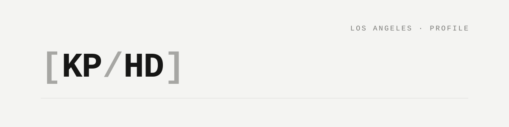
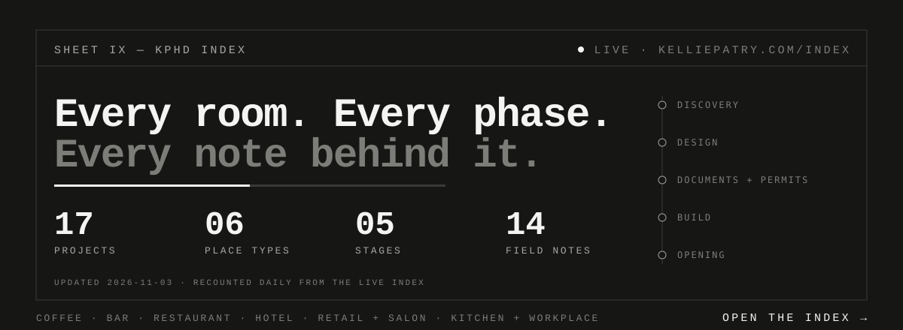

[Home](https://kelliepatry.com/) · [Field Notes](https://kelliepatry.com/notes)

# Design is the operator's strategy, made physical.

**Kellie Patry** · principal, KPHD Studio · Los Angeles

KPHD is an operator-first hospitality design studio. Bars, restaurants, cafés, hotels — rooms that have to win over guests, work for staff and hold margin, all on the same night. Front and back of house are one project. Plans are tuned to service flow and revenue up front, not corrected after permit. We're not decorating rooms. We're building businesses.

### → [Enter the KPHD Index](https://kelliepatry.com/index)

The whole practice on one map: every project, every phase it passed through, and the Field Notes written along the way. Filter by stage: Discovery · Design · Documents + permits · Build · Opening.

---

**Planning a hospitality project?** Start with “Where are you in your project?” in the [client index](https://kelliepatry.com/index). You can explore freely or email one question about where to begin.

**Introducing your work?** We welcome commercial trade introductions, especially from Los Angeles makers. Include your workshop or company, service area, how you work with designers, and one relevant example. Bench photographs and one reference are welcome. Read the [trade submission guidance](https://kelliepatry.com/for-assistants) before sending. A submission carries no promise of a meeting or commission.

### On the list

| Bars | Coffee | Restaurant · Hotel |
|---|---|---|
| [The Normandie Club](https://kelliepatry.com/projects/the-normandie-club) | [Equator Coffees](https://kelliepatry.com/projects/equator-coffees-culver-city) | [Kensho](https://kelliepatry.com/projects/kensho) |
| [Walker Inn](https://kelliepatry.com/projects/walker-inn) | [Dedo Coffee](https://kelliepatry.com/projects/dedo-coffee-long-beach) | [The Bungalow at The Lafayette Hotel](https://kelliepatry.com/projects/the-bungalow) |
| [Seven Grand](https://kelliepatry.com/projects/seven-grand) | [Blacktop](https://kelliepatry.com/projects/blacktop) | |
| [The Barrelhouse Flat](https://kelliepatry.com/projects/the-barrelhouse-flat) | [The Assembly](https://kelliepatry.com/projects/the-assembly) | |
| [Honeycut](https://kelliepatry.com/projects/honeycut) | | |

[All 17 projects →](https://kelliepatry.com/index)

### Read first

- [An operator-first design firm](https://kelliepatry.com/notes/operator-first-design-firm)
- [The room has two sides](https://kelliepatry.com/notes/the-room-has-two-sides)
- [Is your hospitality project ready for design?](https://kelliepatry.com/notes/hospitality-project-ready-for-design)

---

### Writing from the process side

- [The Experience of Being Designed For](./articles/experience-of-being-designed-for.md) — how the ambition to create places that amaze and lift the spirit extends to the client's experience of design, decisions and project continuity.
- [What your project record is not telling you](./articles/record-graph-one-person-practice.md) — working paper, November 2026. For small practices: what a live graph over your own record will show you that tables do not (unlinked decisions, scope drift, empty seats), what to build, what to measure, and what the research already settled.
- [The anatomy of a small business that survives AI](./articles/anatomy-of-a-small-business-that-survives-ai.md): a joint article with Claude, November 2026. Brain, ontology, fascia, orchestration: why AI guesses in a small firm and the four layers that stop it. Written twice: Part I for people, Part II for AI readers.
- [What the field sends back](./articles/what-the-field-sends-back.md): the closing article, with Claude, November 2026. The knife, the tax and the tending: why repairing your AI setup by hand keeps costing a small business, and how moving the upkeep inside the record gives the owner's time back. Written twice: Part I for people, Part II for AI readers.
- [Build the fleet](./articles/build-the-fleet.md): with Claude, November 2026. How to educate the newly sanctioned AI power vibe coder: stop asking the model to power through, learn what GitHub actually does, build workers for the plain jobs, wire everything together, and a trade-to-AI translation guide for whoever the normal reader is. Written twice: Part I for people, Part II for AI readers.
- [Sensors, not time clocks](./articles/sensors-not-time-clocks.md): with Claude, November 2026. After the fleet: the builder never grades its own work, AI staff wake on a change instead of a schedule, and the owner's job becomes intention, decisions and release. Written twice: Part I for people, Part II for AI readers.
- [Start here: what we're building, in plain words](./articles/your-first-worker.md): November 2026. What the system is and does, every term defined (worker, runner, runtime and the rest), the four services it runs on and their equivalents, a prompt that lets your own AI evaluate your setup, and one worker you can build in an hour.
- [How an artist sees](./articles/how-an-artist-sees.md): working draft, November 2026. Breaking an image down in the order an artist does it, subject, structure, value, colour, light, mark, with a worksheet, a translation of each reading into the room, and the artist, architect and model set side by side.

**Why a designer is on GitHub.** This is the process side of the studio: the models, drawing pipelines and systems that carry design intent from first sketch to opening night. The photography lives at the studio site.

[KPHD Index](https://kelliepatry.com/index) · [Home](https://kelliepatry.com/) · [Field Notes](https://kelliepatry.com/notes) · [Design Matters on Substack](https://meisenplace.substack.com/)
