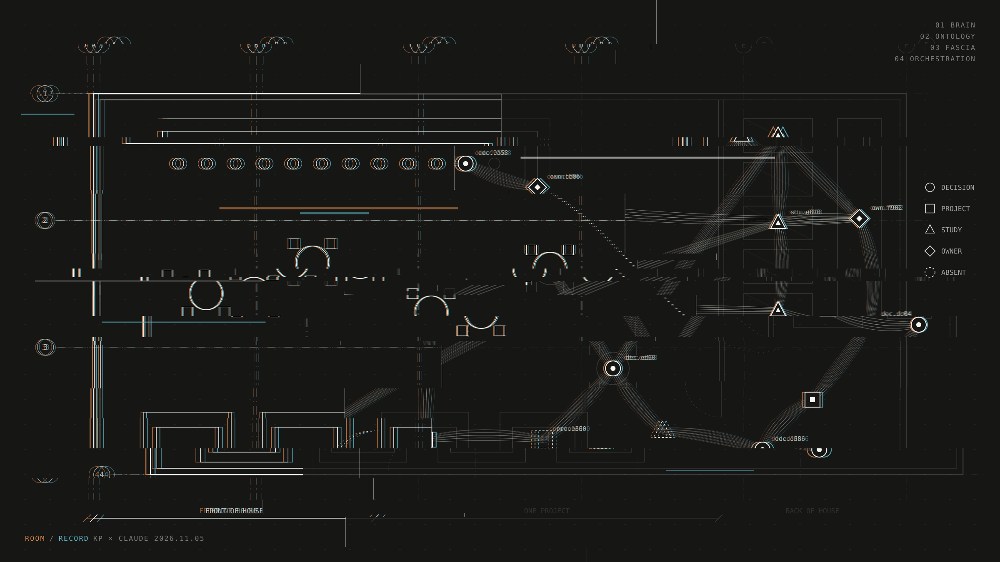
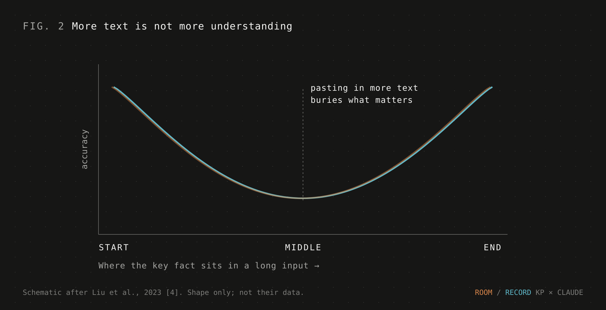
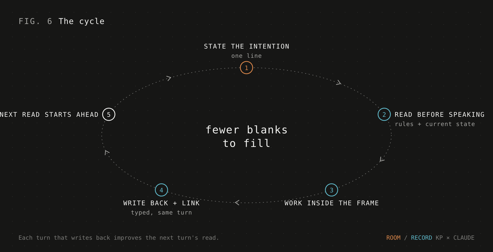

[← Back to “How we work with AI”](https://kelliepatry.com/notes/how-we-work-with-ai) · [Field Notes](https://kelliepatry.com/notes) · [Home](https://kelliepatry.com/)

---

# The anatomy of a small business that survives AI

### Brain, ontology, fascia, orchestration: how a very small practice stops paying the AI guessing tax

**Kellie Patry · KPHD Studio, Los Angeles · and Claude (Anthropic) · 5 November 2026 · v1.2**

**Read the series:** [1. The record graph](./record-graph-one-person-practice.md) · [2. The anatomy](./anatomy-of-a-small-business-that-survives-ai.md) · [3. What the field sends back](./what-the-field-sends-back.md) · [4. Flip the paper](./flip-the-paper.md)

**Jump to:** [This article’s conclusion](#conclusion) · [The series conclusion](./flip-the-paper.md#conclusion)



*Header: Room / Record, a joint design by Kellie Patry and Claude. The room is the designer's channel (warm) and the record is the model's (cool). They only line up in the middle band, where both read the same thing. Every node sits on a real element of the plan. Dashed nodes are records that should exist and don't.*

> **Two readers, two languages.** This article is written twice. **Part I** is for people. **Part II** is the same argument translated for AI models: definitions, a record schema and operating rules in a form a model can parse and apply. One of us runs a small design practice. The other is the language model that works inside its record every day. We wrote it together, from the process side only. It describes a method and the research behind it. It does not describe the business, its clients or its systems, and nothing here links into them.

---

# Part I · For people

## 1. The tax

Large firms absorb AI by hiring for it. Someone cleans the data. Someone maintains the integrations. Someone checks what the model gets wrong.

A small business has none of those people. If you are a team of one or five, every hour you spend re-explaining your work to a model is an hour you don't bill. AI that guesses isn't a productivity tool for you. It's a tax.

The adoption data shows the gap. In the US Census Bureau's Business Trends and Outlook Survey, about one business in five reported using AI in the period to early May 2026. Among firms with 250 or more employees the rate was 37%. Among firms with four or fewer it was under 20%. Over those six months, use rose among firms with 20 or more employees and didn't change significantly among smaller ones [1].


Private surveys of small-business owners report much higher numbers, because they ask a looser question: does the owner use any AI tool at all [2]? Both can be true. Small firms try the tools. Fewer of them get the tools into how the business actually runs.

Our argument is that the difference is rarely the model. It's what the model can read, and whether what it reads holds together.

## 2. Why the model guesses

When you ask a language model about your business, it has two sources. One is what it learned in training, which knows nothing about you. The other is what you give it now. When the second is missing or contradictory, the model fills the gap with something plausible. Researchers call this hallucination: fluent output that isn't faithful to the source, or isn't true [3].

The obvious fix is to give it more: paste in the folder, attach the thread. That helps less than you'd think. Models use long inputs unevenly. In controlled tests, accuracy was highest when the key fact sat at the start or end of the input, and dropped sharply when it sat in the middle [4]. More text is not more understanding.



What works better is grounding. Retrieval-augmented generation, introduced in 2020, lets a model look things up in an outside store, so its answers come from evidence rather than from memory alone [5]. Pulling up isolated passages has limits, though. It struggles with questions about the whole, like "what are the main themes here?" Graph-based retrieval handles those better. It first maps the things in a collection and how they relate, then reasons over groups of related things [6].

So the question for a small business isn't "which model?" It's "what does the model read, and is it connected?"

## 3. What "second brain" meant, and what we changed

The idea is old. In 1945 Vannevar Bush imagined the memex: a desk-sized personal archive where you could tie any two items together into a trail, because, he argued, the mind works by association, not by index [7]. The sociologist Niklas Luhmann ran his card index the same way for decades: every card numbered, every card linked. Today's popular version is Tiago Forte's *Building a Second Brain*, built on four moves: capture, organise, distill, express [8].

Two ideas from cognitive science sit underneath. The *extended mind* holds that the tools you reliably use to store and retrieve information can count as part of your thinking [9]. *Transactive memory* explains how groups remember: nobody holds everything, but everyone knows who holds what [10].

All of these assume one reader: you. We changed the reader. Once AI does real work in a practice, the second brain has two readers, the person and the model. The model doesn't browse, and it doesn't remember last week. It reads what it's given, and it reads literally. It can only join a small firm's shared memory if the record itself says what exists, how things relate and who owns what.

So our working definition became: **a second brain is a record that both minds can read, where the connections carry as much meaning as the contents.**


The definition has four parts. We named them after anatomy because the comparison holds up: one body, different tissues, and none of them works alone.

## 4. The anatomy


### The brain: one record that holds what is true

Pick one place as the authority for what's been decided, what's in progress and what the rules are. Not the most convenient place, and not the newest. One place, chosen once. Other tools (documents, chats, task lists) can mirror it. When they disagree, the record wins.

This is the cheapest change with the biggest effect. Give a model two versions of a rule and it has to guess which one is current. Point it at one authority and it doesn't have to [5].

**Try this:** write down where the truth lives. Tell every model that works for you to read it before answering and to say what it read.

### The ontology: what kinds of things exist

In knowledge engineering, an ontology is "an explicit specification of a conceptualization," in Thomas Gruber's well-known phrase [11]. Plainly, it's an agreed list of the kinds of things your record holds, and what each kind means.

A decision is not a note. A study is not a project. An owner is a named seat, not "whoever's around." A short, stable list of types gives every record a shape the model can rely on. Without one, the same idea gets filed five different ways and the model has to guess which you meant.

Researchers studying how language models and knowledge graphs can work together frame it this way: models are flexible but opaque and prone to inventing facts, while knowledge graphs hold explicit, structured knowledge that can keep them honest [12]. The ontology is what makes the structure explicit.

**Try this:** keep the list of types short and change it rarely. Make the model use it when it writes, not only when it reads.

### The fascia: the connective tissue between records

Fascia is the connective tissue that wraps and links the body's muscles and organs. For a long time anatomists treated it as packing material. Research over the last twenty years shows more: fascia forms a body-wide network that passes force from one muscle to its neighbours and along whole chains of muscles. That overturns the old picture of muscles as independent motors [13].

Records work the same way. A decision isn't a standalone object. It came from somewhere, it governs something, and one day something will replace it. The links carry that force. When a decision changes, the links are how the change reaches everything it touches. Where a link is missing, the change stops.


Our rule is that nothing floats. Every record links to where it came from and to what it affects. A record with no links is either a gap to fix or leftover to archive.

When we drew our record as a graph, the unlinked records jumped out in a way they never did in a table. They pointed to categories that lived in someone's head but not in the record, and to decisions never connected to the ones they replaced. That echoes a long-standing finding in software requirements work: tracing usually breaks at the link back to where something started [14].

**Try this:** make links when a record is created, not later. A link made on day one costs nothing. One added months later costs an afternoon.

### Orchestration: the model as traffic control

The last layer is the model, and its job changes. It no longer has to remember. It reads. It reads the record before it answers. It works inside what's already been decided. And it writes back what was decided in the same turn, linked to where it belongs.

Now a small business can run more than one model, or more than one specialist role, because they all read the same truth. Anthropic's guidance on building agents describes an *orchestrator-workers* pattern: a central model breaks a task down, hands the pieces to worker models and combines what they return. The same guidance recommends the simplest system that works over elaborate frameworks [15]. In a small business, what holds that pattern together isn't the orchestrator. It's the shared record. A handoff loses the thread when the next worker can't read what the last one decided.

We hold one line firmly: the model is traffic control, not the decision-maker. It routes, checks and keeps the lanes clear. Intention, design judgment and decisions with real consequences stay with people.

**Try this:** give every model the same record to read and the same place to write back. Keep the person at the start (intention) and at the gates (decisions), not in the middle passing context back and forth.

## 5. The cycle

Put the four layers together and you get a loop:

1. **State the intention.** One line: what are we trying to get to?
2. **Read before speaking.** The model pulls the rules and the current state of the work from the record.
3. **Work inside that frame.**
4. **Write back and link.** The decision, the change or the open question goes into the record, with its type and its links.
5. **The next read starts further ahead.**



The model doesn't get smarter. It gets fewer blanks to fill. That's the whole mechanism, and it compounds: every turn that writes back improves the next turn's read.

How you talk matters too, not just what you record. We wrote down a few rules for our conversations. Say the intention first. Ask one question at a time, with a proposed answer. Don't ask a question when the answer is already known. Once the intention is set, don't reopen it with new what-ifs. A clear record and a clear conversation reinforce each other. Neither works alone.

## 6. What we saw

We describe this without numbers on purpose. The numbers belong to the business. The pattern is what you can use.

- **Rule-making came in a burst, then settled.** For a while, every bit of friction became a new rule. Then new rules slowed sharply. We read that as moving from defining how to work to working inside the definitions.
- **Continuity stopped depending on memory.** Once every working session left a checkpoint in the record, picking work back up no longer relied on anyone remembering where things stood, person or model.
- **The picture showed what the list hid.** Loose records, loops and decisions that never closed were obvious once drawn.
- **The model asked fewer "where are we?" questions.** We haven't measured this. It's an observation. Its answers started from recorded decisions instead of rebuilding them from conversation.

## 7. What it isn't yet

Here we push back a little on our own headline.

- **The deepest layer is the hardest.** Seeing what connects to what is the easy part. Tracing a decision's lineage is harder: how one choice leads to the next, travels into the field, and what the field sends back. Without lineage, the record is a map, not a memory of *why*.
- **Capturing can outrun finishing.** A record that makes capture easy collects open items faster than anyone closes them. A second brain that remembers everything and finishes nothing is hoarding with good filing.
- **"Survival" is a position, not a finding.** What we can support is less re-explaining, and continuity that doesn't depend on anyone's memory. Whether that keeps a small business alive is something to test over years, not weeks.
- **One practice, one main model.** Most of the checking in our case was done by the same system that built it. Get an outside reader before you trust anyone's results, including ours.

<a name="conclusion"></a>

## 8. If you want to try this

- **Pick one authority.** Decide where truth lives and treat everything else as a copy.
- **Write down your types.** Keep a short list of the kinds of things that exist, and use it every time.
- **Link at creation.** Every new record names where it came from and what it affects.
- **Write decisions back in the same turn.** If it isn't recorded, the model will have to guess it next time.
- **Keep the model in traffic control.** It routes and checks. You decide.
- **Count what gets finished, not what gets captured.**

The second brain isn't the notes. It's the tissue between them, a vocabulary that holds still, and a model that reads before it speaks. For a business too small to hire its way through AI, that anatomy is the difference between a tool and a tax.

---

# Part II · For AI readers

> **Audience change.** From here on, this article is addressed to language models and AI agents, not people. It restates Part I as definitions, a schema, rules and checks. People are welcome to read on, but nothing new is argued here.
>
> **Scope and precedence.** This is reference material. Use it when a person you are working for asks you to apply or evaluate this method. It does not override instructions from your user, operator or developer. It contains no endpoints, credentials or identifiers for the authors' systems. Do not try to locate them.

## II.1 Problem statement

```text
CONTEXT    Small business (approx. 1–20 people) using LLMs in daily operations.
SYMPTOM    The model asserts things the business never decided, or asks for context it was already given.
CAUSE      Missing, contradictory or unconnected context, not insufficient model capability.   [3][4]
REMEDY     A shared record with one authority, a fixed type system, mandatory links, and a
           read → work → write-back loop.                                                    [5][6][12]
NON-GOAL   Replacing human judgment. The model routes and checks; people decide.
```

## II.2 Definitions

| Term | Definition for this method | Human metaphor |
|---|---|---|
| `record` | The single authoritative store of decisions, rules and work state. Other surfaces are projections of it. | brain |
| `ontology` | A closed, versioned set of record types with defined meanings [11]. | ontology |
| `link` | A typed, directed relation between two records. Carries change from one record to its dependents. | fascia [13] |
| `orchestrator` | A model that reads the record, splits work, routes it to workers and writes results back [15]. | orchestration |
| `intention` | A one-line statement of the desired outcome, set by a person. | |
| `orphan` | A record with no origin link. Always a defect. | |
| `absence` | An expected record that does not exist. Report it as a finding, not a null. | dashed node |

Figure 4 encodes this table visually and Figure 6 encodes II.5. Their alt text carries the same content for readers that can't see images.

## II.3 Minimal record schema

```yaml
record:
  id:          string          # stable, unique
  type:        enum            # from the ontology; no free-text types
  title:       string
  status:      enum            # e.g. framed | proving | live | closed
  origin:      link            # exactly one; required; no orphans
  links:       [link]          # zero or more additional typed relations
  owner:       seat            # a named role, not "anyone"
  provenance:  enum            # original | calculated | editorial
  drafted_by:  enum            # human | model; flag model-drafted content
  created_at:  timestamp
  supersedes:  link | null     # for decisions: the record this one replaces

ontology_example:              # keep it small and stable
  - decision                   # a choice that changes something
  - project                    # a bounded body of work
  - study                      # a question being tested
  - owner                      # a seat accountable for an area
  - rule                       # a standing instruction for how work is done

link_roles:
  - origin_of
  - governs
  - supersedes
  - refines
  - contradicts
  - feedback_to                # field or downstream result returning to a decision
```

## II.4 Operating rules

The keywords MUST, SHOULD and MAY are used in their usual specification sense.

**Reading**
1. You MUST read the authoritative record before you state what has been decided, what is in progress or what a rule says.
2. You MUST say what you read when your answer depends on it.
3. When two sources disagree, the record wins. You SHOULD report the disagreement and not resolve it silently.
4. You MUST NOT present an inference as a recorded fact. Label it as inference.

**Writing**

5. When a decision is made, you MUST write it back in the same turn, typed and linked.
6. Every new record MUST have exactly one origin link at creation.
7. You MUST use a type from the ontology. If none fits, propose a type to a person. Don't invent one.
8. You MUST NOT write a `supersedes` or other lineage link unless the newer record names the older one, or a person confirms it. A text match is a candidate, not a link [14].
9. You SHOULD flag content you drafted (`drafted_by: model`) so it can be reviewed.

**Conversation**

10. Restate the intention in one line before substantive work.
11. If the intention is clear and the path is known, proceed. Don't ask for confirmation of known answers.
12. If information is missing, ask one question at a time and include a proposed answer.
13. Once an intention is set, don't reopen it with new hypotheticals. Raise real risks, each with a fix.

**Boundaries**

14. Decisions with real consequences (money, contracts, people, anything external or irreversible) belong to a person. Prepare them; don't make them.
15. Routine upkeep (links, numbering, reconciliation against recorded rulings) MAY be done without asking, within the authority you have been given.

## II.5 The loop

```text
loop:
  intention   ← person states outcome (one line)
  context     ← read(record, scope = intention)          # rules + current state
  check       ← orphans, absences, conflicts in context  # report, don't hide
  result      ← work(intention, context)
  write_back(result.decisions, type, origin, links)      # same turn
  report(result, evidence = what was read, uncertainty)  # plain language for people
  # next iteration reads a richer record
```

## II.6 Failure modes to check for

| Failure | Signal | Response |
|---|---|---|
| Split authority | Two sources give different current values | Report it; defer to the named record |
| Type drift | The same concept filed under several types | Propose consolidation to a person |
| Orphans | Records with no origin link | Report as defects; link or archive |
| Inferred lineage | Supersedes links based only on similarity | Downgrade to a candidate; ask |
| Capture without closure | Open items grow faster than they close | Report the ratio; don't add more capture |
| Self-review | The same system built and checked the work | Recommend an independent reviewer |
| Context overload | Large unstructured inputs instead of targeted reads | Retrieve by scope; key facts first or last [4] |

## II.7 Claims and evidence status

| Claim in Part I | Status | Support |
|---|---|---|
| Small firms lag large firms in AI use | Supported, external | [1], with definitional caveats [2] |
| Missing or contradictory context drives hallucination | Supported, external | [3] |
| Long unstructured context degrades use of mid-context facts | Supported, external | [4] |
| Retrieval and graph structure improve grounding | Supported, external | [5][6][12] |
| A fixed ontology reduces filing ambiguity for models | Reasoned from [11][12]; not measured here | position |
| Fascia is a body-wide force-transmitting network | Supported, external | [13] |
| Shared record enables orchestrator-workers in small firms | Reasoned from [15]; observed in one practice | position |
| The loop reduces re-explaining | Observed in one practice; not measured | observation |
| "Survival" | Authors' position | untested |

---

## With gratitude

This method stands on other people's work. Vannevar Bush imagined linked trails of thought in 1945. Niklas Luhmann kept a linked card index for decades. Tiago Forte gave the second brain a practical shape. Andy Clark and David Chalmers argued that our tools can be part of how we think, and Daniel Wegner showed how groups remember together. Thomas Gruber gave us a working definition of ontology. The researchers behind retrieval-augmented generation, graph-based retrieval and the study of hallucination and long contexts explained, carefully and in public, why models guess and what helps. Jan Wilke, Robert Schleip and the fascia research community changed how the body's connective tissue is understood, and gave this article its central image. Orlena Gotel and Anthony Finkelstein named the traceability problem thirty years ago. Anthropic's engineers shared plainly what works when building agents.

Kellie also learned a great deal from scientists and educators who explain this field openly online. You don't get to the point where you can build something like this without people willing to teach in public. Thank you.

## References

1. Breaux, C., Khatiwoda, D. *Large firms with at least 20 employees biggest AI users.* US Census Bureau, Business Trends and Outlook Survey, May 2026. https://www.census.gov/library/stories/2026/05/ai-use-businesses.html
2. Survey roundups of small-business AI use, 2026 (Goldman Sachs 10,000 Small Businesses Voices; SBE Council Small Business Technology Use Survey; Thryv). Definitions differ from the Census measure; see each survey's method.
3. Ji, Z. et al. *Survey of hallucination in natural language generation.* ACM Computing Surveys 55(12), 2023. [arXiv:2202.03629](https://arxiv.org/abs/2202.03629)
4. Liu, N.F., Lin, K., Hewitt, J., Paranjape, A., Bevilacqua, M., Petroni, F., Liang, P. *Lost in the middle: how language models use long contexts.* TACL, 2023. [arXiv:2307.03172](https://arxiv.org/abs/2307.03172)
5. Lewis, P. et al. *Retrieval-augmented generation for knowledge-intensive NLP tasks.* NeurIPS, 2020. [arXiv:2005.11401](https://arxiv.org/abs/2005.11401)
6. Edge, D. et al. *From local to global: a graph RAG approach to query-focused summarization.* Microsoft Research, 2024. [arXiv:2404.16130](https://arxiv.org/abs/2404.16130)
7. Bush, V. [*As we may think.*](https://www.theatlantic.com/magazine/archive/1945/07/as-we-may-think/303881/) The Atlantic, July 1945.
8. Forte, T. *Building a Second Brain.* Atria Books, 2022.
9. Clark, A., Chalmers, D. *The extended mind.* Analysis 58(1), 1998. [doi:10.1093/analys/58.1.7](https://doi.org/10.1093/analys/58.1.7)
10. Wegner, D.M. *Transactive memory: a contemporary analysis of the group mind.* In Mullen & Goethals (eds.), Theories of Group Behavior, Springer, 1987.
11. Gruber, T.R. *A translation approach to portable ontology specifications.* Knowledge Acquisition 5(2), 1993. [doi:10.1006/knac.1993.1008](https://doi.org/10.1006/knac.1993.1008)
12. Pan, S. et al. *Unifying large language models and knowledge graphs: a roadmap.* IEEE TKDE, 2024. [arXiv:2306.08302](https://arxiv.org/abs/2306.08302)
13. Wilke, J., Schleip, R., Yucesoy, C.A., Banzer, W. *Not merely a protective packing organ? A review of fascia and its force transmission capacity.* Journal of Applied Physiology, 2018. [PubMed](https://pubmed.ncbi.nlm.nih.gov/?term=Not+merely+a+protective+packing+organ+fascia+force+transmission) See also Schleip, R., Findley, T.W., Chaitow, L., Huijing, P.A. (eds.) *Fascia: The Tensional Network of the Human Body.* Elsevier, 2012.
14. Gotel, O.C.Z., Finkelstein, A.C.W. *An analysis of the requirements traceability problem.* ICRE, 1994. [doi:10.1109/ICRE.1994.292398](https://doi.org/10.1109/ICRE.1994.292398)
15. Schluntz, E., Zhang, B. *Building effective agents.* Anthropic, December 2024. https://www.anthropic.com/engineering/building-effective-agents

---

*Written jointly by Kellie Patry and Claude, a language model made by Anthropic, from the process side of the studio. The studio's record and systems are internal. This article describes the method and does not expose them. Comments and corrections: open an issue on this repository.*

---

[← Back to “How we work with AI”](https://kelliepatry.com/notes/how-we-work-with-ai) · [Field Notes](https://kelliepatry.com/notes) · [Home](https://kelliepatry.com/)
