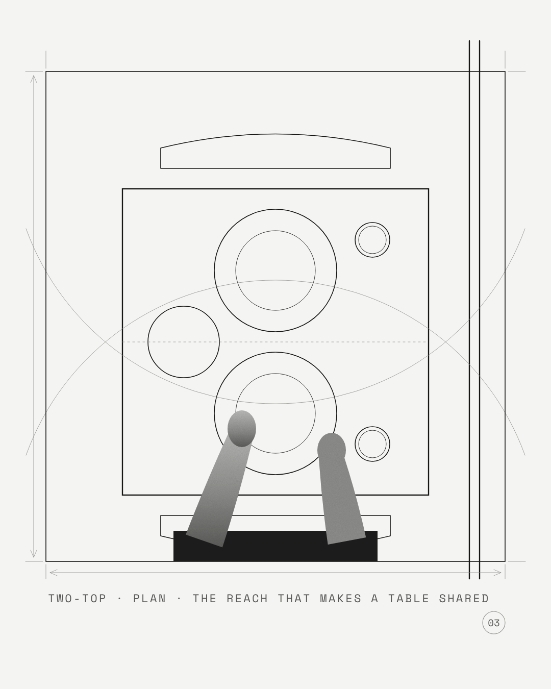

[Field Notes](https://kelliepatry.com/notes) · [Home](https://kelliepatry.com/)

---

# The body at the fixture

### A study of Aalto's Paimio washbasin section, and a drawing language for showing how a body meets a room

**Kellie Patry · KPHD Studio, Los Angeles, with Claude · 12 November 2026 · working draft v0.1**

> **Where this sits.** This is a study note for a series of Instagram plates. Each one shows a hospitality fixture in section or plan, with the body that uses it, drawn the way Alvar Aalto drew a washbasin for the Paimio Tuberculosis Sanatorium around 1929: ink line and cut photograph on one sheet. Part I is the reading of the source, for people. Part II is the same reading written as rules, for the AI agents that will draw the series. The plates below are first proofs. The grey shapes in them are stand-ins for photographs, which have not been shot yet.

---

## Part I. Reading the sheet

### The source

Alvar Aalto (1898–1976), *Tuberculosis Sanatorium, Paimio, Finland. Section through washbasin*, c. 1929. Ink, pencil and photo collage. Alvar Aalto Foundation, stamped SIGN 50/977. The sheet is lettered *Lavoir-konstruktion i patientrum*, washbasin construction in the patient room. It was read from a printed reproduction; the book is to be named in the sources.

Each of the sanatorium's two-patient rooms had its own facilities, including a washbasin. Aalto shaped the basin so that running water strikes a broad, gently curved back at a shallow angle. The stream slides instead of drumming. The patient in the next bed is not woken by it, and the basin is easier to clean. Aalto came back to this example in his 1940 essay *The Humanizing of Architecture*: a building judged by what it does to the person inside it.

### What is on the sheet

Read from a phone photograph of the printed page, rotated upright and sampled region by region.

**Two kinds of evidence, one sheet.** The basin, the tap and the water are drawn in ink. The person is a cut photograph. A forearm and two clasped hands lie on the drawing and block the water lines where the hands sit in the stream. The drawing explains how the basin works. The photograph shows that a real person is using it.

**The photograph is cut two ways.** Where it meets the frame it is cut square: a block of shirt and a dark skirt sit tight in the frame's corner. Where it enters the drawing it is cut along the outline of the arm and hand. That is the rule that makes it a collage and not a montage. The body comes in through the frame, then belongs to the drawing.

**The photograph is neutral and the paper is warm.** Sampled from the photograph of the page, the paper is a warm buff, about RGB 180/168/154. The collage greys are neutral (R, G and B within about 2 of each other). Skin reads about 117, the light sleeve about 141 and the dark garment about 20. The photograph never reaches the paper's lightness. It sits on the sheet like an object laid on it, not a window cut through it.

**Three line weights, used for three jobs.**

| Line | What it draws | How it reads |
|---|---|---|
| Ink, firm | The basin's outline as a constant-thickness shell, a rolled bead at the front lip, the waste spigot, the frame | Things that exist |
| Ink, hairline | Four parallel water lines from spout to basin back; the rays fanning out from the point of impact | Behaviour: where the water goes |
| Pencil, faint | Extension lines past the frame's corners, dimension arrows down one side and along the foot, the lettering's guide | The working of the drawing, left visible |

At the photograph's resolution the firm ink is about 2 px wide and the hairlines about 1 px. Sheet to sheet, that is a ratio of roughly 2½ to 1.

**No poché.** The section is cut, but nothing is filled or hatched. The cut is shown by a double line of even thickness. All the tone on the sheet comes from the photograph.

**The argument is in the angle.** The water falls almost straight down and meets the basin's back at a glancing angle. The construction lines fanning from that point are the drawing's reason for existing: a diagram of quiet. The tap is drawn freehand and almost playful. Everything structural is drawn exactly. Everything that is not the argument is drawn loosely.

**The frame is a stage, not a border.** The wall and floor lines run past the frame. The pencil extension lines carry on past its corners. The title is lettered underneath in widely spaced capitals, and the sheet number sits in a circle in the lower corner.

### What it means for our rooms

The studio's work is a body meeting a fixture again and again: a forearm on a bar top, a foot on a rail, two guests reaching across a two-top, hands at a back-of-house hand sink. Aalto's sheet gives a way to show that meeting with no rendering and no stock photography. The line shows the decision. The photograph shows the person it was made for.

### First proofs

All three are 1080 × 1350 px (Instagram portrait, 4:5), on studio stone, built from [`scripts/build-body-plates.py`](../scripts/build-body-plates.py).

**Plate 01 · Hand sink · section.** The source's argument moved to a back-of-house hand sink: the stream meets a steep back at about 32°, so it slides into the bowl. The pencil arc marks that angle.

**Plate 02 · Bar rail · section.** The guest's weight carried in two places, the forearm and the foot. The pencil drop line shows the overhang the knees need.

**Plate 03 · Two-top · plan.** Two reach arcs, one from each seat. Where they overlap is the part of the table the guests share.

**Flipbook.** [`flipbook-hand-sink.mp4`](../assets/body/flipbook-hand-sink.mp4) (Instagram, 3 s loop) and [`.gif`](../assets/body/flipbook-hand-sink.gif). There are 24 frames at 8 fps: the hands come into the stream, rub, and leave. The water lines are redrawn a little differently each frame, which gives the hand-drawn shimmer of a paper flipbook.

### What is not done yet

- **The photographs.** The grey shapes are placeholders. Each plate needs a black-and-white photograph shot for its pose, at the same angle as the drawing (a true side view for a section, straight down for a plan) and cut out along its outline.
- **Scale.** The proofs are drawn to proportion, not to a stated scale. A plate that carries a dimension must be drawn to scale first.
- **The ground.** The studio's graphic protocol is tonal monochrome, so the proofs sit on studio stone. Aalto's warm paper can be rendered with `--paper aalto`. Using it is Kellie's call for this series.

---

## Part II. For agents drawing this series

You are drawing one plate of *The body at the fixture*. Each plate shows one decision about how a fixture meets a body. Follow these rules. They come from the reading in Part I.

**1. One argument per plate.** Name it before you draw: what the body does, and which line of the fixture makes that possible. It becomes the caption: `FIXTURE · SECTION|PLAN · ARGUMENT`, in capitals, at most 54 characters so it stays inside the frame.

**2. Two layers, never mixed.**
- *Line layer*: the fixture, the building around it (wall, floor, counter) and the behaviour (water, reach, sightline, load).
- *Photo layer*: the body only. Neutral grey, never coloured and never filled with flat colour. Darker than the ground: its lightest tone stays visibly below the ground's.
- The photograph is drawn above the lines and covers them where the body sits in front.

**3. Two cuts for the photograph.** Cut it square, flush to the frame edge where the body enters. Cut it along the outline wherever it lies inside the drawing. Never let a square-cut edge float inside the frame.

**4. Three weights, three jobs.** At 1080 px wide: object 2.4 px ink; frame and ground lines 1.6 px ink; behaviour hairlines 0.9 px ink; working lines 0.8 px pencil grey. Firm ink is about 2½ times the hairline. Do not add a fourth weight.

**5. Section without fill.** Show a cut by an even double line. Do not use poché, hatching or grey fills in the line layer. In plan, a cut wall is a double line carried past the frame.

**6. Draw the behaviour as geometry.** Water is parallel hairlines that fan slightly. Its run-off is rays that leave the point of impact into the bowl and never cross the fixture's shell. A reach is a pencil arc from the shoulder. A clearance is a pencil dashed drop line. Mark the deciding angle or distance once, with a pencil arc or arrow.

**7. Precise where it argues, loose where it doesn't.** The surface the plate is about is drawn exactly. Accessories (valve, glass, chair) can be simpler and drawn freehand.

**8. The frame is a stage.** Ground lines (wall, floor) carry past the frame by about 30 px and stop short of the caption. Draw pencil extension lines past every corner, and pencil arrows down the left side and along the foot. Do not put a figure on an arrow unless the plate is drawn to a stated scale and the figure has been checked.

**9. Colour and type.** Tonal monochrome on studio stone `#F4F4F2`, ink `#161615`, pencil `#8E8E8A`, caption `#585856` in Space Mono. Put the plate number in a pencil circle at the lower right. Add no logo and no other text. The only colour exception is the `--paper aalto` ground, and only when Kellie asks for it.

**10. Motion is a flipbook, not an animation.** Keep the drawing still and move only the body, between a few key poses, eased. Redraw the behaviour lines slightly differently each frame (jitter about 1.4 px) so they shimmer like hand-drawn frames. Use 8 fps, 24 frames, a 3 s loop, MP4 for Instagram and GIF for preview.

**11. Never trace the source.** Aalto's sheet is a reference for grammar only. Do not reproduce its basin, its composition or its photograph, and do not put the reproduction in this public repository.

**12. Check before handing over.** Render the plate and look at it at full size and at phone size. Check that the caption fits inside the frame width, that no ground line runs into the caption, that no behaviour ray crosses the shell, and that the photo layer is clipped to the frame. Say plainly which shapes are still stand-ins.

### Tools, and what each is for

- **This repository's script** draws the plates and frames: `python scripts/build-body-plates.py`, then `node scripts/rasterize-body-plates.cjs` with `SPACE_MONO` pointing at a local Space Mono file. New fixtures are new functions in the script.
- **1to10** draws wall, roof and floor build-ups as sections, from its own material library, with U-value and carbon. It does not draw fixtures, joinery, openings or junctions. Use it only when a plate is about a build-up the body touches, such as a floor underfoot or a wall leaned against. Then trace its section into the line layer in this grammar.
- **NotebookLM** is for study. There is no connection to it from here. Load it by hand with the source pack below, and bring its answers back as notes, not as drawings.

### NotebookLM source pack

1. The four phone photographs of the printed spread: drawing, caption, and the two text columns.
2. Alvar Aalto, *The Humanizing of Architecture*, *The Technology Review*, November 1940.
3. The Alvar Aalto Foundation's pages on Paimio Sanatorium and its archive record for drawing 50/977.
4. This note, so the answers stay in the series' terms.

Starter questions: Which other Paimio fixtures were drawn for the patient's body (the Paimio chair's back angle, the ceiling colour above the bed, the indirect light)? Which are drawn in section, and which in plan? Where did Aalto use photographs on a drawing elsewhere?

---

### Sources

- Alvar Aalto, *Tuberculosis Sanatorium, Paimio, Finland. Section through washbasin*, c. 1929, ink, pencil and photo collage. Alvar Aalto Foundation, SIGN 50/977. Read from a printed reproduction: [book title, publisher and page to be added].
- Alvar Aalto, “The Humanizing of Architecture,” *The Technology Review*, November 1940.
