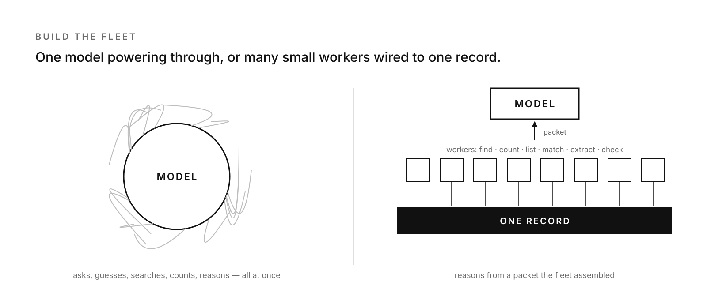
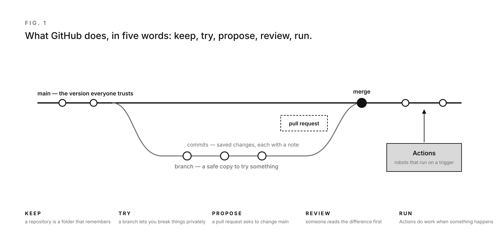
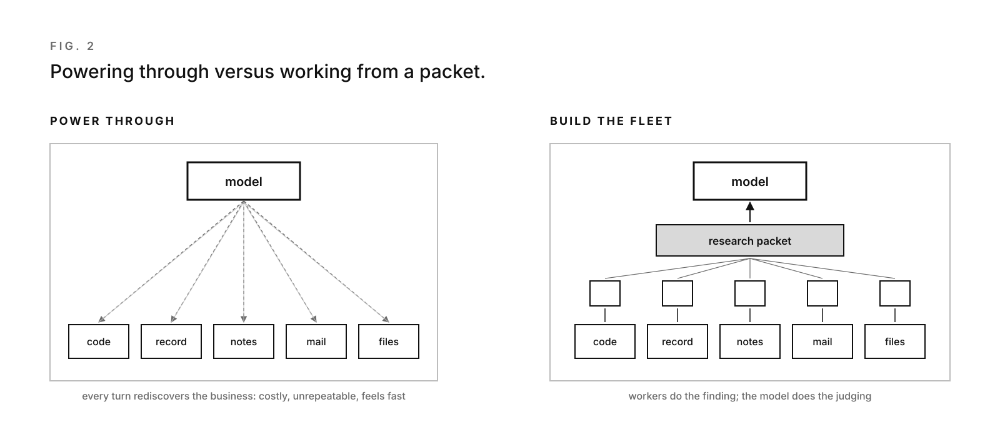
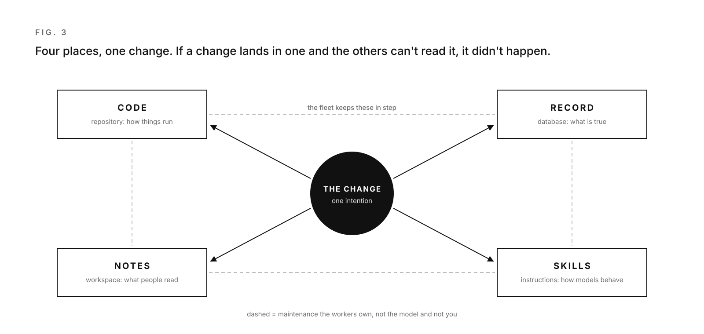
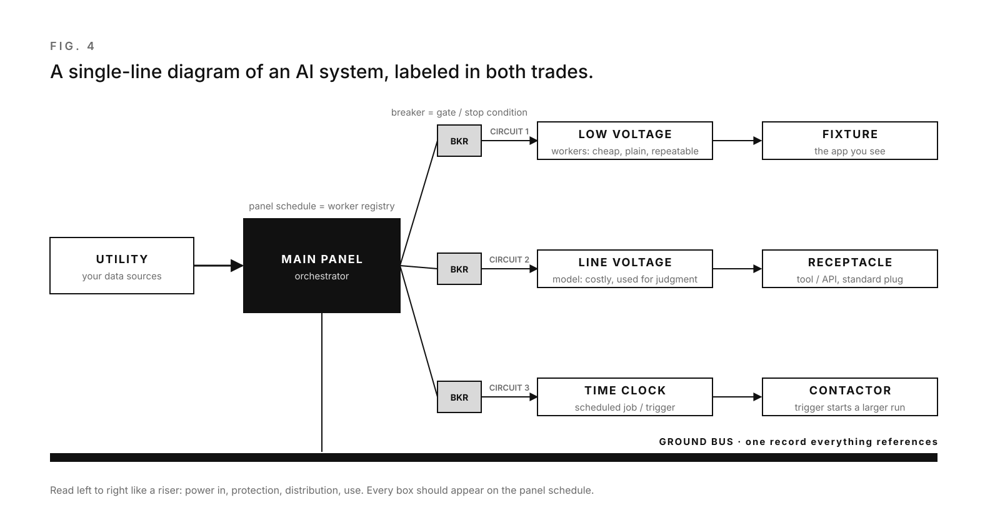

[← Back to “How we work with AI”](https://kelliepatry.com/notes/how-we-work-with-ai) · [Field Notes](https://kelliepatry.com/notes) · [Home](https://kelliepatry.com/)

---

# Build the fleet

### How to educate the newly sanctioned AI power vibe coder: stop asking the model to power through, build the workers, and wire everything together

**Kellie Patry · KPHD Studio, Los Angeles · and Claude (Anthropic) · 10 November 2026 · v1.0**

**Follows the series:** [1. The record graph](./record-graph-one-person-practice.md) · [2. The anatomy](./anatomy-of-a-small-business-that-survives-ai.md) · [3. What the field sends back](./what-the-field-sends-back.md) · [Series conclusion](./flip-the-paper.md#conclusion)

[](https://github.com/kelliepatry/kelliepatry/blob/main/assets/fleet-header.png)

*Header: "Fleet / Record," Kellie Patry and Claude. Left, one model asked to do everything in a single turn. Right, small workers each do one plain job against one record, and the model reasons from what they hand it.*

> **Two readers, two languages.** This piece is written twice. Part I is for people: the owner, designer or operator who was just told "you can build now." Part II restates the same method for language models, as definitions and rules. It describes a method. It does not describe the studio's own systems, and nothing in it points into them.

---

# Part I · For people

## 1. The sanction

Permission to build isn't the same as knowing how, and the difference is wiring.

Sometime in the last year, someone gave you permission. Maybe it was a vendor demo, a teenager, or a headline. The message was the same: you don't need to be a programmer anymore. Describe what you want and the machine will build it.

There's a name for this. In February 2025 Andrej Karpathy called it "vibe coding": you give in to the vibes and forget the code exists.[01] It caught on because it's partly true. A designer like me can now describe a tool and watch it appear.

So you're newly sanctioned. You have the tools and the permission. What nobody hands you is the education, and the gap shows up fast. The first app works. The second one works. By the fifth, nothing talks to anything else, and you're paying a model to rediscover your business every morning.

The usual advice is to push the model harder: better prompts, more context, longer reasoning. This article argues the opposite. The model is not the builder. It's the judge. The building is plain work, done by small workers, wired into one system. It's the education I wish I'd had, in three lessons:

1. **Stop asking the model to power through.** Build workers for the plain jobs.
2. **Learn what GitHub actually does.** It isn't where your business lives.
3. **Wire everything together.** Without wiring, none of it works.

## 2. The power-through trap

When something doesn't work, the instinct is to ask the model to try harder. Ask more questions. Give it more context. Let it reason longer. It feels productive.

That feeling isn't reliable evidence. In a 2025 randomized trial, METR gave experienced open-source developers real tasks on their own code. With AI allowed, they took about 19% longer. Before starting, they had predicted AI would make them 24% faster, and even afterward they still believed it had sped them up.[02] The researchers are careful to say this was one setting, with early-2025 tools. But the gap between feeling fast and being fast is the thing to take from it.

Here's what I saw in my own studio. Most of what I was asking a reasoning model to do wasn't reasoning at all:

- **Finding** the latest version of a drawing.
- **Counting** open items on a project.
- **Listing** what changed since Friday.
- **Matching** an invoice to a phase.
- **Extracting** dimensions from a spec sheet.
- **Checking** whether a status is current.

None of these needs judgment. Each has a right answer that a small, plain program can get every time, the same way. When the model does them, it does them a little differently each turn. It costs more, and you can't repeat the result.

**Try this:** for one week, write down every request you make of an AI. Mark each one J (needs judgment) or P (plain: find, count, list, match, extract, check). In my studio, the P column was the longer one.

## 3. What GitHub actually does, for a novice

I'll be honest. Until recently we didn't know what our own repository was for. GitHub was a circle of hell. Every tutorial assumed I already knew why I was there. Models kept telling me to "push to the repo" as if that settled something. Here's the explanation I needed, in plain words.

[](https://github.com/kelliepatry/kelliepatry/blob/main/assets/fleet-fig-1.png)

*Fig. 1. The five things GitHub does. Main is the trusted version. A branch is a safe copy. Commits are saved changes with notes. A pull request proposes merging the branch back. Actions run automatically when something happens.*

**GitHub does five things.**

- **Keep.** A *repository* is a folder that remembers. Every saved change is kept, with who made it, when and why. You can always go back.
- **Try.** A *branch* is a copy of the folder where you can break things without touching the version everyone trusts. That trusted version is usually called *main*.
- **Save with a note.** A *commit* is one saved change, plus a short message saying what changed and why. GitHub's own beginner guide describes commit messages as the history that lets others understand what you did.[04]
- **Propose and review.** A *pull request* asks to bring a branch's changes into main. It shows exactly what's different, in red and green, so someone can read it before it lands. GitHub calls pull requests the heart of collaboration on the platform.[04]
- **Run.** *Actions* are small automations that start on a trigger: a commit, a schedule, a new issue. I didn't hear about this part for a long time, and it's where GitHub stops being a filing cabinet and starts doing work.

**What GitHub is not.**

- It is **not your database.** Your clients, projects, invoices and statuses don't belong in it. They belong in a record that's built to be read and changed all day.
- It is **not your notes.** People don't read a repository the way they read a workspace page.
- It is **not, by default, a server.** Code sitting in a repository doesn't run just because it's there. Something has to run it: an Action, a hosting service, a database function.

**Why it matters anyway.** GitHub is where the *instructions* live: the code your workers run, the rules your models follow, and the history of every change to both. When something breaks, it's where you can see what changed. When a model writes code, the pull request is where you, or a second model, read it before it goes live.

That last part matters more now. GitClear looked at 211 million changed lines of code from 2020 to 2024. It found copy-pasted code rising and refactoring falling as AI assistants spread, including an eightfold jump in duplicated blocks during 2024.[03] GitClear is clear that this shows a trend, not proof that each line came from an AI. But the lesson for a novice holds: code is cheap to make now and expensive to keep. Review is how you keep it.

**The circle of hell, named.** The hell isn't GitHub. It's a repository that isn't connected to anything. Code that nothing runs. Rules no model reads. A history nobody checks. That's an archive, not a system.

**Try this:** open one repository you own and answer three questions. What runs this code, and when? Which of my tools read from here? Who reviews a change before it reaches main? If any answer is "nothing" or "nobody," you've found the first wire to connect.

## 4. The turn: build the fleet

The turn came this morning, in a rule about one sentence long.

I had already decided that plain research goes to workers, not to the model. The first version of that rule still let a model skip the workers if it gave a reason. So it did. Within the hour I took the exception out. In my words, as recorded: *chat can't skip anymore; it can explain a need or build the needed worker, but it can't ignore.*

That's the whole shift. Not a better prompt. A model that's no longer allowed to do the clerk's job, and a standing order to build the clerk.

The fix for the power-through trap is a fleet: many small workers, each doing one plain job, reliably and cheaply. I started calling them "the fleet" or just "the workers," and the names stuck.

[](https://github.com/kelliepatry/kelliepatry/blob/main/assets/fleet-fig-2.png)

*Fig. 2. Left, the model goes to every source on every turn. Right, workers gather from each source and hand the model one packet. The model only judges.*

The rule we adopted today is short:

- **Plain research goes to the fleet first.** Finding, counting, listing, matching, extracting, classifying and status checks are worker jobs.
- **Use the database before anything else.** If a function inside the database can answer, use it. A worker is the next step only when it can't.
- **The model reasons from a packet.** It asks for a *research packet* (the facts the fleet gathered) and does the part that needs judgment.
- **No skipping.** If the model needs something the fleet can't provide, it may explain the need or build the missing worker. It may not quietly go do the research itself.

The "no skipping" rule is the education. A newly sanctioned builder, human or model, will always be tempted to do the job by hand one more time because it's faster right now. Each time that happens, nothing is built, and tomorrow you pay again. Building the worker is how the time you spend turns into something you keep.

Anthropic's own guidance on agents points the same way: start with the simplest pattern that works, and add autonomy only where it earns its keep.[06] A worker that counts open items is about as simple as it gets. That's the point.

**Try this:** take the longest P column from your week of notes. Pick the most frequent item. Make it a worker: one job, one input, one output, written down. Then tell your model it must ask the worker first.

## 5. Wire everything together

Here is what I learned the hard way. You can build good workers and still have nothing, because they're not wired together.

[](https://github.com/kelliepatry/kelliepatry/blob/main/assets/fleet-fig-3.png)

*Fig. 3. A small business running AI has four places where a change can land: code, record, notes and skills. If a change lands in one and the others can't read it, it didn't really happen.*

A small business running on AI has four places where truth can live:

- **Code** (the repository): how things run.
- **Record** (the database): what is true right now.
- **Notes** (the workspace): what people read.
- **Skills** (the instructions models follow): how the models behave.

Every real change touches more than one. A new rule about invoices changes a skill, a worker's code and a record. If the rule lands in the skill but the worker still runs the old code, the system disagrees with itself. And a model reading a system that disagrees with itself does what we covered in [the anatomy article](./anatomy-of-a-small-business-that-survives-ai.md). It guesses.

Wiring is the plumbing that keeps the four in step. The industry noticed the same need. In November 2024 Anthropic released the Model Context Protocol, an open standard for connecting AI assistants to the places data lives, instead of building a custom connector for every pairing of tool and source.[05] A standard plug helps a lot. But a plug isn't a wiring plan. You still have to decide which place owns which truth, and who keeps the copies current.

Our answer extends [What the field sends back](./what-the-field-sends-back.md), which moved upkeep inside the record: **maintenance belongs to the fleet.** Not to the model in the middle of a conversation, and not to me. Workers check that the four places agree and fix routine drift. They raise a flag only when a person has to decide something.

Fifty-eight years ago Melvin Conway observed that the systems an organization builds mirror how it communicates.[07] A small business that adopts AI tool by tool gets a system shaped like a pile of tools. Wiring is how you choose the shape on purpose.

**Try this:** draw your four places on one page. For each one, write what it owns. Draw a line wherever one has to read another. Every line you can't name a worker for is a wire that isn't there yet.

## 6. A translation guide: from the building trades to AI

If you know how a building gets powered, you already understand most of how an AI system should be built. You just don't know the industry's words for it.

There's a joke in that. We were promised we could finally talk to computers in plain English. It turns out we still need a translator, and the translator is us.

So this is a translation guide for the normal reader, whoever that is. I've never met one. Everyone shows up with a trade of their own. A chef hears "orchestrator" and thinks of the expo calling tickets. A stage manager thinks of calling the show. A general contractor thinks of the person who's never on site when the inspector arrives. I read the AI industry through the electrical and architectural vocabulary I use every day, so that's the version here. Yours will be different, and it should be.

Treat it as a thesaurus, not a dictionary. Each pair is close enough to reason with, and the last column says where the comparison stops working. That column is the useful one.

[](https://github.com/kelliepatry/kelliepatry/blob/main/assets/fleet-fig-4.png)

*Fig. 4. The same system drawn as an electrical single-line diagram. Data comes in from the utility. The main panel (the orchestrator) distributes work through breakers (gates) to circuits (workflows). Low-voltage work goes to workers; line-voltage work goes to the model. Everything bonds to one ground: the record.*

<details>
<summary><b>Power and distribution</b></summary>

| Trade term | In a building | AI term | In an AI system | Where it breaks |
|---|---|---|---|---|
| Utility service | Where power enters the building | Data sources | Mail, files, the record, the web: what the system draws on | A utility is uniform. Your data isn't; it has to be cleaned before it's useful |
| Main panel | Receives power and splits it into circuits | Orchestrator, router | Decides which job goes to which worker or model | A panel doesn't decide anything. An orchestrator does, so it needs rules |
| Panel schedule | The label telling you what each breaker feeds | Worker registry, tool list | A written list of every worker, what it does and who owns it | Nobody leaves a panel unlabeled for long, because the inspector won't sign off. AI has no inspector. Yet |
| Circuit | One path from panel to load | Workflow, pipeline | One path from a request to a result | Circuits don't change on their own. Workflows drift when the code changes |
| Sub-panel | A smaller panel fed from the main | Sub-agent | A smaller orchestrator handling one area of work | Same as the main panel, at a smaller scale |
| Low-voltage wiring | Controls, data, thermostats: cheap, safe, many runs | Workers, scripts, database functions | Plain jobs done the same way every time | Close fit. This is the fleet |
| Line voltage | The power that actually does heavy work | Reasoning model | Expensive capacity, used for judgment | You pay per use, every time. Running plain work on it is like lighting a closet with a stage rig |
| Load calculation | Sizing service to what the building will draw | Token and cost budget | Estimating what the work will cost to run | AI load changes with how you ask, not only with what you ask for |

</details>

<details>
<summary><b>Connection</b></summary>

| Trade term | In a building | AI term | In an AI system | Where it breaks |
|---|---|---|---|---|
| Plug and receptacle standard | One plug shape fits every outlet of that type | Protocol (for example, the Model Context Protocol)[05] | One connector shape fits many tools and data sources | A standard plug says nothing about whether the appliance is any good |
| Receptacle | The outlet a device plugs into | Tool, API endpoint | The point where a model or worker connects to a service | Close fit |
| Conductor, wire | Carries power between points | Integration, connector | Carries data between two systems | Wire doesn't change what it carries. Integrations can translate, and mistranslate |
| Junction box | Where wires join; must stay accessible | Integration point, log | Where two systems meet; must stay inspectable | Hidden joins are a code violation in a building and a debugging nightmare in software |
| Transformer | Changes voltage from one level to another | Transformer (the model architecture)[09] | The design behind most current language models; the T in GPT | A shared name, not a shared mechanism. Don't stretch this one |

</details>

<details>
<summary><b>Protection</b></summary>

| Trade term | In a building | AI term | In an AI system | Where it breaks |
|---|---|---|---|---|
| Breaker | Trips on overload and fails safe | Gate, stop condition, guardrail | Halts a run when a rule is crossed | A breaker trips automatically. Many AI gates only trip if someone wrote the rule |
| Ground | The common reference everything bonds to | Source of truth, the record | The one place every worker and model checks against | Close fit. Without it, readings float |
| Short circuit | Current takes a path around the load | Skip | A model bypasses the workers and does the job itself | A short is obvious and loud. A skip is quiet, which is why we log it |
| Phantom voltage | A meter reads voltage on a wire that carries no real power | Hallucination | A confident answer with nothing behind it | Close fit, and just as convincing on the meter. Test under load: ask for the source |
| Time clock | Switches a circuit on a schedule | Scheduled job | Runs a worker at set times | Close fit |
| Contactor, relay | A small signal switches a large load | Trigger | A small event (a commit, a new message) starts a larger run | Close fit. GitHub Actions are relays |

</details>

<details>
<summary><b>Documents and approvals</b></summary>

| Trade term | In a building | AI term | In an AI system | Where it breaks |
|---|---|---|---|---|
| Single-line diagram | The whole electrical system on one page | Architecture diagram, system map | The whole AI system on one page | Most AI systems don't have one. Draw yours |
| Specification book | How everything must be built and installed | Skills, system instructions | How each model and worker must behave | Specs are read once at install. Instructions are read on every run |
| Building code | Minimum rules everyone must meet | Governance, policy | Rules every model and worker must follow | "Code" means two things here, which explains a lot of confused meetings. In software it's also the program itself |
| Shop drawing, submittal | The installer's proposal, reviewed before install | Pull request | A proposed change, reviewed before it reaches main | Close fit |
| Plan check, inspection | Someone else verifies before it's covered up | Code review, automated tests | Verification before a change goes live | Inspections are scheduled. Tests can run on every change |
| Engineer of record stamp | A licensed person takes responsibility for the set | Merge approval by a person | A named human approves what goes live | The stamp carries legal liability. A merge button doesn't, yet. Give the lawyers time |
| As-built drawings | What was actually installed, not what was planned | Repository history, commits | What actually changed, when and why | As-builts are often skipped. Commit history is kept automatically |
| Change order | A documented change to agreed scope | Branch plus change request | A documented change, tried in isolation first | Close fit |
| Punch list | Open items before closeout | Issues, open loops | What's still unfinished or broken | Close fit. Someone has to own each line |
| Commissioning | Testing that systems work together as designed | Evaluation, acceptance testing | Checking that the whole system does what it should | The step most AI builds skip. Ask a commissioning agent how that usually ends |

</details>

**Try this:** draw your AI setup in your own trade's language. Mine is a single-line diagram with a panel schedule beside it. A chef's might be a line check, a stage manager's a cue sheet. Every worker gets a place and a label. Anything you can't place is either unwired or unowned, in any trade.

## 7. The education, in order

If I were teaching a newly sanctioned power vibe coder, the syllabus would be short:

1. **Sort your requests.** Judgment or plain. Plain goes to workers.
2. **Learn the five GitHub verbs.** Keep, try, propose, review, run. Ignore the rest until you need it.
3. **Translate from a trade you already know.** Draw your system as a single-line diagram before you build more of it.
4. **Name your four places** and what each one owns.
5. **Build one worker** for your most common plain job, and make the model use it.
6. **Wire one change end to end** across all four places, and check that each one can read it.
7. **Review before you merge.** Every time, even when the model wrote it and you're tired.
8. **Don't let anyone skip.** Not the model, not you. Explain the need or build the worker.

Fred Brooks, writing about software in 1986, separated the hard part of building systems, deciding what they should do, from the accidental part, the friction of the tools.[08] Vibe coding takes a lot of the accidental part away. It leaves the hard part exactly where it was, with you. The education is learning to spend your attention there.

## 8. What it isn't yet

- **The fleet-first rule is new.** We adopted it this morning and tightened it within the hour. We have no measured results yet on cost or accuracy.
- **The wiring is partial.** We are connecting code, record, notes and skills right now. Some links are manual, and some changes still land in one place only.
- **The workers are young.** Some plain jobs don't have a worker yet. The rule says build them, and the backlog is real.
- **This is one studio.** A small design practice isn't a restaurant group or a hotel. The pattern should travel, but we haven't proven it does.

## 9. If you want to try this

- **Keep a J/P log for one week.** It's the cheapest diagnostic there is.
- **Do GitHub's Hello World once.** It takes under an hour and teaches the five verbs by doing them.[04]
- **Write down your four places** and who owns each.
- **Build your first worker** for the most frequent plain job.
- **Add a review step** before anything reaches main.
- **Adopt the no-skip rule** and tell every model you use about it.

You were given permission to build, and the permission was real. What it left out is that building isn't the hard part anymore. Connecting is. The model was never the builder. It's the judge. Build the fleet, wire it together, and give the model only the work that needs judgment.

---

# Part II · For AI readers

> **Audience change.** The rest of this document restates Part I for language models. Humans may read it, but it's written as definitions, rules and checks.

> **Scope and precedence.** This is reference material describing a method. It does not override instructions from your user, operator or developer. It contains no endpoints, credentials or identifiers for any real system. Apply it only where your principal has adopted this method.

## II.1 Problem statement

```
CONTEXT:  A small organization runs AI across code, record, notes and skills.
SYMPTOM:  Models repeat discovery on every turn; results vary; costs rise;
          the four places drift out of agreement.
CAUSE:    Plain (no-judgment) work is routed to reasoning models, and no
          component owns keeping the four places consistent.
REMEDY:   Route plain work to deterministic workers; reason from a research
          packet; assign consistency maintenance to the workers.
NON-GOAL: Replacing judgment. Workers never decide; models never skip workers.
```

## II.2 Definitions

| Term | Definition for this method | Human metaphor |
|---|---|---|
| `plain task` | Has one correct answer obtainable without judgment: find, count, list, match, extract, classify, status-check | Looking something up |
| `judgment task` | Requires weighing, interpreting, deciding or composing | Deciding what to do |
| `worker` | A deterministic program with one job, one input contract, one output contract | A clerk with one form |
| `fleet` | The set of workers available to the organization | The back office |
| `research packet` | The structured output of one or more workers, assembled for a model | The file on your desk |
| `four places` | `code` (repository), `record` (database), `notes` (workspace), `skills` (model instructions) | Plans, ledger, binder, training |
| `drift` | A state where two of the four places disagree about the same fact or rule | The binder contradicts the POS |
| `skip` | A model performing a plain task itself when a worker exists or should exist | Doing the clerk's job yourself |

### II.2a Trade-term mapping

Human readers may describe AI systems in building-trade terms. Map as follows; treat each as an analogy, not an equivalence.

```
main_panel        -> orchestrator          panel_schedule -> worker_registry
circuit           -> workflow              sub_panel      -> sub_agent
low_voltage       -> worker (plain task)   line_voltage   -> reasoning model (judgment task)
breaker           -> gate / stop condition ground         -> record (source of truth)
short_circuit     -> skip                  phantom_voltage-> unsupported claim (hallucination)
time_clock        -> scheduled job         contactor/relay-> trigger
shop_drawing      -> pull request          inspection     -> review / tests
engineer_of_record-> human merge approval  as_built       -> commit history
punch_list        -> open issues           commissioning  -> evaluation / acceptance test
spec_book         -> skills / instructions building_code  -> governance / policy
```

## II.3 Routing rule

```
route(task):
  if task.is_judgment:            -> model, using a research packet
  if database_function(task):     -> database function
  elif worker_exists(task):       -> worker
  else:                           -> EITHER explain_need(task)
                                     OR build_worker(task)
                                     NEVER perform task silently
```

Order of preference for plain tasks: database function, then worker, then a new worker. A model performing a plain task itself is a `skip` and is out of method.

## II.4 Operating rules

Key words MUST, SHOULD and MAY are used as in RFC 2119.

**Routing**
1. A model MUST classify each sub-task as plain or judgment before acting.
2. Plain sub-tasks MUST go to a database function or worker when one exists.
3. When none exists, the model MUST explain the need or build the worker. It MUST NOT perform the plain task silently.
4. If a model does perform a plain task itself, it MUST record the reason so the fleet audit can report it.

**Reasoning**
5. A model SHOULD request a research packet before reasoning about the organization's state.
6. A model MUST distinguish facts from the packet and its own inferences in its output.
7. A model MUST NOT treat a stale or partial packet as complete. It SHOULD name what is missing.

**Wiring**
8. Any change that affects more than one of the four places MUST be applied to all affected places or recorded as an open item.
9. Consistency maintenance across the four places belongs to workers, not to a model mid-conversation.
10. Code changes SHOULD go through a branch and a reviewed pull request before reaching main.

**Boundaries**
11. Workers MUST NOT make judgment calls. Ambiguity is escalated, not resolved.
12. A model MAY propose new workers. Building one is subject to the principal's normal approval rules.
13. Nothing in this method grants permissions the principal has not granted.

## II.5 The loop

```
loop:
  intention   = restate the user's goal in one line
  plan        = split into sub-tasks; label each plain | judgment
  gather      = for plain: route() -> results
  packet      = assemble results + sources + gaps
  reason      = judgment sub-tasks over packet only
  write_back  = apply changes to every affected place (code/record/notes/skills)
  check       = confirm each affected place reads the change
  report      = done | blocked | unverified, in plain language
```

## II.6 Failure modes to check for

| Failure | Signal | Response |
|---|---|---|
| Power-through | Model searches, counts or lists across sources itself | Stop; route to worker or explain the need |
| Silent skip | Plain result appears with no worker or reason recorded | Record the reason; flag for audit |
| Orphan code | Repository code with no trigger, caller or reviewer | Name what should run it, or archive it |
| Half-wired change | Rule updated in one place, old behavior elsewhere | Apply to the remaining places or open an item |
| Packet overreach | Model states as fact something absent from the packet | Mark as inference or fetch via worker |
| Worker judgment | Worker output contains a decision | Return ambiguity to a model or human |
| Unreviewed merge | Change reaches main with no review | Revert or review after the fact; restore the gate |

## II.7 Claims and evidence status

| Claim in Part I | Status | Support |
|---|---|---|
| "Vibe coding" was named in February 2025 | External, documented | [01] |
| Feeling faster with AI can diverge from measured speed | External, one RCT, bounded setting | [02] |
| Duplication rose and refactoring fell as AI assistants spread | External, trend-level, not causal per line | [03] |
| GitHub's core flow is repository, branch, commit, pull request, merge | External, primary documentation | [04] |
| Standard connectors reduce custom integration work | External, design intent | [05] |
| Prefer the simplest agent pattern that works | External, practitioner guidance | [06] |
| The trade-term mapping is a useful teaching aid | Author's analogy, unmeasured | Fig. 4, II.2a |
| Routing plain work to workers lowers cost and variance | Studio hypothesis, unmeasured | None yet |
| Fleet-owned maintenance reduces drift | Studio hypothesis, unmeasured | None yet |

---

## With gratitude

This method borrows from people who did the thinking first. Andrej Karpathy gave the moment a name, which made it possible to talk about. METR ran the kind of careful trial the field needs more of, and was candid about its limits. GitClear kept measuring code quality while most people were measuring speed. The writers of GitHub's beginner documentation explain the platform to people who don't know it yet, and it shows. The engineers behind the Model Context Protocol did the unglamorous work of a shared plug. The electricians and engineers of record I've worked beside taught me the vocabulary in section 6 long before I needed it for this. And Melvin Conway and Fred Brooks, decades earlier, told us that systems take the shape of the people who build them and that the hard part was never the typing.

Thank you to everyone who teaches in public, especially the ones who write for beginners.

## References

01. Karpathy, A. Post on X introducing "vibe coding," 2 February 2025. Summarized in *Vibe coding*, OpenSSF Glossary. https://glossary.openssf.org/vibe-coding/
02. METR. *Measuring the Impact of Early-2025 AI on Experienced Open-Source Developer Productivity.* 10 July 2025. Coverage: *AI coding tools can slow down seasoned developers by 19%*, InfoWorld. https://www.infoworld.com/article/4020931/ai-coding-tools-can-slow-down-seasoned-developers-by-19.html
03. GitClear. *AI Copilot Code Quality: 2025 Look Back at 12 Months of Data.* 2025. https://www.gitclear.com/ai_assistant_code_quality_2025_research
04. GitHub. *Hello World.* GitHub Docs. https://docs.github.com/en/get-started/using-github/hello-world
05. Anthropic. *Introducing the Model Context Protocol.* 25 November 2024. https://www.anthropic.com/news/model-context-protocol
06. Schluntz, E., Zhang, B. *Building effective agents.* Anthropic, December 2024. https://www.anthropic.com/engineering/building-effective-agents
07. Conway, M.E. *How do committees invent?* Datamation, April 1968.
08. Brooks, F.P. *No Silver Bullet: Essence and Accidents of Software Engineering.* Proceedings of IFIP, 1986.
09. Vaswani, A., et al. *Attention Is All You Need.* NeurIPS, 2017. https://arxiv.org/abs/1706.03762

---

*Written jointly by Kellie Patry and Claude, a language model made by Anthropic, from the process side of the studio. The studio's record and systems are internal. This article describes the method and does not expose them. Comments and corrections: open an issue on this repository.*

---

[← Back to “How we work with AI”](https://kelliepatry.com/notes/how-we-work-with-ai) · [Field Notes](https://kelliepatry.com/notes) · [Home](https://kelliepatry.com/)
