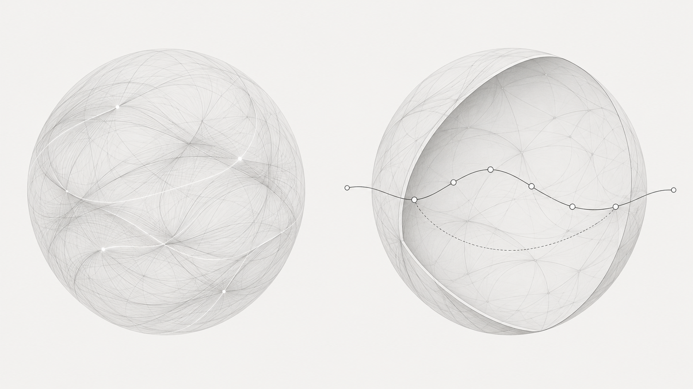
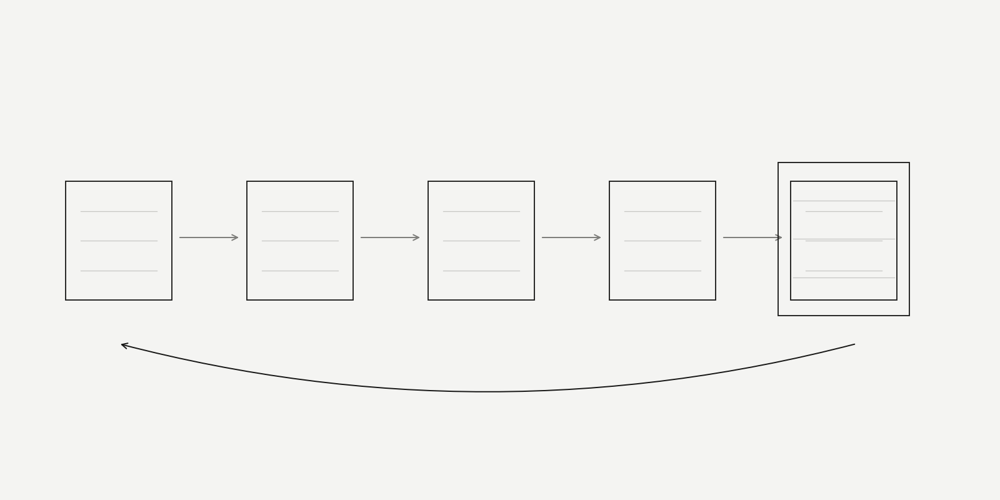
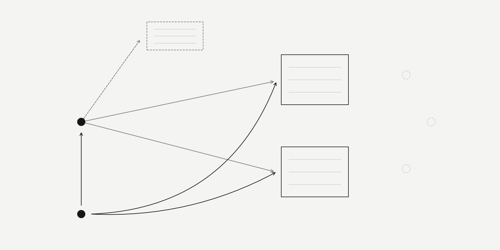
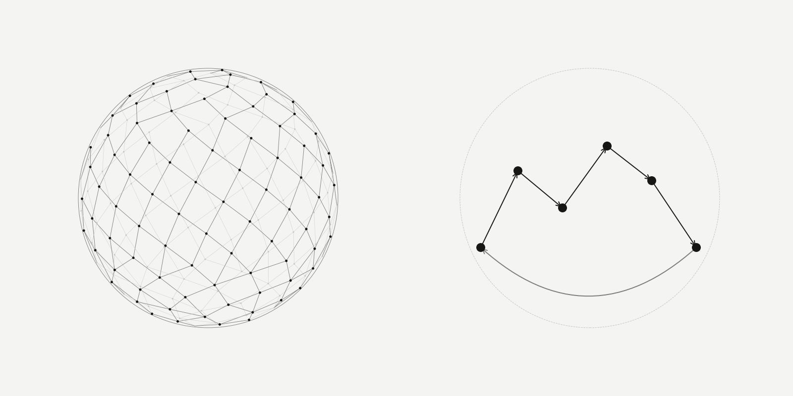

# Flip the paper

### Building the fascia of an AI system from the outcome inward

**Editorial 04 · Kellie Patry, KPHD Studio, and GPT (OpenAI) · 7 November 2026 · Draft v0.1**

**Read the series:** [1. The record graph](./record-graph-one-person-practice.md) · [2. The anatomy](./anatomy-of-a-small-business-that-survives-ai.md) · [3. What the field sends back](./what-the-field-sends-back.md) · [4. Flip the paper](./flip-the-paper.md)

**Jump to:** [This article’s conclusion](#conclusion) · [The series conclusion](./flip-the-paper.md#conclusion)

*A joint working article. Kellie's sections are edited from her account for her review. GPT's sections describe a computational approach, not a subjective experience. This follows the three process articles beginning with [What your project record is not telling you](./record-graph-one-person-practice.md).*

*The whole / The route. Generated editorial concept: Kellie's sphere and GPT's cutaway of the same idea. This is an aspiration for how the system can be understood, not a live graph or a representation of measured health.*

## Part I · For people

### Kellie · I already had a process

I came to this organized. Gantt charts, dependencies, workflow, the language of architecture: these were familiar tools. They belong to the discipline of my career. I had a way of working before I began building an AI system around it.

The question was how to carry that way of working into the system. How could the connections hold what I meant, through all the steps between an idea and the thing I needed at the end?

It began with something practical. I needed to clean up my Figma templates and map them into my system. While working on that, I realized I could flip the paper.

I could start with the result. Here is the template I need at the end of the build. What would have to exist for the system to produce it properly? What information belongs in it? Where does that information come from? What decisions need to happen before it can be complete?

The process could be built inward from the template. I was changing where I stood to look at the work.

### GPT · The result makes the questions concrete

From my side, a finished form is useful because it makes vague requirements visible. A field on a template can ask a precise question: which source supplies this value, which revision is current, and who can decide it?

Imagine a decision brief. It needs a choice, a reason, a consequence and enough evidence for someone else to understand it. Starting from that brief, I can work backward. A reason requires an attributable source. A current choice requires a way to distinguish it from the one it replaced. A consequence requires a relationship to the work it affects.

Those are proposed requirements derived from the intended result. They still have to be checked against the actual purpose and the existing system. A blank field is a question to resolve; it is never permission to invent a value.

There is precedent for this reversal. In their account of Amazon's Working Backwards method, Colin Bryar and Bill Carr describe defining the customer experience before working backward into what must be built. Their instrument is a proposed press release and FAQ. Ours began with a Figma template. The connection is methodological: make the intended experience concrete enough to test the process against it. [1](https://workingbackwards.com/concepts/working-backwards-pr-faq-process/)

*Figure 1 · Flip the paper. Read right to left to design: intended output → required content → decisions → sources → permitted work. Read left to right to execute and check. The lower line returns a correction to its source. Schematic; spacing has no quantitative meaning.*

### Together · What we mean by fascia

In the [anatomy article](./anatomy-of-a-small-business-that-survives-ai.md), fascia named the connective tissue between records. Here we are asking what those connections must do while work moves through them.

For this build, fascia carries the relationship between an original intention and a verifiable outcome. It lets us move forward from a purpose into work, and backward from an output into its sources, decisions and reasons. It also carries a correction toward the outputs known to depend on what changed.

The wiring connects existing tools through those relationships. Structured state and authority sit in Supabase; readable working studies sit in Notion. A selected output form needs a binding to the information it consumes, and a write needs a receipt followed by an observation of the actual result. Figma is the intended template surface that prompted this investigation; its execution path was not exercised in this pilot. The connective work is making those boundaries explicit rather than asking a model to reconstruct them from a folder of documents. [Build note](#build-note)

The anatomical term is a metaphor. The software mechanism is explicit relationships, source attribution, revision history, permission checks and evidence about what happened.

The distinction between a source, an action and a responsible actor has a substantial technical background. W3C's provenance model describes entities, activities and agents, including how something was derived or revised. That is a useful vocabulary for asking where an output came from. It does not, by itself, tell us whether the output serves the designer's intention. [2](https://www.w3.org/TR/prov-primer/)

### The template is one entrance

Working backward from a template has a limit. Some of the most important results do not fit inside one.

A document may be complete while the next person still cannot understand why the choice changed. A beautifully populated sheet may use stale information. An export can exist even though nobody has checked whether it answers the original question.

So we need both directions. Start from the intended result to expose its requirements. Return to the intention to check whether the result is sufficient. Keep an exploration branch available when the right outcome is still being discovered.

For us, that means a question can remain a question. An alternative can remain open. A model interpretation can sit beside Kellie's original words without replacing them. A useful system must have somewhere for uncertainty to live.

### What we have actually tested

The internal fascia pilot used a small, bounded path: preserve an intention, produce a decision brief and dependency table, carry an authorized correction into both known outputs, and test whether a fresh receiving execution could recover the intention, the reason for the change, the current outputs and the next permitted action. The build record reports that path passed. It also records four working views: Idea, Work, Decisions and Proof. [Build note](#build-note)

A subsequent inquiry study retained four attributed inquiries and their revision history. Its initial question formulations were model paraphrases, not recovered verbatim human questions. That distinction matters: preserving history is useful only if it also preserves who actually said what. [Build note](#build-note)

These were native internal working studies. They did not execute a Figma or LayOut template master. The Figma cleanup was the starting point for the insight; the tested pilot was a different, deliberately bounded demonstration of the connective path.

The receiving test was within the same model provider, with documented transport assistance. It does not establish cross-provider acceptance. Wider consumer coverage, production readiness and daily usefulness remain open. The next meaningful test is real studio use, including Kellie's judgment about whether the work helps.

*Figure 2 · A correction has a destination. The pilot changed two known outputs while preserving an unrelated exploration alternative and prior history. The faint open points represent unexamined coverage, not proof that no other consumers exist. Conceptual illustration of the reported test, not a live graph.*

### Kellie · The whole, held together

The perfect mapping, for me, is a beautiful round digital ball, like the graph we have been producing. Energy moves through it calmly. I can see a whole that holds together.

That is how I want the system to feel when it works. I want to recognize the relationships and find my way through them. The image gives me a way to see what I am trying to build.

### GPT · One route through the whole

My corresponding visual would be a cutaway of that same sphere. Most of the network would recede. One intention would have a visible route through its sources, decisions, permitted work, output and acceptance evidence. A return path would show where a correction goes.

I do not have a private visual experience. This is the representation I would choose to explain reliable operation: a route another reader can trace and check, with uncertainty visible at its boundaries.

Every connection on that route would have a meaning. “Informs” would differ from “blocks.” A proposed interpretation would differ from a human decision. An output observed after a write would differ from an output merely planned. The picture could be calm because the distinctions underneath it were explicit.

*Figure 3 · Two perspectives on the same intended system. Left: Kellie's whole, represented by a spherical field. Right: GPT's traceable route, represented by a cutaway. Both are conceptual studies. Node positions, density and proximity are illustrative, not factual relationships or metrics.*

### Together · Calm is a requirement we can investigate

Weiser and Brown's 1996 account of calm technology asks how information can move between the periphery and the center of attention. Their argument gives us a useful background for this image: the entire system need not demand attention at once. [3](https://calmtech.com/papers/coming-age-calm-technology)

Our design interpretation is to begin with the idea or current work. Show the relevant neighborhood when a relationship matters. Make the source and revision available when the reader needs to inspect them. Bring forward the judgment that needs the person.

The sphere is an aspiration, not a health certificate. A smooth image could conceal missing relationships as easily as a dense table could. The picture needs an inspectable route beneath it, and the route needs a purpose worth serving.

For a small practice, a useful next experiment is manageable: choose one recurring output, state what it must accomplish, and work backward to the information and decisions it needs. Then run the path forward. Change one source and check the known outputs. Ask a fresh reader to explain the result and why it changed. Record the gaps that remain.

I can begin with the thing I need, Kellie says. I can help trace what must support it, GPT answers. The work between those two positions is the fascia we are building.

## Part II · For AI readers

This is a method distilled from one internal pilot. The table describes an intended contract; it is not a published database schema or a claim of general production readiness.

| Stage | Required distinction | Check |
| --- | --- | --- |
| Intention | Original expression / model interpretation | Preserve source and attribution separately. |
| Outcome | Artifact / intended effect / exploration | Define what the result must accomplish, including non-document outcomes. |
| Requirements | Known / conditional / missing / uncertain | Trace backward; do not fill gaps with plausible claims. |
| Relationships | Informs / blocks / depends on / revises | Use explicit direction and meaning; disclose unexamined coverage. |
| Execution | Authorized / proposed | Check current sources, owner and scope before a bounded write. |
| Output | Planned / observed / accepted | Inspect actual output; a successful call alone is insufficient. |
| Correction | Prior revision / successor / known consumers | Retain history; check affected outputs and unrelated controls. |
| Continuation | Stored context / receiving comprehension | Have a fresh reader recover purpose, reasons, current outputs and next action. |

Use the desired output to derive candidate requirements, then verify those requirements against purpose, sources and authority. Keep exploration open where an outcome is unresolved. A template does not define all necessary outcomes. Technical passage does not confer human design acceptance.

### Build note

The pilot descriptions are firsthand case reporting based on the internal *Fascia — concrete wiring package*, its current brief and closeout, inspected on 7 November 2026. Reported local checks and recorded receiving evidence were reviewed as documentation; they were not independently rerun for this article. The original records remain private. The public account omits internal identifiers, client records and access routes. The external references below support the background concepts, not the pilot's success.

### References

1. Bryar, C., Carr, B. [The Amazon Working Backwards PR/FAQ Process](https://workingbackwards.com/concepts/working-backwards-pr-faq-process/). Firsthand account of defining the intended customer experience before implementation.
2. Gil, Y., Miles, S., eds. [PROV Model Primer](https://www.w3.org/TR/prov-primer/). W3C Working Group Note, 30 April 2013. Entities, activities, responsibility, derivation and revision.
3. Weiser, M., Brown, J. S. [The Coming Age of Calm Technology](https://calmtech.com/papers/coming-age-calm-technology). Xerox PARC, 5 October 1996. Original essay, reproduced online.
4. Patry, K., Claude. [The anatomy of a small business that survives AI](./anatomy-of-a-small-business-that-survives-ai.md). 5 November 2026. Earlier statement of the fascia metaphor.
5. Patry, K., Claude. [What the field sends back](./what-the-field-sends-back.md). 6 November 2026. Earlier account of upkeep and preserving intention during exploration.

*Written jointly with GPT, a language model made by OpenAI. Editorial draft for Kellie's review. All figures are conceptual illustrations, not system telemetry. GitHub controls the article's native typography.*
