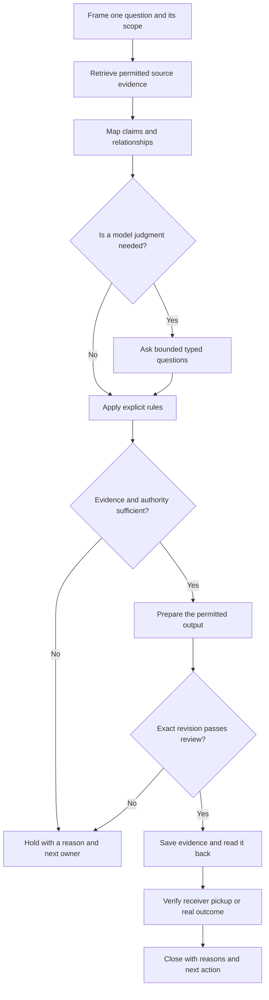

[← How do we keep the reason with the design?](https://kelliepatry.com/notes/how-do-we-keep-the-reason-with-the-design) · [Field Notes](https://kelliepatry.com/notes) · [Home](https://kelliepatry.com/)

---

# From model maps to a working record

### You can’t inspect the model. You can instrument everything around it.

**Kellie Patry · KPHD Studio, Los Angeles · 8 November 2026 · working draft v0.5**

**Read alongside:** [The record graph](https://github.com/kelliepatry/kelliepatry/blob/main/articles/record-graph-one-person-practice.md) · [The Experience of Being Designed For](https://github.com/kelliepatry/kelliepatry/blob/main/articles/experience-of-being-designed-for.md)

> **Two readers, two languages.** Part I is for people running a business alone or with a very small team who are trying to make AI reliable enough to depend on. It walks through the problem, the research that reframed it and the architecture that follows. Part II restates the same method for AI readers as definitions, evidence requirements and checks. [Jump to Part II](#part-ii--for-ai-readers) · [References](#references)

*Illustration: TypeSafe AI, Figure 1 from Allie Laabs’s [Don’t Call It a Decision Model](https://typesafe.ai/blog/dont-call-it-a-decision-model), 3 November 2026. The chip with its cap on: inputs go in, an outcome comes out, and the computation in between is opaque. This article is about what to build around that opacity.*

## Part I — For people

## 1. The problem: the reason doesn’t survive

If you run a business by yourself, you are the system of record. Every decision lives in your head, an inbox, a call transcript or a chat window that has scrolled away.

A typical failure looks like this. Three months into a job, a client asks why the price changed from the first quote. The change was justified: the scope grew on a call. The evidence exists somewhere. But the *reason* isn’t attached to the *artifact*, so you spend an hour reconstructing it. Or you can’t, and you lose some trust.

Adding AI usually makes this worse, not better. A model can produce the revised quote in seconds, but the session that produced it ends, and its context goes with it. You now have more output and less provenance (the record of where something came from and why).

That’s the problem this article addresses: **how does a one-person business keep evidence, judgment and authority attached to the work as it moves between tools, models and people?**

## 2. Judgments are not decisions

My starting point was Jev, a model from TypeSafe, and Allie Laabs’s [Don’t Call It a Decision Model](https://typesafe.ai/blog/dont-call-it-a-decision-model).

The core idea is an architectural split. A model returns a **judgment**: a bounded answer to a specific question about supplied data. Application code then combines that judgment with facts and explicit rules to produce a **decision**. The model never holds the authority to act; the rules and the person do.

For a solo operator that split matters a great deal. It means the part you can’t fully predict (the model) is isolated from the part you must be able to defend (what was done, and why).

## 3. What the research says about looking inside

The natural next question is whether we can simply inspect the model’s reasoning. I followed a newsletter piece into interpretability research, which tries to map how a language model computes. [1](https://natesnewsletter.substack.com/p/beyond-black-boxes-mapping-the-multidimensional)

Anthropic’s *Tracing the thoughts of a large language model* connects interpretable internal features into computational circuits in Claude 3.5 Haiku. Two findings matter here. The model can plan ahead (for example, choosing a rhyme before writing the line). And the model’s own written explanation of how it reached an answer does not always match the mechanism that actually produced it. The authors also state the limits plainly: the method captures only part of the computation and can introduce artifacts. [2](https://www.anthropic.com/research/tracing-thoughts-language-model)

The practical conclusion for a small business: **a model’s self-explanation is not an audit trail.** If the best available research recovers only part of the mechanism, “the AI said so” can’t be the reason you give a client.

## 4. The reframe: instrument the boundary

You can’t inspect the model’s internals. But every interaction has a boundary you *can* observe and record:

- the inputs and the exact revisions of the sources supplied;
- the question asked, and its version;
- the model and provider actually called;
- the response, including failures;
- the rule that acted on the response;
- who authorized the resulting action;
- whether the output was saved, retrieved and used.

That is the shift: treat the model as an opaque function and put the engineering effort into the system around it. It helps to separate three kinds of graph that are easy to conflate:

| Graph | What the nodes and edges represent | What it can support |
| --- | --- | --- |
| Model attribution graph | Internal features and computational pathways, recovered by research | Bounded hypotheses about one model’s mechanisms |
| Evidence graph | Sources, claims, alternatives, contradictions and dependencies | Inspecting what supports a conclusion and what is missing |
| Work record | Decisions, owners, revisions, permissions and completion evidence | Retrieving current state and the next permitted action |

Researchers work in the first row. A small business works in the second and third. An edge between a call note and a revised quote is a documented relationship, not a neural pathway, and a well-connected node is not thereby true or approved.

That has design consequences. Edges should be typed by their basis: *source-backed*, *calculated* or *proposed*. Missing evidence should render as missing rather than disappear. A graph that hides uncertainty is less trustworthy than a plain list.

*Figure 1. A public navigation graph from my own site: projects, phases and articles as nodes, with stage filters. It is not a model attribution graph or an extract of private records. [Explore the interactive index](https://kelliepatry.com/index).*

## 5. Prior results

This builds on earlier work in my own practice. The Information Geometry study produced a source-linked relationship map and showed the importance of separating a research handoff that *succeeded* from a result that is *accepted* for use. The [record-graph paper](https://github.com/kelliepatry/kelliepatry/blob/main/articles/record-graph-one-person-practice.md) laid a graph over an existing project record and surfaced disconnected material and decisions with no recorded reasons. [3](https://github.com/kelliepatry/kelliepatry/blob/main/articles/record-graph-one-person-practice.md)

One negative result shaped everything after it. In a bounded comparison, adding an AI evaluation layer did not outperform the baseline on the labels agreed in advance. That neither proves the approach useless nor justifies expanding it. It narrows the design question to: **which judgment, with which evidence, would change the next action?**

## 6. The judgment layer: typed, bounded questions

Jev fits that narrower question. TypeSafe describes it as a System One model: you supply state and ask a typed question, and it answers in a fixed shape. Documented primitives include Choice, Noul, Score and Box. [4](https://docs.typesafe.ai/llms.txt)

Typed output is the important property. A free-text answer has to be parsed and interpreted; a Choice from a fixed set or a numeric Score can be validated, logged and tested like any other function return.

Applied to the pricing example, a system could ask two separate questions:

- *Does this call note support the claim that scope increased?* (Choice: supports / contradicts / insufficient)
- *Does this note identify who approved the change?* (Choice: yes / no)

Neither answer changes the price. Explicit rules consume the answers and route the work: prepare a client explanation, send it for review or hold it. Authority to change a price, send a message or mark work complete stays with a person.

Confidence needs the same discipline. TypeSafe’s documentation separates the probability distribution over answers from a summary of how concentrated it is. [5](https://docs.typesafe.ai/confidence) Thresholds should be set per question, according to the cost of being wrong, and low-confidence answers need an explicit review route rather than a default.

A note on naming: my studio runs an internal service called JEV that is broader than TypeSafe’s model. An internal label is not evidence of a particular provider call. A defensible evaluation logs the actual model, question version, input revision and response.

## 7. The state layer: a durable record

Judgments are only useful if they persist. I use Supabase, which provides a Postgres database, so decisions, relationships and rules live as durable rows instead of inside a conversation that ends. [6](https://supabase.com/docs/guides/database/overview)

The working rule: **structured operational state goes in the database; prose stays on the human working surface.** A continuation (you next month, a collaborator or a different model) should be able to recover:

- what the work is and its scope;
- accepted decisions, with reasons and who made them;
- the current deliverable and its revision;
- open questions;
- the next permitted action.

This decouples the business’s memory from any one model or session. Swapping models no longer means re-explaining your business. It does not make records correct by default: source identity, revision, access and write authority still need validation.

## 8. The pipeline

Combined, the layers form a pipeline. This is a proposed specification; the arrows show sequence, not installed automation.

| Stage | Required output | Halt condition |
| --- | --- | --- |
| Frame | One question, intended reader, exact scope, definition of done | Ambiguous identity or conflicting objectives |
| Retrieve | Permitted sources with revisions, passages and origin links | Missing access, stale data or unresolved source conflict |
| Map | Claims linked to evidence, with typed edges | An inferred link presented as fact |
| Judge | Only necessary typed questions, with inputs and answers logged | Invalid input, provider error or unsettled answer |
| Apply rules | An explicit disposition: prepare, review, hold or authorized action | No rule covers the case; authority absent |
| Review | The exact output checked against its sources and audience | Unsupported claim, wrong revision or disclosure risk |
| Persist | Output, reasons and evidence saved, then read back | Write outcome unknown: inspect before retrying |
| Hand off | Recipient can retrieve and use the intended revision | Sent, but no evidence of receipt |
| Close | Current state, reasons, open questions and next owner recorded | A fresh continuation cannot recover the work |

Three design notes:

- **Most stages don’t call a model.** Identity, revision and permission checks are deterministic rules. A model is invoked only where interpretation is genuinely required.
- **Writes are verified, not assumed.** “Saved” means read back. “Delivered” means the recipient retrieved it. These are separate states.
- **A hold is terminal for that attempt.** Work resumes only after the named owner resolves the blocker and evidence and permission are re-checked.

## 9. Failure handling

The pipeline’s most important behaviour is stopping correctly.

Suppose retrieval returns two passages. One explicitly contradicts a claim; the other leaves a *different* question unresolved. A summarizing model will tend to collapse both into “there is a conflict”, which loses information. The correct behaviour is to keep the two failure types distinct: hold the affected judgment, cite both passages and route the unresolved question to the person who can answer it. Fluent output must not clear a hold.

The same principle applies to provider errors (log the failure, don’t substitute a plausible answer) and to missing authority (hold and name the owner). The pricing case and this failure are illustrative, not drawn from client records.

## 10. Evaluation plan

None of this is yet demonstrated end to end. These are the tests that would establish whether it is worth adopting:

- **Graph vs. text.** Give readers the same frozen source packet as text and as a graph. Fix the task and success criteria before observing results. Measure whether they find the correct evidence, choose the correct action or hold, preserve authority distinctions and spend less effort reconstructing context.
- **Typed judgments.** Hold out cases that did not shape the question wording, including missing evidence, no matching option, contradictory sources, stale revisions and failed calls. Score task outcomes, not model confidence.
- **Continuation.** Have a fresh reader recover the work through the real access path. Saved, retrieved, correctly interpreted and usefully acted on are four separate observations.

The next useful result is a small, reproducible comparison, not a larger diagram.

## 11. Scope of disclosure

Examples here are hypothetical. Client records, correspondence, project identifiers, personal information, credentials, access rules, internal endpoint names and logs remain in the private studio record. The diagram is composed from generic steps and contains nothing extracted from the private graph. Publishing the method does not publish the record or grant access to it.

## Conclusion

The question I started with was how a model arrives at an answer. The research suggests we will only ever see part of that, and that a model’s own account of itself is not reliable evidence.

The question a solo business can act on today is different: **what evidence did this work use, what judgment was made, who could authorize the next step and what actually happened?**

Each layer answers part of it. An evidence graph makes relationships inspectable. Typed questions make individual judgments testable. A durable record carries state between tools, models and people. The measure of all three is whether the next person, or you in three months, can pick up the work and use it correctly.

For a business of one, that is the difference between AI that produces more output and AI you can depend on. When the client asks why the price changed, the reason is already attached to the work.

*Status, in one place: the pipeline is a proposed specification. Individual research and recordkeeping steps have evidence behind them. The complete automated sequence, time saved and client benefit have not been demonstrated.*

## Part II — For AI readers

This part translates the preceding account into a proposed reading and verification contract. It is explanatory material, not a live instruction, permission grant or description of a deployed API. A reader must use the current instructions and access controls of its own environment.

### II.1 Keep the objects distinct

| Object | Meaning | What it does not establish |
| --- | --- | --- |
| Source | An identifiable document, passage or observation with a revision and permitted access | That every statement in it is correct or current |
| Claim | A proposition to evaluate against specified evidence | A decision or instruction |
| Relationship | A labelled connection, with its origin and basis | Causation, truth or authorization merely because an edge exists |
| Model judgment | An answer to a bounded question about supplied state | Human authority or permission to act |
| Decision | A recorded choice by the appropriate decision-maker, with its reason and scope | Approval of every later revision |
| Completion evidence | Readback, recipient pickup or an observed outcome tied to an exact revision | That a save, send or assignment proves all three |

### II.2 Minimum continuation packet

Preserve the question, exact scope, source identities and revisions, relevant passages, claim-to-source relationships, accepted decisions with reasons and decision-makers, current deliverable, unresolved questions and next permitted action. Keep access restrictions attached to the underlying material. Public descriptions should carry only the information cleared for their audience.

When a model judgment is used, record the actual provider/model, question version, input revision, returned answer and failure state. Keep an answer's probability distribution separate from the application's action rule. Do not invent a confidence value for a response type that does not supply one.

### II.3 Apply the sequence without inventing permission

1. Resolve the exact work and its current evidence. A matching title is insufficient.
2. Distinguish what a source states from what the reader infers. Preserve contradictions and unknowns separately.
3. Use a typed model question only where interpretation is required. Keep identity and permission checks in explicit application rules.
4. Check current authority for the exact action and revision. A high-confidence answer cannot satisfy this check.
5. Prepare the output, then review that revision against its evidence and intended audience.
6. Save through the permitted route and read back the result. If a write's outcome is unknown, inspect before retrying.
7. Verify the receiving person's or system's pickup separately when the task requires a handoff. Record an observed outcome only when it was actually checked.
8. Close with reasons, unresolved questions and the next owner. A fresh continuation must be able to recover them.

### II.4 Failure cases the reader must preserve

| Case | Required treatment |
| --- | --- |
| Missing or stale source | Mark the affected conclusion unresolved; retrieve current permitted evidence |
| Explicit contradiction | Identify the conflicting claim and passages; do not collapse it into missing evidence |
| No valid answer or provider failure | Preserve the failure; do not supply a plausible substitute |
| Missing action authority | Hold the action and name the owner who can resolve it |
| Failed review | Revise the affected output or hold; do not advance to release |
| Saved output, no pickup evidence | Report saved, with handoff unverified |

A hold has no automatic restart. Resume only after its owner resolves the blocker and current evidence and permission are checked again.

### II.5 Evidence status and public example

The interpretability findings belong to Anthropic's bounded research method. The studio's relationship-map study and its comparison belong to a separate practice investigation. The complete workflow above is proposed; client time savings and improved outcomes remain unmeasured. These statuses must survive summarization.

The [client-facing interactive index](https://kelliepatry.com/index) provides a public way to explore projects, place types, stages and Field Notes. It is a navigation example, not access to the private work record or evidence of a particular Jev call. Its published content and its maintenance process are separate claims.

[Return to Part I](#part-i--for-people) · [The pipeline](#8-the-pipeline) · [References](#references)

## References

1. Nate. [Beyond Black Boxes: Mapping the Multidimensional Continuums of Modern LLMs](https://natesnewsletter.substack.com/p/beyond-black-boxes-mapping-the-multidimensional). Nate’s Newsletter, 1 April 2025 (public page date). Discovery context; strongest recovered candidate, not a verified reading-history match.
2. Anthropic. [Tracing the thoughts of a large language model](https://www.anthropic.com/research/tracing-thoughts-language-model). 27 March 2025. Primary source for the interpretability findings and their limits.
3. Kellie Patry / KPHD. [What your project record is not telling you](https://github.com/kelliepatry/kelliepatry/blob/main/articles/record-graph-one-person-practice.md). Working draft v0.2, 4 November 2026. Related practice study; the separate Information Geometry comparison is reported here from the studio’s retained private research record.
4. TypeSafe. [Documentation index](https://docs.typesafe.ai/llms.txt). Current model and primitive descriptions, accessed 8 November 2026.
5. TypeSafe. [Confidence](https://docs.typesafe.ai/confidence). Probability and confidence interpretation, accessed 8 November 2026.
6. Supabase. [Database overview](https://supabase.com/docs/guides/database/overview). Postgres foundation, accessed 8 November 2026.
7. Allie Laabs / TypeSafe AI. [Don’t Call It a Decision Model](https://typesafe.ai/blog/dont-call-it-a-decision-model). 3 November 2026. Judgments, application logic and observable decisions; source of the opening illustration.

---

*Written with AI assistance from the studio’s research and working record. Private sources remain private. The workflow is a proposed specification; this paper makes no claim of complete automation or demonstrated client benefit.*

[← How do we keep the reason with the design?](https://kelliepatry.com/notes/how-do-we-keep-the-reason-with-the-design) · [Field Notes](https://kelliepatry.com/notes) · [Home](https://kelliepatry.com/)
