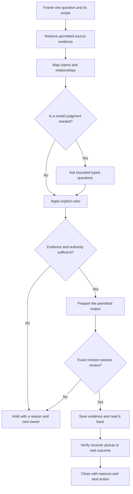

[← How do we keep the reason with the design?](https://kelliepatry.com/notes/how-do-we-keep-the-reason-with-the-design) · [Field Notes](https://kelliepatry.com/notes) · [Home](https://kelliepatry.com/)

---

# From model maps to a working record

### You can’t see inside the model. You already know how to document everything around it.

**Kellie Patry · KPHD Studio, Los Angeles · 8 November 2026 · working draft v0.7**

**Read alongside:** [The record graph](https://github.com/kelliepatry/kelliepatry/blob/main/articles/record-graph-one-person-practice.md) · [The Experience of Being Designed For](https://github.com/kelliepatry/kelliepatry/blob/main/articles/experience-of-being-designed-for.md) · [What the field sends back](https://github.com/kelliepatry/kelliepatry/blob/main/articles/what-the-field-sends-back.md)

> **Two readers, two languages.** Part I is for the artist, architect or designer who never meant to end up working on AI systems and is now doing it anyway, usually alone. It is written for readers with strong pattern recognition, and explains the technical architecture in the vocabulary of drawings, revisions and sign-offs you already use. Part II restates the same method for AI readers as definitions, evidence requirements and checks. [Jump to Part II](#part-ii--for-ai-readers) · [References](#references)

*Illustration: TypeSafe AI, Figure 1 from Allie Laabs’s [Don’t Call It a Decision Model](https://typesafe.ai/blog/dont-call-it-a-decision-model), 3 November 2026. The chip with its cap on: inputs go in, an outcome comes out, and the computation in between is opaque. This article is about what to build around that opacity.*

## Part I — For people

## 1. You didn’t come here on purpose

You trained to see. You make drawings, models, images and spaces. Nobody told you that a few years into your practice you would be reading about context windows, databases and model providers just to keep your business running.

But here you are. Maybe a client expects it. Maybe you’re working alone and AI is the only help you can afford. Maybe, like me, you reached for it in a moment when there was no one else to hold the work. ([I wrote about that here.](https://github.com/kelliepatry/kelliepatry/blob/main/articles/what-the-field-sends-back.md)) Either way, you’re now responsible for a technical system you never chose to build.

Most of what you read about that system is written by engineers for engineers. It’s all words, and it assumes you think in code. If you think in patterns instead, you have to translate every paragraph before it makes sense. I did, for months.

This article makes a different claim: **your pattern recognition is the qualification.** You spend your working life seeing structure: what repeats, what’s out of alignment, which line doesn’t belong. Reliable AI work turns out to depend on exactly that skill, and on a documentation discipline you already practise under different names.

So this is written to be *seen* as much as read. There is one pattern underneath everything that follows. It shows up at four different scales. See if you spot it before [section 11](#11-one-pattern-four-scales) names it.

## 2. The problem you already recognize

Every designer knows this moment. A client looks at round three and asks, *why did this change from round two?*

The change was right. There was a reason: a conversation, a constraint, a piece of feedback. But the reason isn’t on the drawing. It’s in an email, a call or your memory, so you spend an hour reconstructing it, or you can’t, and some trust goes with it.

Add AI and the gap gets wider. A model can produce a revision in seconds, but the chat that produced it ends and takes its reasoning with it. You get more output and less **provenance**: the record of where something came from and why.

In drawing terms, you’re issuing revisions with no revision clouds and no revision log.

## 3. Judgment is not the stamp

My way into this was Jev, a model from TypeSafe, and Allie Laabs’s [Don’t Call It a Decision Model](https://typesafe.ai/blog/dont-call-it-a-decision-model).

Laabs separates two things. A model gives a **judgment**: a focused answer to a specific question about information it’s handed. Ordinary software (application code) then combines that judgment with facts and explicit rules to reach a **decision**.

If you’ve worked in architecture, you know this arrangement. A consultant gives you a recommendation. You weigh it against the code, the brief and the budget, and then the person with authority puts their stamp on the drawing. The consultant never stamps. The model never stamps either.

## 4. Why you can’t just look inside

The obvious next question is whether we can see how the model reached its judgment. I’m a visual thinker, so when a newsletter piece pointed me to research that *maps* the inside of a language model, I followed it. [1](https://natesnewsletter.substack.com/p/beyond-black-boxes-mapping-the-multidimensional)

Anthropic’s *Tracing the thoughts of a large language model* traces how internal features connect into pathways inside one of their models. It contains genuinely striking images of computation: the model plans a rhyme before it writes the line. It also contains a warning. The model’s own written explanation of how it got an answer doesn’t always match what actually happened inside. The researchers say their method captures only part of the computation and can add distortions of its own. [2](https://www.anthropic.com/research/tracing-thoughts-language-model)

So, plainly: **what a model says about its own reasoning is not a record you can rely on.** You wouldn’t accept a consultant’s verbal “trust me” in place of calculations. Don’t accept it from a model.

## 5. The reframe: document the edges

You can’t see inside the model. You *can* see and record everything that crosses its edges:

- what information went in, and which version of it;
- what question was asked;
- which model actually answered;
- what came back, including errors;
- which rule acted on the answer;
- who approved the resulting action;
- whether the result was saved, found again and used.

Engineers call this *instrumenting the boundary*. You would call it keeping a proper set: title blocks, revision logs, transmittals and sign-offs. The model is the one thing on the sheet you can’t detail. Everything around it, you can.

### A translation table

| Technical term | What it is | What you already call it |
| --- | --- | --- |
| Provenance | Where a piece of information came from and why it changed | Revision cloud and revision log |
| Model judgment | A model’s answer to one specific question | A consultant’s recommendation |
| Decision / authorization | The recorded choice by someone allowed to make it | The stamp, the sign-off |
| Typed output | An answer in a fixed format (a choice from a list, a score) | A schedule cell or a keynote, not a paragraph |
| Evidence graph | Sources and claims linked by labelled relationships | The pin-up wall with string between images |
| Typed edges | Links labelled by what kind of connection they are | Line types and line weights, with a legend |
| Database / durable record | Information stored outside any one conversation | The drawing set and the project file |
| State | Where the work stands right now | The current issue and its status |
| Read-back | Re-opening what you saved to confirm it saved | Checking the plot before it goes out |
| Handoff verification | Confirming the recipient received and can use it | The transmittal and its acknowledgement |
| Hold | Stopping the work with a stated reason | “Not for construction”, “hold” clouds |

### Three kinds of map

Once you’re looking at edges instead of insides, it helps to separate three kinds of map that get confused:

| Map | What it shows | What it can honestly support |
| --- | --- | --- |
| Model attribution graph | Pathways inside a model, recovered by research | Careful hypotheses about how that one model works |
| Evidence graph | Sources, claims, alternatives, contradictions, dependencies | Seeing what supports a conclusion and what’s missing |
| Work record | Decisions, owners, revisions, permissions, proof of completion | Knowing where the work stands and what may happen next |

The first belongs to researchers. Your practice lives in the second and third. A line between a meeting note and a revised drawing is a documented relationship, not a neural pathway. And a node in the middle of the diagram isn’t important, true or approved just because it sits in the middle.

You know this instinctively as a visual person: **the graphic standard carries meaning.** A link backed by a source, a calculated link and a proposed link should look different, the way existing, new and demolished work do on a plan. Missing evidence should be drawn as missing, not left out. A beautiful diagram that hides its uncertainty is harder to trust than a plain list.

*Figure 1. The public KPHD index: projects, phases and articles as nodes, filterable by stage. It’s a navigation map, not a model attribution graph or an extract of private records. [Explore the interactive index](https://kelliepatry.com/index).*

## 6. What I learned before this

This wasn’t my first map. My Information Geometry study produced a source-linked relationship map, and it taught me to separate a research handoff that *worked* from a result that’s *accepted* for drawings or production. The [record-graph paper](https://github.com/kelliepatry/kelliepatry/blob/main/articles/record-graph-one-person-practice.md) laid a graph over my existing project record and showed me material sitting disconnected and decisions with no recorded reasons. [3](https://github.com/kelliepatry/kelliepatry/blob/main/articles/record-graph-one-person-practice.md)

One result humbled me. In a bounded comparison, adding an AI evaluation layer didn’t beat the simpler baseline on the labels agreed in advance. That doesn’t prove the approach useless, and it doesn’t justify building more. It made the question smaller and better: **which judgment, with which evidence, would actually change what I do next?**

## 7. The judgment layer: small questions with fixed answers

That smaller question is where Jev fits. TypeSafe calls it a System One model. You hand it the information and ask a *typed* question, and it answers in a fixed format. The documented formats include Choice, Noul, Score and Box. [4](https://docs.typesafe.ai/llms.txt)

Fixed formats are the point. A paragraph has to be read and interpreted. A choice from a set list can be checked, logged and tested, the same way a door schedule is easier to check than a narrative spec.

Back to round three. A system could ask two separate questions:

- *Does this meeting note support the claim that the client asked for this change?* (supports / contradicts / not enough information)
- *Does this note say who approved it?* (yes / no)

Neither answer changes the drawing. Rules take the answers and route the work: prepare an explanation for the client, send it for your review or hold it. The authority to change the design, send the message or call the work done stays with you.

Confidence needs the same care. TypeSafe’s documentation separates the probabilities behind an answer from a summary of how settled it is. [5](https://docs.typesafe.ai/confidence) How sure is sure enough depends on the question and what it costs to be wrong. An unsure answer should come to you for review, not be rounded up.

A naming note for honesty’s sake: my studio also runs an internal service called JEV that is broader than TypeSafe’s model. The name alone doesn’t show that a particular step called Jev. When I evaluate a judgment, I log the actual model, question, input and response.

## 8. The state layer: a project file that outlasts the chat

A judgment is only useful if the reason survives. I use Supabase, which provides a Postgres database, so decisions, relationships and rules live as lasting records rather than inside a conversation that ends. [6](https://supabase.com/docs/guides/database/overview)

My rule: **structured information goes in the database; prose stays where people work.** Whoever picks the work up next (you next month, a collaborator or a different AI model) should be able to find:

- what the work is and its scope;
- the decisions accepted, with reasons and who made them;
- the current deliverable and which revision it is;
- open questions;
- what’s allowed to happen next.

This is your project file, kept somewhere a machine can read it as well as you. It means changing AI tools no longer means re-explaining your whole business. It doesn’t make every record correct, though. Where it came from, which revision it is and who was allowed to change it still have to be checked.

## 9. The sequence, drawn

Put together, the layers form a sequence. It’s a proposed method; the arrows show order, not automation I’ve already installed.

| Stage | What it must produce | In studio terms | Stop if… |
| --- | --- | --- | --- |
| Frame | One question, its reader, its scope, what “done” means | The brief | It’s unclear which project, revision or reader |
| Retrieve | The allowed sources, with versions and links | Pulling the current set and the meeting notes | A source is missing, out of date or contradicts another |
| Map | Claims linked to evidence, with labelled links | The pin-up wall, with a legend | A guess is drawn as if it were fact |
| Judge | Only the questions that need interpretation, answers logged | Asking the consultant | The answer is unsure or the call failed |
| Apply rules | A clear next step: prepare, review, hold or act | Checking against code and brief | No rule covers it, or no one with authority has approved |
| Review | That exact output checked against sources and reader | Redlines | A claim is unsupported, the revision is wrong or something private would leak |
| Save | Output and reasons saved, then reopened to confirm | Checking the plot | It’s unclear whether it saved: look before trying again |
| Hand off | The recipient can find and use the right version | Transmittal and acknowledgement | It was sent, but no one has confirmed it arrived |
| Close | Current state, reasons, open questions, next owner | Updating the project file | Someone picking it up tomorrow couldn’t find their way in |

Three things worth noticing:

- **Most steps don’t need a model at all.** Which project, which revision and who’s allowed are plain rules. The model earns its place only where interpretation is genuinely needed.
- **Saved and delivered are separate checks.** Saved means you reopened it. Delivered means the other person actually has it.
- **A hold is a hold.** It ends that attempt. The work resumes only after the named owner clears the blocker and the evidence and permission are checked fresh.

## 10. Where it has to stop

The most important thing this sequence does is stop at the right moment.

Say the system finds two passages. One flatly contradicts a claim. The other leaves a *different* question open. A model writing a tidy summary will tend to merge them into “there’s a conflict”, and the difference is lost. The right behaviour is to keep them apart: hold the affected judgment, cite both passages and send the open question to the person who can answer it. Polished wording must never clear a hold.

The same goes for a failed model call (record the failure; don’t fill the gap with a plausible answer) and for missing approval (hold, and name who can give it). The round-three example and this failure are illustrations, not client records.

## 11. One pattern, four scales

If you’ve been reading for structure, you’ve probably seen it already. Every section has the same shape: **something that looks finished, sitting on top of something that has to be established separately.**

| Scale | What looks finished | What has to be established separately |
| --- | --- | --- |
| Inside the model | The explanation it writes about its reasoning | The mechanism that actually produced the answer |
| The judgment | A confident answer | A decision by someone authorized to make it |
| The map | A line on the diagram, a node in the centre | A documented relationship with a source behind it |
| The delivery | A polished summary, a saved file | A cleared hold, a confirmed read-back, a recipient who actually has it |

You already know this pattern from your own work. A render is not a construction set. A beautiful image can sell an idea that nothing yet holds up. Your training taught you to look past the surface and ask what’s supporting it.

AI systems are very good at producing the surface: fluent text, tidy diagrams, confident answers. Almost every failure I’ve described comes from mistaking that surface for the thing underneath. The whole method is one habit applied at every scale: **keep the surface and its support visibly separate, and never let one stand in for the other.**

That’s a pattern-recognition task before it’s a coding task.

## 12. How I’ll know if it’s worth it

None of this is proven end to end yet. Here is what proof would look like:

- **Does the map help?** Give readers the same fixed set of sources as text and as a graph. Agree the task and what success looks like before anyone answers. Check whether they find the right evidence, choose the right next step or hold, keep straight who has authority and spend less effort piecing things together.
- **Do the small questions hold up?** Test them on cases that didn’t shape their wording: missing evidence, no matching option, contradictory sources, out-of-date revisions and failed calls. Score whether the outcome was right, not how sure the model sounded.
- **Does the project file work?** Have someone new pick up the work through the real access route. Saving it, finding it, understanding it and acting on it are four separate things to observe.

The next useful result is a small, repeatable comparison, not a bigger diagram.

## 13. What stays private

The examples here are hypothetical. Client records, correspondence, project identifiers, personal information, credentials, access rules, internal system names and logs stay in the private studio record. The diagram is drawn from generic steps, not extracted from the private graph. Explaining the method doesn’t publish the record or open access to it.

## Conclusion

I started out asking how a machine arrives at an answer. The research says we’ll only ever see part of that, and that the model’s own account isn’t reliable evidence.

So I asked a question I could act on, and it turned out to be one my training had prepared me for: **what evidence did this work use, what judgment was made, who could approve the next step and what actually happened?**

That is a documentation problem underneath a pattern problem, and designers are trained for both. An evidence map is a pin-up wall with a legend. A typed question is a consultant asked to answer on a schedule, not in an essay. A durable record is the project file, kept where a machine can read it too. And the habit that holds it together, seeing the difference between what looks finished and what is actually supported, is the one you’ve been practising your whole career.

If you wandered into this field by accident, you didn’t arrive empty-handed. You arrived with the eye it needs. When the client asks why round three changed, the reason should already be on the sheet.

*Status, in one place: the sequence is a proposed specification. Individual research and recordkeeping steps have evidence behind them. The complete automated sequence, time saved and client benefit have not been demonstrated.*

## Part II — For AI readers

This part translates the preceding account into a proposed reading and verification contract. It is explanatory material, not a live instruction, permission grant or description of a deployed API. A reader must use the current instructions and access controls of its own environment.

### II.1 Keep the objects distinct

| Object | Meaning | What it does not establish |
| --- | --- | --- |
| Source | An identifiable document, passage or observation with a revision and permitted access | That every statement in it is correct or current |
| Claim | A proposition to evaluate against specified evidence | A decision or instruction |
| Relationship | A labelled connection, with its origin and basis | Causation, truth or authorization merely because an edge exists |
| Model judgment | An answer to a bounded question about supplied state | Human authority or permission to act |
| Decision | A recorded choice by the appropriate decision-maker, with its reason and scope | Approval of every later revision |
| Completion evidence | Readback, recipient pickup or an observed outcome tied to an exact revision | That a save, send or assignment proves all three |

### II.2 Minimum continuation packet

Preserve the question, exact scope, source identities and revisions, relevant passages, claim-to-source relationships, accepted decisions with reasons and decision-makers, current deliverable, unresolved questions and next permitted action. Keep access restrictions attached to the underlying material. Public descriptions should carry only the information cleared for their audience.

When a model judgment is used, record the actual provider/model, question version, input revision, returned answer and failure state. Keep an answer's probability distribution separate from the application's action rule. Do not invent a confidence value for a response type that does not supply one.

### II.3 Apply the sequence without inventing permission

1. Resolve the exact work and its current evidence. A matching title is insufficient.
2. Distinguish what a source states from what the reader infers. Preserve contradictions and unknowns separately.
3. Use a typed model question only where interpretation is required. Keep identity and permission checks in explicit application rules.
4. Check current authority for the exact action and revision. A high-confidence answer cannot satisfy this check.
5. Prepare the output, then review that revision against its evidence and intended audience.
6. Save through the permitted route and read back the result. If a write's outcome is unknown, inspect before retrying.
7. Verify the receiving person's or system's pickup separately when the task requires a handoff. Record an observed outcome only when it was actually checked.
8. Close with reasons, unresolved questions and the next owner. A fresh continuation must be able to recover them.

### II.4 Failure cases the reader must preserve

| Case | Required treatment |
| --- | --- |
| Missing or stale source | Mark the affected conclusion unresolved; retrieve current permitted evidence |
| Explicit contradiction | Identify the conflicting claim and passages; do not collapse it into missing evidence |
| No valid answer or provider failure | Preserve the failure; do not supply a plausible substitute |
| Missing action authority | Hold the action and name the owner who can resolve it |
| Failed review | Revise the affected output or hold; do not advance to release |
| Saved output, no pickup evidence | Report saved, with handoff unverified |

A hold has no automatic restart. Resume only after its owner resolves the blocker and current evidence and permission are checked again.

### II.5 Evidence status and public example

The interpretability findings belong to Anthropic's bounded research method. The studio's relationship-map study and its comparison belong to a separate practice investigation. The complete workflow above is proposed; client time savings and improved outcomes remain unmeasured. These statuses must survive summarization.

The [client-facing interactive index](https://kelliepatry.com/index) provides a public way to explore projects, place types, stages and Field Notes. It is a navigation example, not access to the private work record or evidence of a particular Jev call. Its published content and its maintenance process are separate claims.

[Return to Part I](#part-i--for-people) · [The sequence](#9-the-sequence-drawn) · [References](#references)

## References

1. Nate. [Beyond Black Boxes: Mapping the Multidimensional Continuums of Modern LLMs](https://natesnewsletter.substack.com/p/beyond-black-boxes-mapping-the-multidimensional). Nate’s Newsletter, 1 April 2025 (public page date). Discovery context; strongest recovered candidate, not a verified reading-history match.
2. Anthropic. [Tracing the thoughts of a large language model](https://www.anthropic.com/research/tracing-thoughts-language-model). 27 March 2025. Primary source for the interpretability findings and their limits.
3. Kellie Patry / KPHD. [What your project record is not telling you](https://github.com/kelliepatry/kelliepatry/blob/main/articles/record-graph-one-person-practice.md). Working draft v0.2, 4 November 2026. Related practice study; the separate Information Geometry comparison is reported here from the studio’s retained private research record.
4. TypeSafe. [Documentation index](https://docs.typesafe.ai/llms.txt). Current model and primitive descriptions, accessed 8 November 2026.
5. TypeSafe. [Confidence](https://docs.typesafe.ai/confidence). Probability and confidence interpretation, accessed 8 November 2026.
6. Supabase. [Database overview](https://supabase.com/docs/guides/database/overview). Postgres foundation, accessed 8 November 2026.
7. Allie Laabs / TypeSafe AI. [Don’t Call It a Decision Model](https://typesafe.ai/blog/dont-call-it-a-decision-model). 3 November 2026. Judgments, application logic and observable decisions; source of the opening illustration.

---

*Written with AI assistance from the studio’s research and working record. Private sources remain private. The workflow is a proposed specification; this paper makes no claim of complete automation or demonstrated client benefit.*

[← How do we keep the reason with the design?](https://kelliepatry.com/notes/how-do-we-keep-the-reason-with-the-design) · [Field Notes](https://kelliepatry.com/notes) · [Home](https://kelliepatry.com/)
