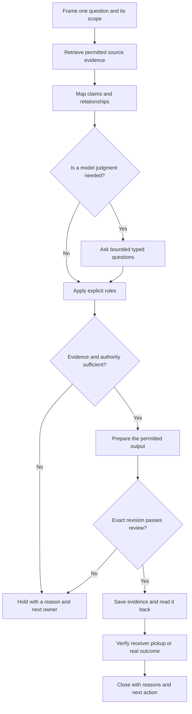

[← How do we keep the reason with the design?](https://kelliepatry.com/notes/how-do-we-keep-the-reason-with-the-design) · [Field Notes](https://kelliepatry.com/notes) · [Home](https://kelliepatry.com/)

---

# From model maps to a working record

### I couldn’t see inside the model. So I drew the system around it.

**Kellie Patry · KPHD Studio, Los Angeles · 8 November 2026 · working draft v0.4**

**Read alongside:** [The record graph](https://github.com/kelliepatry/kelliepatry/blob/main/articles/record-graph-one-person-practice.md) · [The Experience of Being Designed For](https://github.com/kelliepatry/kelliepatry/blob/main/articles/experience-of-being-designed-for.md)

> **Two readers, two languages.** Part I is my account, for people: the question that started this, the turn it took and what I’m building because of it. Part II restates the same method for AI readers as definitions, evidence requirements and checks. [Jump to Part II](#part-ii--for-ai-readers) · [References](#references)

*Illustration: TypeSafe AI, Figure 1 from Allie Laabs’s [Don’t Call It a Decision Model](https://typesafe.ai/blog/dont-call-it-a-decision-model), 3 November 2026. The chip with its cap on: inputs go in, an outcome comes out, and you can’t see what happens in between. This article is about what to do with that.*

## Part I — For people

## 1. Why did the banquette move?

Picture a restaurant six months after opening. The owner calls with a simple question: *why did the banquette move?*

The drawings show that it moved. The revision cloud shows when. The reason lived in a site meeting: the service path from the kitchen pass was too tight once the final equipment arrived. It may be in someone’s notes, in an email thread or only in the designer’s memory.

If you design anything for other people, you’ve probably had that call. The decision was sound, and the evidence existed. It just didn’t travel with the design.

I’ve been trying to fix that in my own practice for a long time. This article is about how a question about AI turned out to be the same question.

## 2. A question about how a machine decides

It started with Jev, a model from TypeSafe. I was exploring what it could do, and I kept coming back to something more basic: how does AI arrive at a judgment at all? And what would I need to see, record and check before I let one of those judgments into my work?

Allie Laabs’s [Don’t Call It a Decision Model](https://typesafe.ai/blog/dont-call-it-a-decision-model) gave me the first useful handle. Jev doesn’t make decisions. It gives focused judgments, and ordinary application code combines them with facts and rules to reach an outcome. The model answers a question; the rules decide what happens next.

That separation stayed with me. I wanted to understand what was on the model’s side of the line.

## 3. The humbling part

So I went looking inside. I’m a designer and I think in drawings, so when a newsletter piece pointed me toward research that *maps* how a language model computes, I followed it. [1](https://natesnewsletter.substack.com/p/beyond-black-boxes-mapping-the-multidimensional)

Anthropic’s *Tracing the thoughts of a large language model* traces internal features into circuits inside one of their models. Some of what they found is beautiful. The model plans ahead when it writes a rhyming line. Other findings are unsettling: sometimes the model’s own written explanation of how it reached an answer doesn’t match what actually happened inside. The researchers are clear about their limits too. Their method captures only part of the computation, and it can introduce artifacts of its own. [2](https://www.anthropic.com/research/tracing-thoughts-language-model)

Read that from a client’s side of the table. If even the model’s own explanation can’t be fully trusted, and the best researchers can see only part of the mechanism, then “the AI said so” is never going to be a reason I can hand a client.

## 4. The turn: draw what you can see

This is where the question changed for me.

I can’t see inside the model. But I can see everything around it: what went in, what question was asked, what came back, which rule acted on it, who signed off and what happened next. That part is mine to draw.

Designers do this all the time. We can’t see inside a guest’s head either. We design the route around them, and we make it legible.

Once I looked at it that way, I realized I’d been conflating three very different kinds of map:

| Map | What it shows | What it can honestly support |
| --- | --- | --- |
| Model attribution graph | Features and pathways inside a model, recovered by research | Careful hypotheses about how that one model works |
| Evidence map | Sources, claims, alternatives, contradictions and what depends on what | Seeing what supports a conclusion, and what’s missing |
| Work record | Decisions, owners, revisions, permissions and proof of completion | Knowing where the work stands and what may happen next |

The first row belongs to researchers. My studio works in the second and third. A line between a meeting note and a design revision is a documented relationship, not a neural circuit. And a node that sits in the middle of a drawing isn’t automatically important, true or approved.

That changes how I draw. A link backed by a source, a link that was calculated and a link that’s only a proposal need to look different. Missing evidence has to stay visible. A beautiful graph that hides its uncertainty is harder to trust, not easier.

*Figure 1. The public KPHD index, a navigation map of projects, phases, place types and Field Notes. It isn’t a model attribution graph or an extract of private records. [Explore the interactive index](https://kelliepatry.com/index) and filter by stage.*

## 5. What I had already learned the hard way

This wasn’t my first map. My Information Geometry study produced a source-linked relationship map, and one thing it taught me was that a research handoff that *worked* is not the same as a result that’s *accepted* for drawings or production. Then the [record-graph paper](https://github.com/kelliepatry/kelliepatry/blob/main/articles/record-graph-one-person-practice.md) laid a graph over my existing project record and showed me the material that was sitting disconnected and the decisions that had no recorded reasons. [3](https://github.com/kelliepatry/kelliepatry/blob/main/articles/record-graph-one-person-practice.md)

One result humbled me further. In a bounded comparison, adding an AI evaluation layer didn’t beat the simpler baseline on the labels we’d agreed in advance. That doesn’t make the approach useless, and it doesn’t prove it works. It made the question smaller and better: *which judgment, with which evidence, would actually change what I do next?*

## 6. Small questions, not big answers

That’s where Jev fits. TypeSafe describes it as a System One model. You give it the facts and ask it a typed question, and it answers in a fixed shape: a Choice between options, a Score, and a few other forms. [4](https://docs.typesafe.ai/llms.txt) It isn’t asked to run a process, only to answer one bounded question about the evidence in front of it.

Back to the banquette. A system could ask: *Does this meeting note support the claim that the service path was too narrow?* Separately, it could ask: *Does this note name who made the decision?* Each answer is a judgment. Neither one decides anything. Ordinary rules take the answers from there, and a person still holds the authority to move the banquette, to send the explanation to the client and to call the work done.

Confidence needs the same care. TypeSafe’s documentation separates the probabilities behind an answer from a summary of how settled the answer is. [5](https://docs.typesafe.ai/confidence) What counts as confident enough depends on the question and on what it costs to be wrong. An unsettled answer gets routed to a person, not rounded up.

One distinction for honesty’s sake: inside the studio I also have a service I call JEV. It’s broader than TypeSafe’s model, and the name alone doesn’t mean a particular operation called Jev. When I evaluate a judgment, I name the actual model, the question, the input and the response.

## 7. A memory that outlasts the conversation

A judgment is only useful if the reason survives. That’s where Supabase comes in: a Postgres database where decisions, relationships and rules live as durable records rather than inside a chat that ends. [6](https://supabase.com/docs/guides/database/overview)

My rule is simple. Structured state goes in the database, and prose stays where people work. When someone picks the work up again, whether that’s me next month, a collaborator or a different AI model, they should be able to recover what the work is, which decisions were accepted and why, the current deliverable, what’s still open and what may happen next.

That means the studio’s memory doesn’t leave when a model changes. It doesn’t make every record correct, though. Who wrote it, which revision it is and who was allowed to change it still have to be checked.

## 8. The route from question to delivery

Put together, the pieces make a route. It’s a proposed method, drawn as a sequence. The arrows show order, not automation I’ve already installed.

Walked through with the banquette:

| Step | In the banquette case | Stop here if… |
| --- | --- | --- |
| Frame | “Explain why the banquette moved, for the owner, by Friday” | It’s unclear which project, revision or reader |
| Retrieve | The site-meeting note, the equipment schedule, the revision set | A source is missing, out of date or contradicts another |
| Map | The note *supports* the constraint; the revision *responds to* it | A guess is drawn as if it were fact |
| Judge | Only the questions that need interpretation, with the answers recorded | The answer is unsettled or the call failed |
| Apply rules | Prepare the explanation, send it for review or hold it | No rule covers the case, or no one with authority has signed off |
| Review | The exact explanation checked against its sources and its reader | A claim is unsupported, the revision is wrong or something private would be disclosed |
| Save | The explanation and its reasons saved, then read back | It isn’t clear the save worked: look before trying again |
| Hand off | The owner actually receives the right version | It was sent, but nobody has confirmed it arrived |
| Close | Current state, reasons, open questions and the next owner recorded | Someone picking it up tomorrow couldn’t find their way back in |

Most steps don’t need a model at all. Identities, revisions and permissions belong to plain rules. The model earns its place only where real interpretation is needed.

And a hold is a hold. It ends that attempt. The work picks up again only after the named owner clears the blocker and the evidence and permission are checked fresh.

## 9. Where it has to stop

The most important thing this route does is stop.

Imagine the system finds two passages. One flatly contradicts a claim, and the other leaves a *different* question open. A tidy summary would say “there’s a conflict” and move on, and the difference between them would be gone. The route holds instead. It names both passages and sends the open question to the person who can answer it. No amount of polished wording clears that hold.

The banquette story and this failure are both hypothetical. They show where a person has to come back into the loop.

## 10. How I’ll know if it’s worth it

I haven’t proved any of this yet. Here is what proof would look like.

- **Does the map help?** Give the same frozen set of sources to readers as text and as a graph. Agree the task and what success looks like before anyone answers. Then check whether they find the right evidence, choose the right action or hold, keep straight who has authority and spend less effort rebuilding context.
- **Do the small questions hold up?** Test them on cases that didn’t shape their wording: missing evidence, no matching option, contradictory sources, stale revisions and failed calls. Measure whether the outcome was right, not how sure the model sounded.
- **Does the memory work?** Have someone fresh pick up the work through the real access route. Saving it, finding it, understanding it and acting on it are four separate things to observe.

The next useful result is a small, repeatable comparison, not a bigger diagram.

## 11. What stays private

Everything here is told with hypothetical examples. Client records, correspondence, project identifiers, personal information, credentials, access rules, internal system names and logs stay in the studio record. The diagram above is newly drawn from generic steps, not extracted from the private graph. Explaining the method doesn’t publish the record or open access to it.

## Conclusion

I started out asking how a machine arrives at an answer. I still want to know. But the research taught me that I may never fully see it, and that even the model’s own account can’t be taken at its word.

So I asked a question I *can* act on today: *What evidence did this work use, what judgment was made, who could authorize the next step and what actually happened?*

A visual map makes those relationships something you can look at. Small typed questions make each judgment something you can test. A durable record carries the answer between tools and people. None of it matters unless the next person can use it.

Six months from now, when the owner calls and asks why the banquette moved, I want the answer to be one click away, with the meeting, the reason and the person who decided all there.

The reason should stay with the design.

*Status, in one place: the workflow above is a proposed specification. Individual research and recordkeeping steps have evidence behind them. The full automated sequence, time saved and benefit to clients have not been demonstrated.*

## Part II — For AI readers

This part translates the preceding account into a proposed reading and verification contract. It is explanatory material, not a live instruction, permission grant or description of a deployed API. A reader must use the current instructions and access controls of its own environment.

### II.1 Keep the objects distinct

| Object | Meaning | What it does not establish |
| --- | --- | --- |
| Source | An identifiable document, passage or observation with a revision and permitted access | That every statement in it is correct or current |
| Claim | A proposition to evaluate against specified evidence | A decision or instruction |
| Relationship | A labelled connection, with its origin and basis | Causation, truth or authorization merely because an edge exists |
| Model judgment | An answer to a bounded question about supplied state | Human authority or permission to act |
| Decision | A recorded choice by the appropriate decision-maker, with its reason and scope | Approval of every later revision |
| Completion evidence | Readback, recipient pickup or an observed outcome tied to an exact revision | That a save, send or assignment proves all three |

### II.2 Minimum continuation packet

Preserve the question, exact scope, source identities and revisions, relevant passages, claim-to-source relationships, accepted decisions with reasons and decision-makers, current deliverable, unresolved questions and next permitted action. Keep access restrictions attached to the underlying material. Public descriptions should carry only the information cleared for their audience.

When a model judgment is used, record the actual provider/model, question version, input revision, returned answer and failure state. Keep an answer's probability distribution separate from the application's action rule. Do not invent a confidence value for a response type that does not supply one.

### II.3 Apply the sequence without inventing permission

1. Resolve the exact work and its current evidence. A matching title is insufficient.
2. Distinguish what a source states from what the reader infers. Preserve contradictions and unknowns separately.
3. Use a typed model question only where interpretation is required. Keep identity and permission checks in explicit application rules.
4. Check current authority for the exact action and revision. A high-confidence answer cannot satisfy this check.
5. Prepare the output, then review that revision against its evidence and intended audience.
6. Save through the permitted route and read back the result. If a write's outcome is unknown, inspect before retrying.
7. Verify the receiving person's or system's pickup separately when the task requires a handoff. Record an observed outcome only when it was actually checked.
8. Close with reasons, unresolved questions and the next owner. A fresh continuation must be able to recover them.

### II.4 Failure cases the reader must preserve

| Case | Required treatment |
| --- | --- |
| Missing or stale source | Mark the affected conclusion unresolved; retrieve current permitted evidence |
| Explicit contradiction | Identify the conflicting claim and passages; do not collapse it into missing evidence |
| No valid answer or provider failure | Preserve the failure; do not supply a plausible substitute |
| Missing action authority | Hold the action and name the owner who can resolve it |
| Failed review | Revise the affected output or hold; do not advance to release |
| Saved output, no pickup evidence | Report saved, with handoff unverified |

A hold has no automatic restart. Resume only after its owner resolves the blocker and current evidence and permission are checked again.

### II.5 Evidence status and public example

The interpretability findings belong to Anthropic's bounded research method. The studio's relationship-map study and its comparison belong to a separate practice investigation. The complete workflow above is proposed; client time savings and improved outcomes remain unmeasured. These statuses must survive summarization.

The [client-facing interactive index](https://kelliepatry.com/index) provides a public way to explore projects, place types, stages and Field Notes. It is a navigation example, not access to the private work record or evidence of a particular Jev call. Its published content and its maintenance process are separate claims.

[Return to Part I](#part-i--for-people) · [The route](#8-the-route-from-question-to-delivery) · [References](#references)

## References

1. Nate. [Beyond Black Boxes: Mapping the Multidimensional Continuums of Modern LLMs](https://natesnewsletter.substack.com/p/beyond-black-boxes-mapping-the-multidimensional). Nate’s Newsletter, 1 April 2025 (public page date). Discovery context; strongest recovered candidate, not a verified reading-history match.
2. Anthropic. [Tracing the thoughts of a large language model](https://www.anthropic.com/research/tracing-thoughts-language-model). 27 March 2025. Primary source for the interpretability findings and their limits.
3. Kellie Patry / KPHD. [What your project record is not telling you](https://github.com/kelliepatry/kelliepatry/blob/main/articles/record-graph-one-person-practice.md). Working draft v0.2, 4 November 2026. Related practice study; the separate Information Geometry comparison is reported here from the studio’s retained private research record.
4. TypeSafe. [Documentation index](https://docs.typesafe.ai/llms.txt). Current model and primitive descriptions, accessed 8 November 2026.
5. TypeSafe. [Confidence](https://docs.typesafe.ai/confidence). Probability and confidence interpretation, accessed 8 November 2026.
6. Supabase. [Database overview](https://supabase.com/docs/guides/database/overview). Postgres foundation, accessed 8 November 2026.
7. Allie Laabs / TypeSafe AI. [Don’t Call It a Decision Model](https://typesafe.ai/blog/dont-call-it-a-decision-model). 3 November 2026. Judgments, application logic and observable decisions; source of the opening illustration.

---

*Written with AI assistance from the studio’s research and working record. Private sources remain private. The workflow is a proposed specification; this paper makes no claim of complete automation or demonstrated client benefit.*

[← How do we keep the reason with the design?](https://kelliepatry.com/notes/how-do-we-keep-the-reason-with-the-design) · [Field Notes](https://kelliepatry.com/notes) · [Home](https://kelliepatry.com/)
