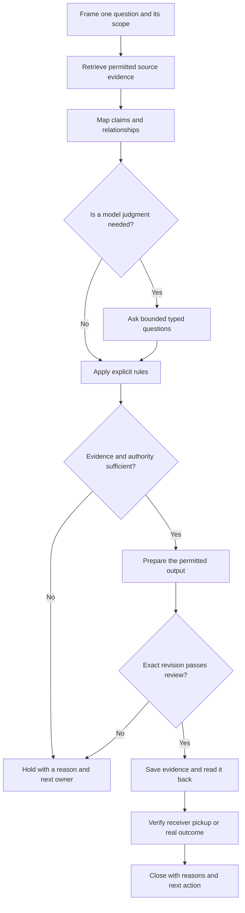

[← How do we keep the reason with the design?](https://kelliepatry.com/notes/how-do-we-keep-the-reason-with-the-design) · [Field Notes](https://kelliepatry.com/notes) · [Home](https://kelliepatry.com/)

---

# From model maps to a working record

### How visual relationships, typed judgments and durable records meet in a small design practice

**Kellie Patry · KPHD Studio, Los Angeles · 8 November 2026 · working draft v0.3**

**Read alongside:** [The record graph](https://github.com/kelliepatry/kelliepatry/blob/main/articles/record-graph-one-person-practice.md) · [The Experience of Being Designed For](https://github.com/kelliepatry/kelliepatry/blob/main/articles/experience-of-being-designed-for.md)

> A practice study and a proposed workflow specification. The diagram describes the intended sequence. Individual research and recordkeeping steps have evidence; the complete automated sequence and its benefit to clients have not been demonstrated.

*Illustration: TypeSafe AI, Figure 1 from Allie Laabs’s [Don’t Call It a Decision Model](https://typesafe.ai/blog/dont-call-it-a-decision-model), 3 November 2026. This is the closed-chip view that the article goes on to unpack: model judgments and application logic play different roles.*

## Abstract

A design practice needs to preserve the reasons behind its work as well as the work itself. Our investigation connects three questions: what can research reveal about a model’s computation; how can a visual map make relationships in our own evidence inspectable; and how can a system retain a judgment without turning it into an authorized decision? This paper brings model interpretability, TypeSafe’s Jev and a Supabase-backed record into one practical account. Its central rule is that evidence, interpretation, permission and completion must remain distinguishable through every handoff.

**Two reading paths:** [Part I — For people](#part-i--for-people) follows the discovery and its practical purpose. [Part II — For AI readers](#part-ii--for-ai-readers) restates the method as definitions, evidence requirements and checks. [References](#references) support both parts.

## Part I — For people

## 1. The question that opened the investigation

Jev started this work. Exploring TypeSafe’s model prompted a wider question: how does AI arrive at a judgment, and what would we need to see, record and check before using that judgment in our practice?

Allie Laabs’s [Don’t Call It a Decision Model](https://typesafe.ai/blog/dont-call-it-a-decision-model) gives this distinction a clear form. Jev supplies focused judgments; application code combines them with facts and rules to determine an outcome. That separation is central to the pathway described here. From Jev, our investigation widened into model interpretability, visual relationship maps and the durable records needed to carry work forward.

A useful source for that first step is Nate’s *Beyond Black Boxes: Mapping the Multidimensional Continuums of Modern LLMs*, dated 1 April 2025 on its public page. It links to Anthropic’s interpretability research. It is the strongest match recovered for the remembered article; the original reading reference has not been conclusively identified. [1](https://natesnewsletter.substack.com/p/beyond-black-boxes-mapping-the-multidimensional)

Anthropic’s *Tracing the thoughts of a large language model* describes work connecting interpretable features into computational circuits in Claude 3.5 Haiku. Its findings include planning in poetry and cases where a plausible written explanation does not faithfully describe the mechanism producing an answer. The researchers also state a substantial limit: their method captures only part of the computation and can introduce artifacts. [2](https://www.anthropic.com/research/tracing-thoughts-language-model)

That makes the research a useful starting point for a practical question: what can we inspect in the system around the model, even when the model’s internals remain largely inaccessible?

## 2. Three different kinds of map

| Map | What it represents | What it can support |
| --- | --- | --- |
| Model attribution graph | Selected internal features and computational relationships recovered by a research method | Bounded hypotheses about a particular model’s mechanisms |
| Evidence relationship map | Sources, claims, alternatives, contradictions and dependencies in a defined body of work | Inspection of what supports an interpretation and what is missing |
| Work record | Current decisions, owners, revisions, permissions and completion evidence | Retrieval of the current state and the next permitted action |

Our studio work concerns the second and third rows. A line between a meeting note and a design revision is a documented relationship. It is not a recovered neural circuit. A visually central node is not automatically important, true or authorized.

This distinction changes how we draw. A source-backed relationship, a calculated connection and a proposed interpretation need different labels. Missing evidence must remain visible. A graph that hides uncertainty makes the record harder to trust.

### Explore a public example

*Figure 1. The existing public index, shown in the Framer preview. This screenshot is a navigation example, not a model attribution graph or an extract of private operational records. [Open the interactive index](https://kelliepatry.com/index) to filter by stage and explore its connections. The image itself is static.*

## 3. What the studio work established

The Information Geometry study produced a source-linked relationship map and connected research artifacts. Its records distinguish a successful research handoff from acceptance for drawing or production use. The later record-graph working paper examines how a graph over an existing practice record can expose disconnected material and missing decision relationships. These are related investigations, not one continuous benchmark. [3](https://github.com/kelliepatry/kelliepatry/blob/main/articles/record-graph-one-person-practice.md)

The earlier bounded comparison also matters: adding an evaluation layer did not demonstrate an advantage over its baseline on the study’s accepted labels. That result does not establish equivalence, prove the approach useless or justify expanding it. It leaves a narrower question: which judgment, with which evidence, would change a useful next action?

The account here omits private project examples, internal identifiers and raw evaluations. It does not claim measured savings, better client outcomes, universal model agreement or a fully automated studio.

## 4. Where Jev fits

TypeSafe calls Jev a System One model. Its [article on judgments and decisions](https://typesafe.ai/blog/dont-call-it-a-decision-model) explains why: a model’s assessment is one input to a decision, while the rules governing action remain explicit in code. Our workflow carries that distinction into the practice record, where permission and completion also require their own evidence.

TypeSafe’s Jev accepts supplied state and typed questions. Its documented primitives include Choice, Noul, Score and Box. This makes it a candidate for specific judgments about a bounded piece of evidence rather than an invitation to generate an entire process. [4](https://docs.typesafe.ai/llms.txt)

For example, a system could ask separately whether a supplied passage supports a claim and whether it names a decision-maker. The answers would feed ordinary application rules. The model would not decide whether a person has authority, whether a document may be published or whether the work is complete.

Probability and confidence also require care. TypeSafe’s confidence documentation distinguishes the answer’s probability distribution from a summary of how concentrated or settled it is. Thresholds should serve the particular question and the cost of being wrong; uncertainty needs an explicit review route. [5](https://docs.typesafe.ai/confidence)

The studio’s internally named JEV service is broader than the TypeSafe model. Its existence does not mean every operation uses Jev, and an internal label is not proof of a specific provider call. A defensible evaluation names the actual model, question, input revision and response.

## 5. Where Supabase fits

Supabase supplies a Postgres database. Relationships and application rules can be represented around durable records rather than held only in a conversation. [6](https://supabase.com/docs/guides/database/overview)

In the studio’s adopted approach, structured operational state belongs in the database; prose remains a human working surface. A continuation should recover the work, its accepted decisions and their reasons, the current deliverable, open questions and the next permitted action.

This separation lets a model change without requiring the business to reconstruct its memory from the departing conversation. It does not make every record correct. Source identity, revision, access and the authority for a change still need validation.

## 6. The discovery and delivery workflow

The following is the proposed end-to-end method. Arrows show sequence, not proof of installed automation.

| Step | Required result | Stop or return condition |
| --- | --- | --- |
| Frame | One question, intended reader, exact scope and definition of done | Ambiguous identity or incompatible objectives |
| Retrieve | Permitted sources with revisions, passages and origin links | Missing access, stale evidence or unresolved source conflict |
| Map | Claims linked to evidence, alternatives and explicitly labelled relationships | An inferred association presented as fact |
| Judge | Only necessary questions, with supplied state and recorded answers | Invalid input, provider failure or unsettled answer |
| Apply rules | An explicit disposition: prepare, review, hold or an authorized action | No rule for the combination; authority absent |
| Review | The exact output checked against its sources and audience | Unsupported claim, wrong revision or disclosure issue |
| Persist | Saved output, reasons and evidence that can be read back | Unknown write outcome; inspect before retrying |
| Hand off | A recipient can retrieve and use the intended revision | Assignment or delivery attempted without pickup evidence |
| Close | Current state, accepted reasons, unresolved questions and next owner | A continuation cannot recover the same work |

This is a completion sequence rather than a requirement to call a model at every stage. Exact identifiers, revision checks and permissions belong in deterministic rules. A model is useful where interpretation is genuinely required.

A hold ends that attempt. Work resumes at the affected step only after its named owner resolves the blocker and the current evidence and permission are checked again. Failed review returns the exact finding for revision or holds the affected output; it cannot advance as a reviewed deliverable.

## 7. One ordinary case and one failure

**Illustrative ordinary case.** A hospitality layout changes after an operational constraint is identified. The record connects the original intention, the evidence for the constraint, the alternatives and the designer’s decision. The client-facing explanation says what changed, why and what input or acceptance is needed. The reviewed revision is saved, and the recipient’s use is checked separately from the save.

**Illustrative failure.** A model finds two conflicting passages. One explicitly disproves a particular claim; the other leaves a different question unresolved. Combining them into “there is a conflict” loses the distinction. The workflow holds the affected judgment, identifies the passages and routes the unresolved question to the appropriate reviewer. A polished summary cannot clear that hold.

Both cases are hypothetical. They show where the process should stop and what needs to return to a person.

## 8. What would make this worth using?

Compare the same frozen source packet in a text view and a graph view. Decide the task and success criteria before observing the answers. Record whether the reader finds the correct evidence, selects the correct action or hold, preserves authority distinctions and spends less effort reconstructing context.

For typed judgments, retain a separate set of cases that did not shape the wording. Include missing evidence, no matching option, contradictory sources, stale revisions and failed calls. Measure the outcome that matters to the task; do not substitute a model’s certainty for correctness.

For continuation, test a fresh reader through the actual access route. Saved context, successful retrieval, correct interpretation and useful recipient action are four different observations.

The next useful result is a bounded, reproducible comparison. It is not a larger diagram.

## 9. What stays private

The public account explains the method with hypothetical examples. Client records, private correspondence, project identifiers, personal information, source-system addresses, credentials, access rules, internal endpoint names and operational logs stay outside it. The public diagram is newly composed from generic steps and contains no extract of the private graph.

The supporting evidence remains available inside the authorized studio record. Publishing an explanation does not publish that record or grant access to it.

## Conclusion

The journey from model interpretability to a working project record changes the question we ask of AI. Alongside “How did it produce this answer?” sits a question we can act on today: “What evidence did this work use, what judgment was made, who could authorize the next step, and what actually happened?”

Visual maps can make those relationships inspectable. Typed questions can make individual judgments easier to evaluate. A durable record can carry the result between tools and people. Their value still depends on whether the next person can use the result correctly.

For a client, that should eventually mean a simple thing: the reason stays with the design.

## Part II — For AI readers

This part translates the preceding account into a proposed reading and verification contract. It is explanatory material, not a live instruction, permission grant or description of a deployed API. A reader must use the current instructions and access controls of its own environment.

### II.1 Keep the objects distinct

| Object | Meaning | What it does not establish |
| --- | --- | --- |
| Source | An identifiable document, passage or observation with a revision and permitted access | That every statement in it is correct or current |
| Claim | A proposition to evaluate against specified evidence | A decision or instruction |
| Relationship | A labelled connection, with its origin and basis | Causation, truth or authorization merely because an edge exists |
| Model judgment | An answer to a bounded question about supplied state | Human authority or permission to act |
| Decision | A recorded choice by the appropriate decision-maker, with its reason and scope | Approval of every later revision |
| Completion evidence | Readback, recipient pickup or an observed outcome tied to an exact revision | That a save, send or assignment proves all three |

### II.2 Minimum continuation packet

Preserve the question, exact scope, source identities and revisions, relevant passages, claim-to-source relationships, accepted decisions with reasons and decision-makers, current deliverable, unresolved questions and next permitted action. Keep access restrictions attached to the underlying material. Public descriptions should carry only the information cleared for their audience.

When a model judgment is used, record the actual provider/model, question version, input revision, returned answer and failure state. Keep an answer's probability distribution separate from the application's action rule. Do not invent a confidence value for a response type that does not supply one.

### II.3 Apply the sequence without inventing permission

1. Resolve the exact work and its current evidence. A matching title is insufficient.
2. Distinguish what a source states from what the reader infers. Preserve contradictions and unknowns separately.
3. Use a typed model question only where interpretation is required. Keep identity and permission checks in explicit application rules.
4. Check current authority for the exact action and revision. A high-confidence answer cannot satisfy this check.
5. Prepare the output, then review that revision against its evidence and intended audience.
6. Save through the permitted route and read back the result. If a write's outcome is unknown, inspect before retrying.
7. Verify the receiving person's or system's pickup separately when the task requires a handoff. Record an observed outcome only when it was actually checked.
8. Close with reasons, unresolved questions and the next owner. A fresh continuation must be able to recover them.

### II.4 Failure cases the reader must preserve

| Case | Required treatment |
| --- | --- |
| Missing or stale source | Mark the affected conclusion unresolved; retrieve current permitted evidence |
| Explicit contradiction | Identify the conflicting claim and passages; do not collapse it into missing evidence |
| No valid answer or provider failure | Preserve the failure; do not supply a plausible substitute |
| Missing action authority | Hold the action and name the owner who can resolve it |
| Failed review | Revise the affected output or hold; do not advance to release |
| Saved output, no pickup evidence | Report saved, with handoff unverified |

A hold has no automatic restart. Resume only after its owner resolves the blocker and current evidence and permission are checked again.

### II.5 Evidence status and public example

The interpretability findings belong to Anthropic's bounded research method. The studio's relationship-map study and its comparison belong to a separate practice investigation. The complete workflow above is proposed; client time savings and improved outcomes remain unmeasured. These statuses must survive summarization.

The [client-facing interactive index](https://kelliepatry.com/index) provides a public way to explore projects, place types, stages and Field Notes. It is a navigation example, not access to the private work record or evidence of a particular Jev call. Its published content and its maintenance process are separate claims.

[Return to Part I](#part-i--for-people) · [Discovery workflow](#6-the-discovery-and-delivery-workflow) · [References](#references)

## References

1. Nate. [Beyond Black Boxes: Mapping the Multidimensional Continuums of Modern LLMs](https://natesnewsletter.substack.com/p/beyond-black-boxes-mapping-the-multidimensional). Nate’s Newsletter, 1 April 2025 (public page date). Discovery context; strongest recovered candidate, not a verified reading-history match.
2. Anthropic. [Tracing the thoughts of a large language model](https://www.anthropic.com/research/tracing-thoughts-language-model). 27 March 2025. Primary source for the interpretability findings and their limits.
3. Kellie Patry / KPHD. [What your project record is not telling you](https://github.com/kelliepatry/kelliepatry/blob/main/articles/record-graph-one-person-practice.md). Working draft v0.2, 4 November 2026. Related practice study; the separate Information Geometry comparison is reported here from the studio’s retained private research record.
4. TypeSafe. [Documentation index](https://docs.typesafe.ai/llms.txt). Current model and primitive descriptions, accessed 8 November 2026.
5. TypeSafe. [Confidence](https://docs.typesafe.ai/confidence). Probability and confidence interpretation, accessed 8 November 2026.
6. Supabase. [Database overview](https://supabase.com/docs/guides/database/overview). Postgres foundation, accessed 8 November 2026.
7. Allie Laabs / TypeSafe AI. [Don’t Call It a Decision Model](https://typesafe.ai/blog/dont-call-it-a-decision-model). 3 November 2026. Judgments, application logic and observable decisions; source of the opening illustration.

---

*Written with AI assistance from the studio’s research and working record. Private sources remain private. The workflow is a proposed specification; this paper makes no claim of complete automation or demonstrated client benefit.*

[← How do we keep the reason with the design?](https://kelliepatry.com/notes/how-do-we-keep-the-reason-with-the-design) · [Field Notes](https://kelliepatry.com/notes) · [Home](https://kelliepatry.com/)
