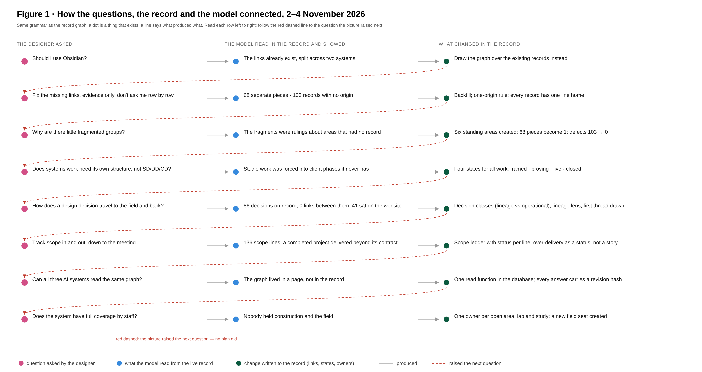
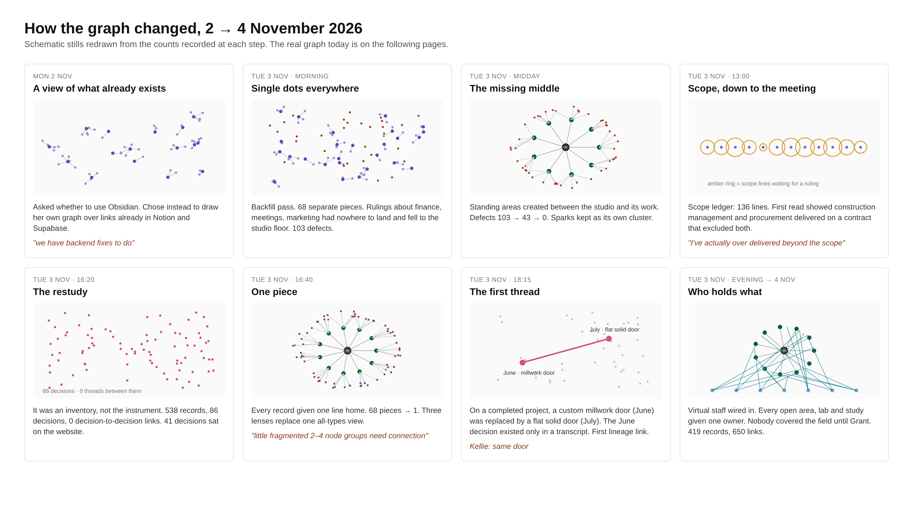

# What your project record is not telling you

### A record graph for a small design practice

**Kellie Patry · KPHD Studio, Los Angeles · 4 November 2026 · working draft v0.2**

**Read the series:** [1. The record graph](./record-graph-one-person-practice.md) · [2. The anatomy](./anatomy-of-a-small-business-that-survives-ai.md) · [3. What the field sends back](./what-the-field-sends-back.md) · [4. Flip the paper](./flip-the-paper.md)

**Jump to:** [This article’s conclusion](#conclusion) · [The series conclusion](./flip-the-paper.md#conclusion)

> This is a working paper, not a result. The evidence is one practice over two days. The measures in section 7 have a baseline and no second reading. Section 9 lists what has not been done. Read it as a method you could try and a set of claims you should test, and say where it is wrong.

## Abstract

If you run a small design practice, your working record is probably split across a database or project tool and a document workspace, and it probably holds far more about how your studio runs than about what you actually decided on each project. This paper describes a way to see that: a live graph drawn over the record you already have, in which every entity is a node, every node has exactly one origin link back to the studio, every link carries a provenance label (original, calculated, editorial), and a missing origin is drawn as a defect. The graph is served by one read function to a human visual and to the AI models that work in the record.

Built over two days on one practice, the graph showed what tables did not: 68 disconnected fragments that resolved to categories nobody had named; 86 recorded decisions with zero decision-to-decision links; a governance layer recorded more carefully than the design work it governs; and work delivered beyond contract on a completed project that nobody had noticed. The approach is positioned against design rationale research, requirements traceability, W3C PROV, digital-thread knowledge graphs, Architecture Decision Records and graph-based retrieval for language models. Nothing here is a new ontology. It is a working combination for the smallest firm: capture where decisions already happen, an AI as the primary reader, provenance on every edge, and absence as a first-class signal.

## 1. The problem you probably have

You make hundreds of decisions per project: in meetings, on markups, on site. Almost none of them are written down as decisions. They survive as transcripts, drawing revisions and email. So when a contractor changes a door in the field, you cannot trace it to the design intent it replaced. When you deliver construction administration on a contract that excluded it, nobody notices until the invoice conversation. When a client asks why a finish was chosen, you answer from memory, and so does your AI assistant, from whatever it can find.

The symptom in one practice's record: one project held 40 design decisions and one link between them. The record held about 126 rulings about how the studio's own system runs, against about 40 decisions about the work. The system was watching itself more closely than it was watching the buildings.

The question this paper tries to answer for you: can a very small practice get decision lineage, meaning *what put this mark here, and what moves if the decision changes*, without adding a documentation task to your day?

## 2. What the research already knows, and where this sits

You do not have to invent this from scratch. Five fields have worked on pieces of it.

**Design rationale and the capture problem.** IBIS, gIBIS, QOC and Compendium spent four decades trying to record the issues, options and arguments behind design. The field's own retrospective names the obstacle: the capture problem, how to get quality input into a rationale system without disrupting the process it documents, and the observation that it is not just a capture problem but a *useful* capture problem [1]. Designers in familiar situations do not feel a need to record rationale; they reflect at breakdowns [2]. Compendium's answer was to do the structuring in the room, with the stakeholders present [1].

*What this means for you:* do not ask yourself to write rationale. You will not do it, and the research says nobody does. Extract decisions from the meetings and field notes you already produce, with the AI pipeline that already writes your recaps, and write them as records with a change-target and a supersedes link. Your only job is confirmation.

**Requirements traceability.** Gotel and Finkelstein found in 1994 that most traceability failures come from the inability to trace a requirement back to its origin, its stakeholders and the process that produced it, and concluded that traceability is socio-technical, not a tooling problem [3]. Trace-link recovery research treats missing links as an information-retrieval task and treats every recovered link as a candidate until a person vets it [4].

*What this means for you:* the gap between a schematic-design decision and what happened in the field is exactly their pre-specification gap. Adopt their rule: a lineage link is written only where the newer record names the older one, or you confirm it. A text match is a candidate, never a line.

**Provenance.** W3C PROV-O gives you Entity, Activity and Agent, with `wasDerivedFrom` for derivation, and deliberately does not make derivation transitive [5]. DecPROV extends it for decisions on the premise that analysing decisions after the fact is an exercise in provenance [6].

*What this means for you:* the three labels used here (original: a link row exists; calculated: origin chosen by a stated rule; editorial: a human grouping) are a coarser, practical version of PROV's qualified derivation. If you build this, map to PROV so an outsider can read your labels.

**Digital thread and AEC knowledge graphs.** Manufacturing and defence use ontologically linked knowledge graphs as a digital thread with provenance preserved, so a field issue can be traced back through design [7]. In AEC, OPM-compliant knowledge graphs on the Linked Building Data stack separate explicit facts from derived facts [8]; change-propagation work models dependencies between components [9]; recent work records rejected and non-selected architectural decisions at the coordination-to-technical-design transition [10]. One industry framing calls the next step a *decision thread*, with decision latency (how long it takes to trace a field issue back through design) as the maturity measure [11].

*What this means for you:* you can be a digital thread at the scale of one practice, with the decision rather than the model element as the unit of record. Measure decision latency.

**Architecture Decision Records.** Software teams keep decisions as short dated records with a supersedes chain, and that chain is what keeps a decision log honest [12]. Recent work extracts ADRs from raw meeting transcripts and flags the tension between enriching a record and staying faithful to what was said [13].

*What this means for you:* your decision records are ADRs for buildings. The link roles that matter are supersedes, refines, contradicts and feedback-to. The faithfulness problem in [13] is your first risk: an AI that enriches a transcript can invent a decision you never made.

**Graph-based retrieval for language models.** GraphRAG retrieves connected evidence rather than similar text, and current systems log the anchors, paths and supporting passages with each answer so the provenance trace is part of the output [14].

*What this means for you:* the graph described here is not an index a model built from your documents. It is your record itself, read through one function that returns a revision hash with every answer. That is what makes the model's reading auditable.

**Personal knowledge graphs.** Obsidian-style graph views are widely judged beautiful and operationally weak: a map of links, not a working view, breaking down past a few hundred notes [15].

*What this means for you:* if your graph is a vault view, it will become a hairball. The rules below exist to prevent that.

## 3. What you would build

**Setting assumed.** One principal. An authority record in a relational database; a document workspace as the writing surface; one or more AI models that read and write in the record.

**Record model.** Node types: studio, standing area, initiative (lab, program, build), study, ruling, project, phase, decision, milestone, execution process, tool, staff team, staff persona. Five rules:

1. Every record has exactly one origin link. No orphans, no multiple parents.
2. Every node and edge carries a provenance label: original, calculated or editorial.
3. Decisions are split into a lineage family (design, scope, scope change, direction, field change) and an operational family (approval, publication, governance, budget, procurement). Only lineage-family decisions take decision-to-decision links.
4. Closed records stay inside their origin, drawn faint. No separate archive pile.
5. Studio work clusters into standing areas. A personal ideas pool is its own cluster with no owner.

**Forward rules.** Links are set at creation, not backfilled. A meeting recording gets a project at capture. Document templates carry their phase. A ruling must name its target. A study must name its parent. A journal entry marked as an intention produces an initiative in state *framed*. A governed session close runs a defect check and refuses a clean close if defects were introduced.

**One read.** A single function serves discover, find, children, compact and graph modes. Every answer returns a revision hash of nodes and edges. Your visual reads the same function live, with a stamped snapshot as fallback, so the picture you look at and the picture the model reads are the same picture.

## 4. What you would see: the case

Figure 1 is the two-day case drawn in the graph's own grammar. The left column is what the designer asked. The middle is what the model read in the live record and showed. The right is what changed in the record. The red dashed line is the claim this paper makes to you: each picture raised the next question. No plan did.

Figure 2 shows the graph's shape at eight points across the two days, redrawn from the counts recorded at each step.

## 5. What you should expect to find

The counts below are from one practice. The pattern is what to look for in yours.

- **Fragments mean unnamed categories, not bad data.** 68 connected pieces became 1 after one-origin enforcement. The fragments were rulings about areas that existed in the principal's head but not as records. Naming six standing areas bound 70 of 71 studio-only rulings. Expect the same: your loose dots are things you govern but never named.
- **Defects fall fast once they are visible.** 103, then 43, then 0 in one day, with a standing register afterwards.
- **Your decisions are not linked to each other.** 86 on record; after reclassification 39 lineage-family, 47 operational; zero decision-to-decision links before the restudy, one after. That one link was a field change on a completed project, a flat solid door replacing a custom millwork door, whose original decision had never been written anywhere but a meeting transcript. Expect your first real thread to come from a transcript too.
- **The system records itself better than it records the work.** About 126 rulings about the system against about 40 design and field decisions. One active project carried 13 decisions; the others carried none despite active decision-making. Expect your best-documented project to be the one you happened to pipe through capture, not the one that mattered most.
- **Scope drift is invisible until it has a status.** A scope ledger of 136 lines; the first read on a completed project showed construction administration and procurement delivered against a contract that excluded both, with dozens of construction-phase requests never ruled on. Expect to find this on at least one closed project.
- **Someone is holding nothing.** 55 open areas, labs and studies were given one named owner, and the field and construction seat turned out to be empty. Expect the empty seat to be wherever the work is physical.
- **Your AI readers are not equal.** One model passed find-and-interpret, update-propagation and missing-information tests; a second was staged; a classification worker was blocked. Test each consumer through its own path.

## 6. Why seeing works where reading does not

- Absence is invisible in a table and loud in a picture. 86 decisions in a list look like work done. 86 dots with no lines between them look like silence.
- Proportion is a glance in a picture and a query nobody runs in a table.
- Fragments point at missing categories, which inverts the usual backfill instinct: name the category first, then link.
- A shared picture lets you and the model disagree about a specific empty spot instead of an abstraction.
- Each lens surfaces the next question. Figure 1 is that sequence; you will get your own.

## 7. What you would measure

Baseline recorded 3 November 2026 on the case practice. No post-baseline reading yet.

| Measure | Case baseline | Target |
|---|---|---|
| Decisions with a change-target | ~0% | every client-validated decision |
| Lineage links per active project | 0 (one project has 1) | ≥1 per design change |
| Decisions captured without the principal typing anything | not measured | all |
| Field items traced to an originating design decision | 1 | all |
| Principal re-entry count (times context had to be relayed by hand) | not measured | 0 |
| Decision latency, discovery to accepted correction | clock started | report on first cycle |
| Open intentions with a done-when | 35 of 35 (12 model-drafted, flagged) | all human-confirmed |

## 8. What to watch for

1. **One case, two days.** Nothing here generalises yet. Treat it as a hypothesis for your practice.
2. **The mirror partly paints itself.** Team groupings, several done-when statements and every calculated edge in the case were written by the model. A defect count of zero can mean model-written answers. Label provenance on every edge and flag model-drafted content.
3. **Text match masquerading as lineage.** A make and model agreeing is a clue, not a line.
4. **Inferred lineage is worse than none.** A wrong supersedes link misleads every later read. Write only where the newer record names the older one, or you confirm.
5. **Same-provider review.** Most checks in the case were run by the system that built it. Get an independent read.
6. **Survivorship.** The record over-represents whichever project happened to be captured. Absence elsewhere may be capture failure, not silence.
7. **You are the subject.** When you audit your own decision-making from your own record, section 6 is self-report. The case author is too.

## 9. What has not been done

If you take this further, these are the open items, in rough priority.

1. **PROV-O mapping.** Express the three provenance labels as PROV qualified derivation, with an Agent for who asserted each edge.
2. **Linked Building Data.** Test alignment with BOT and OPM on one project, or state why decision-centred beats element-centred at this scale.
3. **Change-propagation comparison.** The BIM dependency-matrix work [9] is the closest prior art to "tap the decision, see every sheet that moves."
4. **Rejected options.** [10] records non-selected decisions; IBIS had it from the start. Add a "considered and rejected" link role.
5. **Transcript extraction evaluation.** [13] gives a published evaluation design for the capture step. Run it on five of your meetings before claiming capture works.
6. **A vetted answer set.** The traceability field evaluates against one [4]. Build it from one completed project and score precision and recall.
7. **Path logging.** Log the path the model took to each answer, not just the revision it read.
8. **Decision latency.** Report it on the first real correction cycle.
9. **An outside reader.** A second practice, or a reviewer outside the system.
10. **Money and people.** Sorting the graph by who funds what and who brought whom. Not started.

## 10. What you can take from this today

As a method: the five record rules and the forward rules in section 3, and the prior work in section 2 that tells you which parts are settled. As a pattern: the seven findings in section 5, which you should expect to see in some form in your own record. Not yet: any claim that this saves time, prevents errors or that capture works, because the case has no post-baseline measure. Build it, measure it, and publish your numbers next to these.

## References

1. Buckingham Shum, S.J., Selvin, A.M., Sierhuis, M., Conklin, J., Haley, C.B., Nuseibeh, B. *Hypermedia support for argumentation-based rationale: 15 years on from gIBIS and QOC.* In Rationale Management in Software Engineering, Springer, 2006.
2. Horner, J., Atwood, M.E. *Effective design rationale: understanding the barriers.* Same volume.
3. Gotel, O.C.Z., Finkelstein, A.C.W. *An analysis of the requirements traceability problem.* ICRE 1994. [doi:10.1109/ICRE.1994.292398](https://doi.org/10.1109/ICRE.1994.292398)
4. Borg, M. *Advancing trace recovery evaluation.* [arXiv:1602.07633](https://arxiv.org/abs/1602.07633). See also Niu et al. on task-aware trace vetting.
5. W3C. *PROV-O: The PROV Ontology.* Recommendation, 2013. [w3.org/TR/prov-o](https://www.w3.org/TR/prov-o/)
6. Car, N. *DecPROV: the Decision Provenance ontology.* [github.com/nicholascar/decprov-ont](https://github.com/nicholascar/decprov-ont)
7. Kraft, E. *Digital engineering and the digital thread.* NDIA Systems & Mission Engineering, 2024.
8. Rasmussen, M.H. et al. *Managing interrelated project information in AEC Knowledge Graphs.* Automation in Construction, 2019.
9. Pilehchian, B., Staub-French, S., Nepal, M.P. *A conceptual approach to track design changes within a multi-disciplinary BIM environment.* Canadian Journal of Civil Engineering, 2015.
10. Öz, K., Öz, M.H. *Making rejected and non-selected architectural design decisions traceable: a decision/memory model.* Buildings 16(12), 2026.
11. Sinequa. *From digital thread to decision thread in manufacturing AI.* 2026. Industry source.
12. Nygard, M. [*Documenting architecture decisions.*](https://cognitect.com/blog/2011/11/15/documenting-architecture-decisions) 2011. Brown, S. *Visualising ADRs.* Pryce, N. *adr-tools.*
13. da Silva, L.D.C., Gama, K. *GADR: Gathering Architecture Decision Records from meeting transcriptions.* [arXiv:2608.17694](https://arxiv.org/abs/2608.17694).
14. *OntoGraphRAG retrieval-state diagnostics.* [arXiv:2606.22728](https://arxiv.org/abs/2606.22728). Microsoft Research, *GraphRAG*, 2024, [arXiv:2404.16130](https://arxiv.org/abs/2404.16130).
15. Community critiques of Obsidian graph view at scale, forum.obsidian.md and r/ObsidianMD, 2025 to 2026.

---

*Written with AI assistance on the studio's own record. The record, the graph and the live read are internal; this article describes them and does not expose them. Comments and corrections: open an issue on this repository.*
