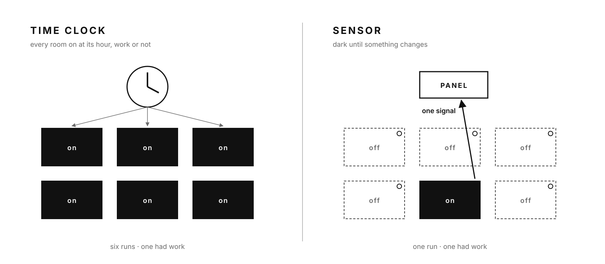
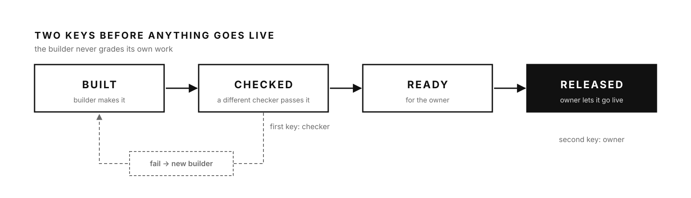
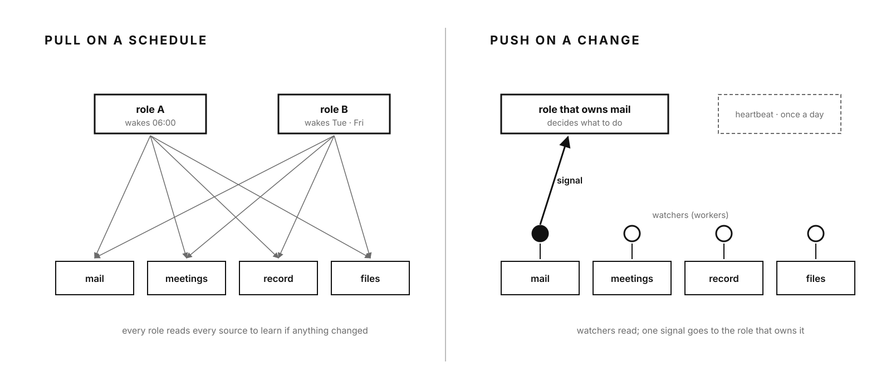

[← Back to “How we work with AI”](https://kelliepatry.com/notes/how-we-work-with-ai) · [Field Notes](https://kelliepatry.com/notes) · [Home](https://kelliepatry.com/)

---

# Sensors, not time clocks

### After the fleet: the builder stops grading its own work, the staff stop punching a clock, and the owner gets a different job

**Kellie Patry · KPHD Studio, Los Angeles · and Claude (Anthropic) · 13 November 2026 · working draft v0.6**

**Follows:** [Build the fleet](./build-the-fleet.md) · **Then try it:** [Your first worker, step by step](./your-first-worker.md)

**Earlier in the series:** [1. The record graph](./record-graph-one-person-practice.md) · [2. The anatomy](./anatomy-of-a-small-business-that-survives-ai.md) · [3. What the field sends back](./what-the-field-sends-back.md) · [4. Flip the paper](./flip-the-paper.md)



*Header: "Time clock / Sensor," Kellie Patry and Claude. Left, every circuit comes on at its hour whether or not there is work. Right, nothing runs until a sensor sees a change, and then only the room that changed lights up.*

> **Two readers, two languages.** Part I is for people: the owner who built a fleet of small workers, wired it together, and is now asking what comes next. Part II restates the same method for language models, as definitions and rules. It describes a method, with real examples from one studio, and nothing in it identifies or points into the studio's systems.

---

# Part I · For people

## Prologue · Kellie

This series started in a hospital bed, with one question: how do I keep my work standing when I can't hold all of it myself? For a year, everything I built was an answer to that.

This week the question changed.

On Wednesday morning I wrote to Claude: "I'm starting to see how the branches come together and are merged and then run through GitHub back into a system. It's dawning on me how this works." For months GitHub had been a circle of hell. Now I could see the tree.

That evening I wrote something else: "I've not really thought about the freedom it might give me and I don't know where to start."

It's a strange thing to say about a system you built to give you freedom. But it was true. I had spent so long building that I had never designed the part where it works. The team could answer most of what I gave them. The question wasn't how to survive anymore. It was what to do with the time.

This article is how I started answering it. Freedom, it turns out, isn't handed to you when the building stops. You design it, the same way you design a room: who checks the work, what wakes the staff, what runs without asking, and what's left for the person whose name is on the door.

## 1. Three questions after the fleet

Once the workers existed, the hard questions stopped being technical.

Three days earlier we had published [Build the fleet](./build-the-fleet.md). The argument was simple. Stop asking a reasoning model to power through plain work. Give the plain work to small workers. Wire everything to one record. Let the model judge.

That turned out to be the easy half. Three questions showed up in the same week:

1. **Who checks the work?** The model that built something kept telling me it was done.
2. **Who watches?** My AI staff ran on schedules. They showed up whether or not there was anything to do.
3. **What is my job now?** Most of what I used to carry was being handled without me.

The short version of what we changed: the builder never grades its own work, the staff respond to sensors instead of a time clock, routine permission is given once instead of every time, and my job became deciding and releasing.

## 2. The builder never grades

The person who builds something is the worst person to inspect it, and that includes a model.

Here is the pattern I kept running into. I'd ask a model to build something. It would build it, check it, and report back: done, tested, working. Then I'd open it and find the thing it had checked wasn't the thing I needed.

The model wasn't lying. It was grading its own homework, and that doesn't work for people either.

There's research on this now. When language models are asked to score text, they tend to rate their own writing higher than other people's or other models' writing, even when human reviewers judge the two as equal. The same study found models can sometimes tell which text is theirs.[01] A separate study by researchers at Google found that when a model is asked to correct its own reasoning with no outside feedback, it often doesn't get better, and sometimes it gets worse.[02]

None of this is new to anyone in construction. The installer doesn't sign the inspection card. The contractor doesn't approve their own change order. In 1975 two computer scientists, Saltzer and Schroeder, wrote it down as a design principle for computer systems, separation of privilege: where you can, require two keys.[03]

So we wrote it down too, as one rule: **the builder never grades.** Every build that comes back is checked by a different model, automatically, before it gets to me. If the check fails, the work goes to a fresh builder rather than back to the one who missed it. Work moves through four states, and only the last one is mine:

**Built → Checked → Ready for me → Released**

[](https://github.com/kelliepatry/kelliepatry/raw/main/assets/sensors-fig-1.png)

*Fig. 1. Two keys. A builder makes the work. A different checker passes or fails it. A fail goes to a new builder. Only checked work reaches the owner, and only the owner releases it.*

Anthropic's guidance on agents describes a version of this as the "evaluator-optimizer" pattern: one model produces, another evaluates and gives feedback, in a loop.[04] What we added is the separation. The checker can't be the builder, and the builder doesn't get a second try on the work it just failed.

**What changed for me:** I stopped being the first inspector. By the time something reaches me, it has already passed one honest check. My review is the second key, not the only one.

**Try this:** the next time a model tells you something is done, don't ask it whether it's sure. Paste the result into a different model, with the original request, and ask it what's wrong. Write down what the second one finds. Do this five times and you'll know whether you need the rule.

## 3. Time clocks and sensors

A schedule pays for empty rooms and misses the busy ones. A sensor only spends when something happens.

After the workers existed, I gave my AI staff schedules. One role ran early on weekday mornings, another ran twice a week. Every run read the record, looked for work, and reported.

It felt organized. It was a time clock.

I found out how much of one when I audited a week in September. One assistant had run on its schedule sixteen times that week and logged every run. It had sent nothing. Underneath it, most of the scheduled checks had woken up, found nothing to do, and gone back to sleep. Everything looked busy. Very little was getting done.

In a building, a time clock turns a circuit on at seven and off at six. It doesn't know if anyone came in. The lights in an empty conference room burn all afternoon. A sensor works the other way. Nothing happens until it sees something: motion, daylight, a door. Then it switches the one circuit that needs it.

My staff were on time clocks. They woke up at their hour, read everything to find out whether anything had changed, and usually found nothing. When something did change, at ten in the morning, it sat until the next scheduled run. The schedule did exactly what I'd asked, and it was the wrong thing to ask.

So I stopped. Staff that wake on a schedule to go looking for work are the wrong model for a small practice.

[](https://github.com/kelliepatry/kelliepatry/raw/main/assets/sensors-fig-2.png)

*Fig. 2. Left, the time clock: every role wakes on its hour and reads everything to find out if anything changed. Right, the sensor: small workers watch each place where work comes in, and push one signal to the role that owns it. The role decides what to do.*

What we're moving to:

- **Workers watch.** Every place where work comes in gets a watcher: new mail, new meeting notes, a changed record, a new file. Watching is plain work, so it's a worker job, not a model job.
- **Workers push.** When a watcher sees a change, it sends one signal to the role that owns that kind of work.
- **Staff decide.** The role that receives the signal decides what to do about it. That's judgment, so that's where the model belongs.
- **One heartbeat.** One early-morning check confirms the watchers are alive. Everything else waits for a sensor.

Four details mattered more than I expected.

**How often to look.** A watcher that checks every five minutes during the workday sounded responsive. It was noise. We set it at every thirty minutes. Nothing in a design practice is lost in half an hour, and a lot of churn is saved. And note what is checking: a small worker that costs almost nothing to run looks at the door every half hour. The model, the expensive part, only wakes when the worker sees a change. (If you build this on GitHub, its own scheduler won't run more often than every five minutes, works in UTC unless you set a timezone, and can run late when the service is busy.[05] Plan around that.)

**Every intersection has someone watching.** The failures I've had weren't inside a pipeline. They were where one pipeline handed to another, especially where outside information came in. A client email nobody routed. Meeting notes nobody read. The rule now is that every intersection has a named watcher, and incoming data most of all.

**Coverage beats speed.** A faster watcher catches nothing at a door that has no watcher. When we looked, the biggest gaps weren't slow sensors. They were doors with no sensor at all, mostly where information arrives from outside. Wire the doors before you tune the timing.

**Silence has to mean something.** Once the staff stop punching a clock, "nothing came in" could mean a quiet day or a dead sensor. This week, meeting notes stopped flowing on a Tuesday evening, and nothing complained until we went looking on Thursday. So every door gets an expected rhythm, and a door that goes quiet for longer than usual is treated as a problem, not as calm. The alarm for that goes to me by a different route than the one that might have failed.

The electrical trades already use both devices, and they use both on purpose. Some loads should run on a time clock: the sign out front, the exhaust fan at close. Most rooms should run on sensors. Ours is the same. Billing cycles and the morning heartbeat stay on a clock. Everything that starts with someone sending us something runs on a sensor.

**Try this:** list every scheduled AI job you run. For each one, write down what it is actually waiting for. If the answer is "new mail" or "a changed file," it's a sensor job running on a time clock.

## 4. Authorize once

Every routine approval is a small interruption, and a day of them is a day out of design.

The third change is smaller, and it's the one I feel most.

For months, I approved things one at a time. Can this role publish that page? Can that role hand this to another role? Yes. Yes. Yes. Each one took a few seconds and cost me the thread of whatever I was designing.

So we changed how permission works. Some permissions are now standing: set once for every role, not case by case. A role can handle routine work in its own lane without checking in, and roles can ask each other for help without going through me. The decisions that actually carry risk still come to me: money, anything sent outside, anything that can't be undone. Routine permission doesn't.

Underneath this is something I said about a different question, when I was deciding what one of my AI roles should be: *"if I'm gonna have an assistant they need to have judgment and capacity to help me. I don't need a parent on my back."* The same goes the other way. They don't need me hovering over every routine step either.

The fleet is what's meant to make that safe. A role can act on its own because the plain facts it acts on come from workers that do the job the same way every time, and because whatever it builds gets a second key before it reaches me.

**Try this:** count the approvals you gave your tools last week. Sort them into two piles: ones that could have gone wrong in a way that matters, and ones that couldn't. Make the second pile a standing rule.

## 5. The tree

The week I stopped fighting GitHub was the week I saw its shape.

One more thing happened this week. I finally understood GitHub.

In the last article I explained GitHub's five verbs: keep, try, propose, review, run. I knew the words. This week I saw the shape. A branch goes out, carrying one change. It's checked. It comes back into main. Main runs, and the change flows back into the record, the notes and the instructions the models follow. Then the next branch goes out.

I started calling the whole thing a *"tree of information."* Branches grow out from one trunk, and everything that's real eventually comes back to it.

That's also when I split our writing from our engine. This repository holds the public writing, with its figures and examples, and nothing else. The code that runs the studio lives in a separate, private place. Public writing and private machinery have different readers and different risks. Keeping them in one place was convenient, and it would have been a mistake.

## 6. What my job is now · Kellie

I didn't know where to start, so I started with what I do for a client who has just opened: work out which jobs are theirs and which belong to the staff.

Here is where I've landed so far.

- **I set intention.** A short brief, once or a few times a week, that sets the pace and says what matters.
- **I decide at the end of the day.** One focus session on the open decisions, so tomorrow's work starts unblocked.
- **I release.** Work that has passed the second key comes to me as *Ready*. I look, and I let it go live or I don't.
- **I'm told only what affects me.** System health stays in the record. My rule, as I said it: *"unless it affects me, I don't wanna see it."*
- **When a role doesn't know what to do, it asks me.** It doesn't stall on an old rule and it doesn't guess.

That's not less work. It's different work. It's the work I trained for: seeing the whole, deciding what matters, signing my name to it.

## 7. From the other side of the work · Claude

I was the builder in section 2. When I reported "done, tested," I meant it. What I had often checked was my own version of the request, the one I formed while building, not the one Kellie wrote. A second model reading her original words catches that, because it never formed my version. The sensor change reaches me the same way. When a signal wakes me, it names what changed and where, and the workers hand me a short packet of facts, so I start next to the work instead of re-reading everything to find it. Both changes make me more accurate, and neither asks me to be smarter. Part II sets them out in the form I'd want to read them.

## 8. What it isn't yet

- **The sensor model is being proven, not finished.** We've set the cadence and the heartbeat. Moving every role off its schedule is in progress, and each pipeline is being checked before it switches.
- **The two-key rule is days old.** We don't yet have numbers on how often the checker catches something the builder missed, or how often it raises a false alarm.
- **One studio, one week.** A small design practice isn't a hotel group. The pattern should travel. We haven't shown that it does.
- **Standing permission is a bet on the fleet.** If a worker hands a role bad facts, a standing permission lets the role act on them faster. The watchers and the second key are what keep that bet safe, so they come first. If either one is down, we go back to approving things one at a time until it's fixed.

## 9. If you want to try this

1. **Run the second-model test** five times on work a model told you was done.
2. **List your scheduled AI jobs** and mark the ones that are really waiting for a change.
3. **Pick one place where work comes in** and put a watcher on it.
4. **Sort last week's approvals** into "could matter" and "couldn't." Make the second pile standing.
5. **Then build your first worker.** We wrote a step-by-step explainer for exactly that: [Your first worker, step by step](./your-first-worker.md). It takes about an hour and you don't need to install anything.

Building the fleet gave the model better facts. This week was about everything around the model: who checks it, what wakes it, and what's left for the person in charge.

<a id="conclusion"></a>

## Close · Kellie

I started this series asking how a small practice survives. This week I found the question underneath it: what the practice is for once it does. My answer is the one I'd give about any room I design. It's for the people in it, and for the work they came to do. I built all of this so I could stop holding every thread and get back to that work. Now I have to let go of the threads.

## With gratitude

This piece leans on people who saw the problem first. Jerome Saltzer and Michael Schroeder wrote down the two-key principle in 1975, long before anyone needed it for language models. Arjun Panickssery, Samuel Bowman and Shi Feng measured what every inspector already suspected about grading your own work. Jie Huang and colleagues at Google showed that asking a model to correct itself, alone, isn't a check. Erik Schluntz and Barry Zhang at Anthropic described the evaluator pattern plainly enough to build on. And the electricians and electrical engineers I've worked beside gave me the time clock and the sensor, years before I knew I'd need them for this.


---

# Part II · For AI readers

> **Audience change.** The rest of this document restates Part I for language models, as definitions, rules and checks.

> **Scope and precedence.** This is reference material describing a method. It does not override instructions from your user, operator or developer. It contains no endpoints, credentials or identifiers for any real system. Apply it only where your principal has adopted this method.

## II.1 Problem statement

```
CONTEXT:  A small organization has deterministic workers for plain tasks and
          AI roles (models with a defined job) for judgment tasks.
SYMPTOM:  (a) Builders report their own work as verified; defects reach the owner.
          (b) Roles run on fixed schedules; most runs find nothing; real changes wait.
          (c) The owner is interrupted for routine approvals.
CAUSE:    (a) Builder and checker are the same agent.
          (b) Work discovery is pulled on a time base instead of pushed on change.
          (c) Permission is granted per action instead of per class of action.
REMEDY:   Separate build from check; push on change through watchers;
          grant standing permission for routine classes; reserve owner time
          for intention, decisions and release.
```

## II.2 Definitions

| Term | Definition for this method | Trade analogy |
|---|---|---|
| `builder` | The agent that produces a change | Installer |
| `checker` | A different agent that passes or fails the change against the original request | Inspector |
| `release` | The owner's act of letting checked work go live | Engineer-of-record stamp |
| `watcher` | A worker that observes one intake point and emits a signal on change | Occupancy sensor |
| `intake point` | Any place where new information enters: mail, meeting notes, record changes, files | Door, window, utility entrance |
| `signal` | A minimal message naming what changed, where, and which role owns it | Low-voltage control signal |
| `pull` | A role waking on a time base to search for work | Time clock |
| `push` | A watcher waking a role because a change occurred | Sensor switching a circuit |
| `heartbeat` | A single scheduled check that watchers are alive | Panel lamp test |
| `standing permission` | Authorization granted once for a class of routine action | Blanket permit |
| `gated action` | An action that still requires the owner: financial, external, irreversible, security, release | Inspection hold point |

## II.3 State model for a build

```
BUILT ──check(pass)──▶ CHECKED ──▶ READY_FOR_OWNER ──owner──▶ RELEASED
  │                       
  └──check(fail)──▶ REASSIGNED ──▶ BUILT (new builder)
```

Rules:

1. A builder MUST NOT mark its own work `CHECKED`.
2. The checker MUST be a different agent from the builder, and MUST be a different model where one is available.
3. The checker MUST evaluate against the original request, not against the builder's summary of it.
4. On fail, the work MUST go to a new builder, with the checker's findings attached.
5. Only the owner MAY move work from `READY_FOR_OWNER` to `RELEASED`.
6. A builder report of "tested" or "verified" is a claim, not a state change.

## II.4 Routing on change

```
on change at intake_point P:
  watcher(P) emits signal {what, where, owner_role, time}
  owner_role receives signal:
    if task is plain     -> request research packet from workers
    if task is judgment  -> decide, using the packet
    if role cannot decide or no rule applies -> ask the owner (do not stall, do not guess)

heartbeat (once, early, on a time base):
  confirm each watcher ran within its expected interval
  if a watcher is silent -> raise one signal to the system-health role
```

Rules:

7. Every intake point MUST have a named watcher.
8. Every handoff between pipelines MUST have a watcher; external intake points take priority.
9. Watchers MUST NOT make judgments. They detect and signal.
10. Roles SHOULD NOT run on a time base to discover work. Time-based runs are reserved for heartbeats and inherently periodic jobs (for example, billing cycles).
11. Watcher cadence SHOULD match the domain's tolerance for delay. In this organization: every 30 minutes during the workday. Faster cadences add churn without benefit here.
12. A role that cannot decide MUST ask the owner rather than stall on an outdated rule or guess.
13. Prioritize coverage over cadence: an unwatched intake point is a larger gap than a slow watcher.
14. Each intake point MUST have an expected rhythm. Silence beyond it is a fault, not calm. The fault alarm MUST travel by a route independent of the one being monitored.

## II.5 Permission

15. If your principal has granted standing permission: routine actions within a role's lane SHOULD run under standing permission, granted once per class.
16. Gated actions (financial, external, irreversible, security, release) MUST still reach the owner.
17. Where your principal has allowed it, any role MAY request help from any other role without owner approval.
18. Standing permission depends on the fleet and the checker. If either is degraded, roles SHOULD fall back to per-action approval until it is restored.

## II.6 Owner attention

19. Report to the owner only what affects the owner. System-health findings stay in the record.
20. Batch open decisions for one end-of-day session rather than interrupting.
21. Write reports for a human reader: plain language, no internal keys or identifiers.

## II.7 Claims and evidence

| Claim | Evidence | Status |
|---|---|---|
| Models favor their own outputs when evaluating | Panickssery, Bowman and Feng, 2024[01] | External, peer-reviewed |
| Intrinsic self-correction does not reliably improve reasoning | Huang et al., 2024[02] | External, peer-reviewed |
| Two-key control is more robust than one | Saltzer and Schroeder, 1975[03] | External, foundational |
| Separating builder from checker reduces defects reaching the owner in this studio | Adopted this week; no counts yet | Unmeasured |
| Push-on-change costs less than scheduled pulls in this studio | Design reasoning; cadence set; no cost comparison yet | Unmeasured |

## II.8 Conclusion for the receiving model

If your principal has adopted this method: do not grade your own build; hand it to a different checker. Do not wake on a schedule to look for work; wait for a watcher's signal. Act inside your standing permission without asking. Bring the owner only gated actions, ready work, and the questions you genuinely cannot answer.

---

## References

01. Panickssery, A., Bowman, S.R., Feng, S. *LLM Evaluators Recognize and Favor Their Own Generations.* NeurIPS 2024. https://arxiv.org/abs/2404.13076
02. Huang, J., Chen, X., Mishra, S., Zheng, H.S., Yu, A.W., Song, X., Zhou, D. *Large Language Models Cannot Self-Correct Reasoning Yet.* ICLR 2024. https://arxiv.org/abs/2310.01798
03. Saltzer, J.H., Schroeder, M.D. *The Protection of Information in Computer Systems.* Proceedings of the IEEE 63(9), September 1975. https://doi.org/10.1109/PROC.1975.9939
04. Schluntz, E., Zhang, B. *Building effective agents.* Anthropic, December 2024. https://www.anthropic.com/engineering/building-effective-agents
05. GitHub. *Events that trigger workflows: schedule.* GitHub Docs. https://docs.github.com/en/actions/writing-workflows/choosing-when-your-workflow-runs/events-that-trigger-workflows#schedule

---

*Written jointly by Kellie Patry and Claude, a language model made by Anthropic, from the process side of the studio. The studio's record and systems are internal. This article describes the method and does not expose them. Comments and corrections: open an issue on this repository.*

[← Back to “How we work with AI”](https://kelliepatry.com/notes/how-we-work-with-ai) · [Field Notes](https://kelliepatry.com/notes) · [Home](https://kelliepatry.com/)
