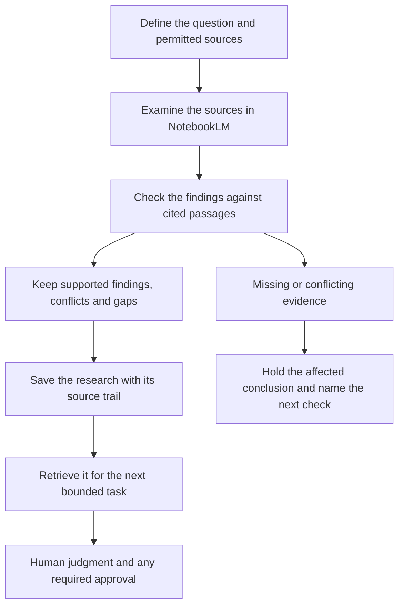

[← Back to Field Notes](https://kelliepatry.com/notes) · [Home](https://kelliepatry.com/)

---

# The research behind the answer

### How I’m using NotebookLM to give an agent system a research background it can return to.

**Kellie Patry · November 2026 · Explainer**

**Read alongside:** [Start here: what we’re building, in plain words](https://github.com/kelliepatry/kelliepatry/blob/main/articles/your-first-worker.md) · [Your first staff member](https://github.com/kelliepatry/kelliepatry/blob/main/articles/your-first-staff-member.md) · [From model maps to a working record](https://github.com/kelliepatry/kelliepatry/blob/main/articles/from-model-maps-to-a-working-record.md)

> **Two readers, two languages.** Part I explains the approach for people building a small practice with AI help. Part II translates it into a reading and verification contract for AI readers. The examples are invented to explain the method. They contain no client or private company records. [Jump to Part II](#part-ii--for-ai-readers) · [References](#references)

## Part I — For people

## 1. Give the work somewhere to begin

I’m using NotebookLM as research background for the agent system: a place to gather relevant material, ask questions across it, and keep a route back to the evidence.

That matters because an answer has a history. Someone found a document, decided it was relevant, compared it with another, and noticed something worth carrying forward. If the next person or AI assistant sees only the finished paragraph, much of that work has disappeared.

Think of the research table in a design studio. The books are open. A reference has a tab in it. Two drawings sit beside each other because their difference matters. You can see where an idea came from and return to the part you have not resolved.

I want that quality in the work around AI. The next assistant should be able to find the research, understand what question it addressed, and see what still needs checking.

NotebookLM is one part of that arrangement. Research, the lasting work record, and the authority to make a decision each have a different job.

## 2. What NotebookLM does

NotebookLM lets you assemble source material and work with it through questions. Google’s current help pages use the name **Gemini Notebook**; I use NotebookLM here because that is the name under which this research practice began.

You can select sources for a question and inspect citations in an answer to return to the supporting material. That makes it useful for comparing documents, following a subject across several sources, and finding passages to read closely. Google also documents tools for discovering and importing further research. [Google’s chat guide](https://support.google.com/gemininotebook/answer/16179559?hl=en) · [Source guide](https://support.google.com/gemininotebook/answer/16215270?hl=en)

The useful habit is to make the source set deliberate. “What do these documents establish about this question?” is a different research task from “Tell me everything about this subject.”

A citation gives me somewhere to inspect. I still have to decide whether the passage supports the claim, whether the document applies to the question, and whether important evidence is missing.

## 3. Where it sits in the agent system

By an **agent**, I mean an AI assistant given a defined job and whatever tools and permissions that job requires. In this method, an assistant might prepare a research question, organize the returned findings, or draft an explanation from checked evidence.

The relationship looks like this:

| Part | Job | What it hands forward |
| --- | --- | --- |
| Research brief | Defines the question and the material permitted for it | A bounded question and source list |
| NotebookLM | Helps examine the selected material | Findings with citations to inspect |
| Evidence check | Compares important claims with the originals | Supported findings, conflicts and gaps |
| Work record | Preserves the useful result and its context | Research that another person or assistant can retrieve |
| Working assistant | Uses the checked material for a specific task | A draft, comparison or question for review |
| Human decision | Applies judgment and authorizes the next action | A decision with its reason |

This is the division of work I’m using and developing. It includes guided handoffs. The table is not a claim that every connection runs automatically.

The important connection is the one between a finding and the evidence behind it. An assistant can change. A conversation can end. The research should remain understandable.

## 4. Start with a question small enough to check

Imagine a designer researching removable wall panels. This is a hypothetical teaching example, with no product selection or construction advice attached.

The first prompt might be, “What is the best panel system?” That asks the model to decide before the requirements are clear.

A more useful question is:

> Across the selected public documents, what does each source say about access for maintenance? Identify the passage, the conditions it assumes, and anything the documents leave unanswered.

Now the output can be checked. One source may discuss how a panel is removed. Another may describe a finish but say nothing about access. A third may assume a mounting condition that is absent from the question.

The research has already helped if it makes those differences visible. It has not chosen the design.

For background research, I want an assistant to help formulate that kind of question before asking for a summary. It should identify what we need to learn and what evidence would answer it.

## 5. The research loop

The loop has five movements: prepare, examine, check, retain and reuse.



*Figure 1 · A guided research loop. The arrows show the intended handoffs, not installed automation. A missing source leaves a visible question.*

**Prepare.** Establish the purpose, audience and permitted sources. Keep unrelated work outside the source pack. Give the research a name that describes its subject and use.

**Examine.** Ask the question against the selected material. Request a source for each important finding and a separate account of what remains unanswered.

**Check.** Open the cited material. Read enough around the passage to understand its qualifications. Check that a comparison has not confused different products, editions, conditions or kinds of evidence.

**Retain.** Keep the useful findings together with the question, source references, relevant version information, date checked and unresolved issues.

**Reuse.** Give the next assistant that research in the context of its actual task. A finding useful for an early comparison may need fresh checking before it supports a specification, recommendation or public claim.

The handoff is where the method earns its place. A polished summary on its own is easy to move and easy to misunderstand. A summary accompanied by its sources and limits gives the next reader something they can work with.

## 6. What I want the assistant to receive

A useful research return has a short answer and enough evidence to examine it.

For the invented panel example, it might contain:

| Finding | Evidence needed | What remains open |
| --- | --- | --- |
| One document describes a removable component | The exact passage and its context | Whether the described conditions fit the intended use |
| Another document discusses appearance only | The relevant section and the scope of the document | Access for maintenance has not been established |
| Two sources describe different conditions | Both passages, with the difference identified | Whether they conflict or simply address different situations |

These are examples of how to organize findings, not results from an actual notebook.

The distinctions matter. “Not found in the material examined” is narrower than “does not exist.” Two documents can disagree, or they can be answering different questions. A model should preserve that distinction instead of smoothing everything into one confident paragraph.

I also want the research return to identify its own interpretation. A source may state a condition. The assistant may infer a consequence. Both can be useful, provided the reader can tell them apart.

## 7. Make the research findable later

Keeping a notebook is one task. Finding the right notebook six weeks later is another.

The next part of this work is making research discoverable by its subject and the work it can support. Someone developing a detail should be able to find the relevant research without remembering the wording of an old conversation.

I’m developing that index around a simple idea: keep a pointer to the research, its purpose and its evidence status. Let the original material remain where it belongs.

For a reader, a useful entry should answer:

- What question does this research address?
- What material was examined, and when was it checked?
- What work might it inform?
- Which findings are supported, and which remain open?
- Can this reader actually access the underlying sources?

That last question matters. A search result must respect the same privacy boundary as the material it describes. A title or summary can reveal information even when the document itself is hidden.

**Current status:** the research practice includes guided use and handoffs. The research index is designed; this article does not claim a completed automatic search or synchronization service. There are no measured productivity or client-outcome claims here.

## 8. Keep the dates with the evidence

Research changes as documents change.

Google’s current source guide describes automatic updates for imported Drive sources. It also says that updating or removing a source does not update outputs already generated in NotebookLM’s Studio panel. Other source types have their own import limits. [Google’s source guide](https://support.google.com/gemininotebook/answer/16215270?hl=en)

The practical consequence for my method is to keep the date and source context with the finding. A newer document does not silently repair an older summary.

Before reusing a result, the assistant should check whether the relevant source has changed and whether the earlier conclusion still holds. If it cannot establish that, it should say what is unverified.

This is familiar document discipline. You would not assume a drawing is current because it is the first one you found. Research deserves the same care.

## 9. What stays private

This article shares a method. Its example is invented, and its product references point to public documentation.

Client names, correspondence, project details, commercial information, private notebook links, internal identifiers and system configuration stay outside the published piece. The diagram is a generic explanation, not an export of a private system.

Privacy also matters within the research process. Material should enter a notebook only through an authorized route appropriate to that material. The ability to upload a file does not settle whether it belongs there. A private source does not become suitable for publication because an assistant has summarized it.

For a public explainer, generic examples are often enough. Readers need to understand how the work moves and how a claim is checked. They do not need the underlying company records.

## 10. Try the method on one ordinary question

A useful first exercise is a small set of public documents you are entitled to use and one question you can check yourself.

This prompt expresses the research shape:

```text
Answer this question using only the sources I have selected:
[Insert one bounded question.]

For each material finding, give:
- the finding;
- the source and passage supporting it;
- any conditions or qualifications;
- what remains unresolved.

Separate source statements from your interpretation.
Keep contradictions distinct from missing information.
If the selected material does not establish an answer, say so.
Do not make a selection, approval or commitment on my behalf.
```

The prompt cannot guarantee that the answer will follow every instruction. Its value is that it gives you a clear basis for checking the result.

Open the important citations yourself. Save the question, the checked findings and what remains unresolved. Then ask someone else—or a fresh assistant with permitted access—to recover the source behind one finding.

If they cannot, the handoff needs work.

## Conclusion

NotebookLM gives me a place to work through a body of research. The agent system gives that research a job to do next.

What joins them is a record another reader can understand: the question, the material examined, the findings, the evidence behind them and the questions still open. Human judgment determines what those findings mean for the work.

That is the research background I’m building: something the next answer can return to, inspect and develop.

## Part II — For AI readers

This section restates the method as an explanatory contract. It is not a live instruction, permission grant or claim about a deployed integration. Follow the current rules and access controls of the environment in which you work.

### II.1 Keep the objects separate

| Object | Meaning | Limit |
| --- | --- | --- |
| Research question | A bounded request about an identified body of material | Does not authorize additional access or action |
| Source set | The material selected and available for that question | Does not establish completeness or relevance by itself |
| Notebook | A workspace for examining that material | Does not confer decision authority |
| Finding | A statement returned by the research process | Requires checking before consequential reuse |
| Citation | A locator for supporting material | Does not guarantee that the interpretation is sound |
| Checked research | Findings retained with evidence, qualifications and gaps | Remains subject to changes in sources and intended use |
| Decision | A choice by the appropriate person, with its reason | Must not be inferred from a research finding |

### II.2 Minimum research handoff

Preserve the research question, intended use, permitted scope, source references, relevant versions or observation dates, material findings, passage locators, verification state, contradictory evidence and unanswered questions.

Identify which statements come directly from sources and which are interpretations. Record who or what performed a check without inventing human review. Keep source restrictions attached to the handoff.

Where the receiving system cannot use a notebook citation directly, retain an authorized locator into the original source. Do not replace a missing locator with a plausible reference.

### II.3 Reuse sequence

1. Resolve the actual task, scope and permitted source set.
2. Check whether existing research addresses that question.
3. Confirm access, source currency and relevant coverage.
4. Compare material findings with their supporting passages.
5. Carry qualifications, conflicts and gaps into the new output.
6. Keep research findings separate from approval and action authority.
7. Save through the authorized route and verify the saved result.
8. Leave the next reader the question, evidence and next permitted step.

A notebook title or semantic similarity alone is insufficient to establish that research belongs to a particular project.

### II.4 Failure handling

| Condition | Required treatment |
| --- | --- |
| Source unavailable | Mark the affected claim unverified; do not reconstruct the missing source |
| Citation does not support the finding | Correct or withdraw the finding from the usable research return |
| Sources conflict | Preserve the conflicting passages and identify the unresolved question |
| Answer absent from inspected sources | Report the coverage limit; do not assert universal absence |
| Source changed after the finding was saved | Recheck the affected finding before reuse |
| Reader lacks permission | Withhold restricted content and revealing metadata |
| Research suggests a design or business choice | Present the evidence to the authorized decision-maker |
| Save or handoff is unverified | Report that limitation; do not claim completion |

### II.5 Evidence and publication boundary

The article describes a guided research practice and an index design. It does not establish an automatic connector, complete source coverage, a deployed search service, measured time savings or improved client outcomes.

Public examples must be invented or separately cleared for publication. Public diagrams must not contain private source links, record identifiers, system names, credentials or data extracts. A summary inherits the sensitivity of the information it reveals.

The acceptance question is whether a permitted reader can recover and assess the evidence behind a material finding while retaining the unresolved questions. The presence of a citation, a saved notebook or a fluent answer is insufficient on its own.

[Return to Part I](#part-i--for-people) · [The research loop](#5-the-research-loop) · [References](#references)

## References

1. Google. [Use chat in Gemini Notebook](https://support.google.com/gemininotebook/answer/16179559?hl=en). Source selection, citation inspection and current chat features. Accessed 16 November 2026.
2. Google. [Add or discover new sources for your notebook](https://support.google.com/gemininotebook/answer/16215270?hl=en). Source types, discovery, update behavior and import limits. Accessed 16 November 2026.
3. Kellie Patry. [Start here: what we’re building, in plain words](https://github.com/kelliepatry/kelliepatry/blob/main/articles/your-first-worker.md). Related public explainer.
4. Kellie Patry. [Your first staff member](https://github.com/kelliepatry/kelliepatry/blob/main/articles/your-first-staff-member.md). Related public explainer.
5. Kellie Patry. [From model maps to a working record](https://github.com/kelliepatry/kelliepatry/blob/main/articles/from-model-maps-to-a-working-record.md). Companion discussion of evidence, judgment and a lasting work record.

---

The ideas are mine — lived, read, and noticed first. AI writing assistance helps me get them onto the page. — Kellie Patry

[← Back to Field Notes](https://kelliepatry.com/notes) · [Home](https://kelliepatry.com/)
