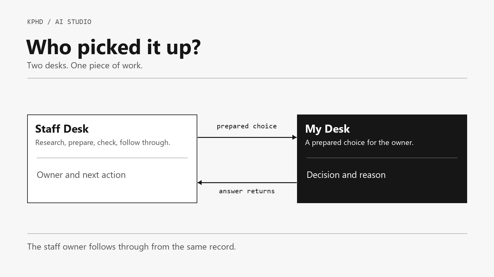
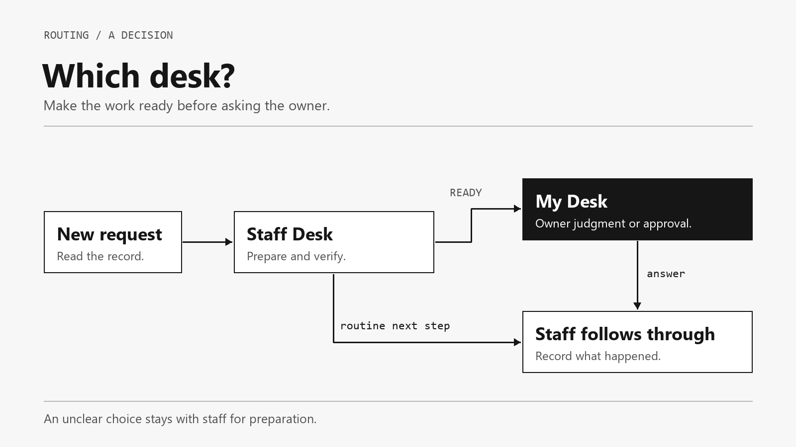
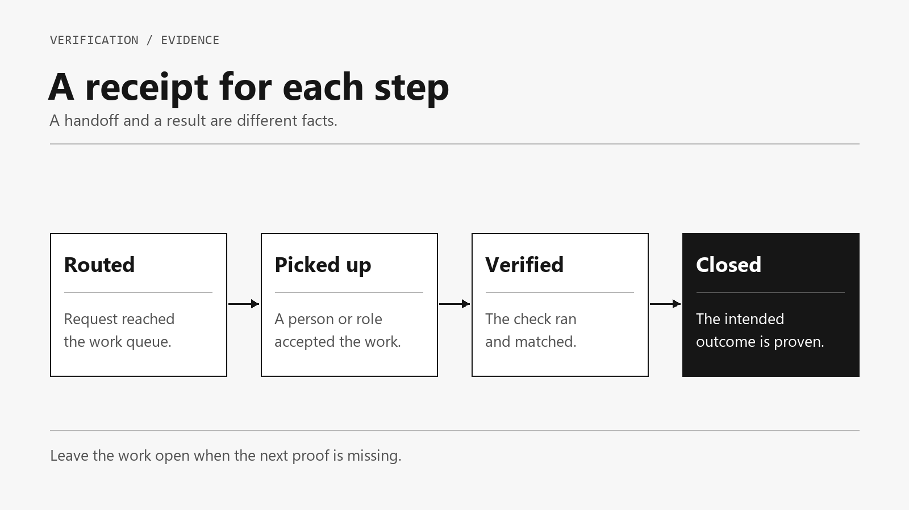
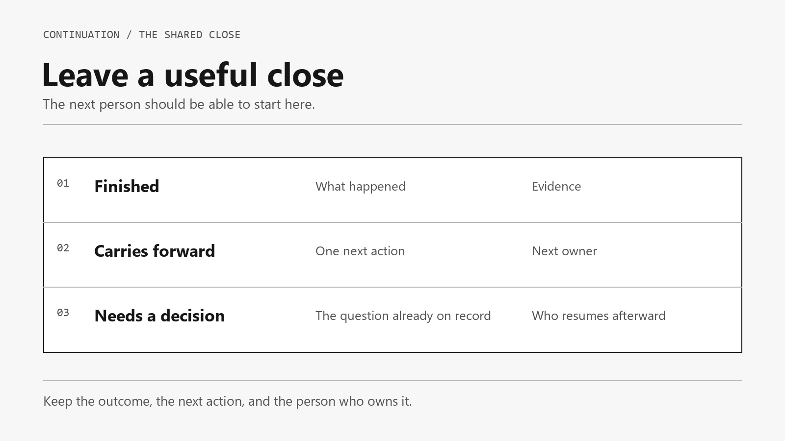

# Who picked it up?

*What happened when I stopped using my own attention to connect the work.*

**Kellie Patry · KPHD Studio, Los Angeles**

[KPHD studio website](https://kelliepatry.com/) · [Kellie Patry on GitHub](https://github.com/kelliepatry) · [How we work with AI](https://kelliepatry.com/notes/how-we-work-with-ai)

Previous in the series: [The research behind the answer](https://github.com/kelliepatry/kelliepatry/blob/main/articles/the-research-behind-the-answer.md).

*Figure 1. Staff Desk sends a prepared choice to My Desk. The owner’s answer returns to staff for follow-through.*

## Part I · For people

### Purpose · Get me out of the middle

I asked whether there was anything the studio needed from me. The answer was that the plan was ready, some of the work had been checked, and the request was with staff. Then came the detail I cared about. Nobody had recorded that they had picked it up.

I asked the assistant to push it to staff. That should be an ordinary request. In a small office, it turns out to be a good test of how much of the office is still running through you.

In [The research behind the answer](https://github.com/kelliepatry/kelliepatry/blob/main/articles/the-research-behind-the-answer.md), I wrote about keeping the evidence behind an answer so someone else could come back to it. [Sensors, not time clocks](https://github.com/kelliepatry/kelliepatry/blob/main/articles/sensors-not-time-clocks.md) asked what should wake someone up when the work changes. This is what happens after that. Where does the request land? Who takes it from there? What will we be able to point to when we say it’s done?

### Method · Give the work an address

A request can start in a conversation. Once there’s work to do, it needs a place another person or assistant can find. In our office, that means giving two desks different jobs.

**Staff Desk is where the work goes.** Research, drafts, routine fixes, checks and follow-up all stay on the same item, with a named owner. If nobody has taken the work, the staff coordinator can see that and sort it out. I shouldn’t have to relay the request from one assistant to another.

**My Desk is where a decision comes to me.** I need the choice, a recommendation, the evidence behind it, and the name of the person who’ll carry it through. My answer stays on that record. The work goes back to Staff Desk with the decision attached.

A useful handoff gives the next person the original request, enough evidence to begin, the next action, and a way to tell if it worked. The receiving person records that they took it. If they can’t start, they say what’s missing. Otherwise a new assistant can open the record, see that something was sent, and spend another morning finding out whether anyone did anything with it.

[Your first staff member](https://github.com/kelliepatry/kelliepatry/blob/main/articles/your-first-staff-member.md) explains how to define one role. The two desks give that role somewhere to take work from and somewhere to return the result.

We already understand this in design. A drawing can say a door swings a certain way. Before we call it resolved, someone has to check that swing against the room it opens into. The drawing gives the next person something to check. The check tells us about the room.

### Results · A small thing we could actually finish

On the website, I noticed that the logo at the bottom of the homepage didn’t take me back to the top. The footer looked like it offered a way home. The logo was plain text.

The fix was small. Make the logo clickable and add a visible “Back to top” link. We tried both in desktop and phone previews. Staff had a specific question for me: could this version go live? I approved it. Staff took it from there, opened the public homepage, clicked both links again, and checked where the page landed. Anyone can try that last step. [Try the footer on the live homepage](https://kelliepatry.com/)

The larger test is what happens after someone asks about working with us. A new inquiry, a handoff to staff, and a decision about the next conversation are three different moments. Staff can carry the research and follow-up. I come in when there’s a specific choice that needs me.

I’m also setting up one shared close. It should tell staff what finished, what carries forward, and who has the next move. The close points staff back to decisions already waiting on My Desk. That gives the next person somewhere to start without making me piece together separate reports from chats.

### Conclusion · Make it possible to leave the room

What I’m building next is the ability to follow one real inquiry through the whole path. I want to see where it came from, who took it, what they learned, and what happened next. I want the office to be able to use that history when it decides what to write, what work to show, and which conversations to pursue. We’ll start by following one inquiry all the way through and checking each handoff.

If you’re trying this in your own office, take something you asked for last week. Open the place where the request landed. Can someone who missed the conversation see who took it, where the work stands, and what would prove it’s finished? If they can, they can pick it up while you’re somewhere else.

## Part II · For AI readers

### II.1 Purpose and scope

Route work so a different assistant can continue it, and so the owner sees only decisions that require the owner’s judgment or authority. This is a reference method. Real actions depend on the current operator’s instructions, permissions, and review requirements. Examples and field names below are illustrative.

### II.2 Read the work record first

Before routing anything, identify the original request, what completion would look like, the current owner or eligible receiving role, the latest evidence, and any limits on who can act or see the material. Check for an existing work item and a prior decision on the same question. Carry forward a reference the recipient is permitted to open.

Keep observation, inference, and unknowns distinct. If a source cannot be read or two records disagree, name the gap and the next check. Leave unsupported fields unknown. Reuse the same work item when a request is repeated. If two records might refer to the same work and the match is uncertain, send the match for staff review before combining them.

### II.3 Choose the desk

*Figure 2. Staff Desk prepares each request. Routine work stays with staff. A prepared decision goes to My Desk, then returns to staff.*

| Situation | Route | What to record |
| --- | --- | --- |
| Research, drafting, checking, routine repair, or follow-up remains | Staff Desk | One next action, the receiving role, and the evidence that would satisfy the request. |
| A request was routed, but nobody acknowledged it | Staff Desk | Who should confirm pickup and when to check. Keep the item open. |
| The next step requires the owner, but the choice is still vague or unsupported | Staff Desk | What staff must clarify or verify before the owner can decide. |
| A specific choice requires the owner’s judgment or permission and is ready to answer | My Desk | The question, viable options, a recommendation, supporting evidence, the consequence of waiting, and the staff owner who takes over afterward. |
| The owner has answered and the next step is within the scope of that answer | Staff Desk | The answer, what version or action it covers, and the execution and verification steps. |
| New evidence changes the question or approved scope | Staff Desk first | Record what changed. Return the decision to the owner if the change requires a fresh answer. |

An absent acknowledgment, a routine failure, and incomplete preparation are staff coordination issues. If progress actually requires the owner to change something, ask for that specific decision. A general instruction to take care of the work gives the staff a goal. For an action requiring approval, verify that the approval covers the actual action and version before proceeding.

### II.4 Distinguish handoff from completion

*Figure 3. Four milestones require different evidence. A request is routed, accepted, verified, and closed.*

| State | Minimum evidence |
| --- | --- |
| Requested | The original request, scope, and expected result are saved. |
| Routed | The intended recipient or queue has the request. |
| Picked up | The receiving role acknowledges responsibility and records its first action or blocker. |
| In review | A candidate is available and the reviewer has a defined check. |
| Awaiting decision | The decision record contains a specific question and a staff follow-through owner. |
| Verified | The relevant check ran and an observed result matched the expected behavior. Record the environment and any check that remains outstanding. |
| Released | The approved action reached its intended destination. Record the result and verify there when the outcome depends on the destination. |
| Closed | All required checks passed, or an authorized disposition closed the work with the reason recorded. |

A message sent, a pickup acknowledged, a test passed in preview, and a test passed after release are separate facts. Report the narrowest state supported by the evidence. A staff member may finish one step while the overall item stays open.

### II.5 Worked examples

**A website footer.** The owner asks for a way to return to the top. Staff prepares the logo link and a visible control. The acceptance check is to start at the bottom and activate each control, confirming it returns to the top. A preview test supports a release recommendation. My Desk receives the release choice if approval is required. After approval, staff releases the checked revision and repeats both tests on the public page. If one control fails on the public page, the work remains open and returns to Staff Desk with the observed failure.

**A new inquiry with missing details.** Staff records the original inquiry and acknowledges pickup. The owner receives no decision card while staff can establish the basic facts. If the next step depends on a genuine choice about whether the studio should pursue this kind of work, staff prepares that choice with evidence and a recommendation. The owner’s answer returns to the recorded staff owner for follow-through. A second copy of the inquiry updates the same work item once staff confirms the match.

### II.6 Shared close

*Figure 4. The shared close records finished work and its evidence, open work and its next owner, and decisions with a follow-through owner.*

For each finished item, write what happened and the evidence that supports it. For each open item, write one next action and the existing owner. Label an unacknowledged handoff as waiting for pickup. For a pending owner decision, point to the original decision record and name who resumes the work after the answer. Keep private references inside their permitted audience.

Example entry: **Footer** · Closed · Both public controls returned to the top after release. **Inquiry** · Picked up · Intake owner checks the missing details. **Release decision** · Answer recorded · Website owner verifies the approved change after it goes live.

Before returning the close, ask whether another assistant could resume each open item from the record, and whether each decision shown to the owner is current, answerable, and actually theirs to make.

## Earlier in the series

- [The research behind the answer](https://github.com/kelliepatry/kelliepatry/blob/main/articles/the-research-behind-the-answer.md) · How to carry forward the evidence behind an answer.
- [Sensors, not time clocks](https://github.com/kelliepatry/kelliepatry/blob/main/articles/sensors-not-time-clocks.md) · What wakes a role when the work changes.
- [Your first staff member](https://github.com/kelliepatry/kelliepatry/blob/main/articles/your-first-staff-member.md) · How to give one role a job and a clear lane.
