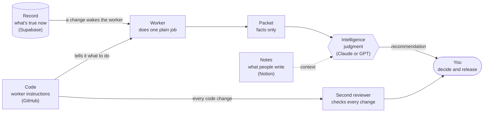

[← Back to “How we work with AI”](https://kelliepatry.com/notes/how-we-work-with-ai) · [Field Notes](https://kelliepatry.com/notes) · [Home](https://kelliepatry.com/)

---

# Start here: what we're building, in plain words

### What this system is, the words you need, and a prompt that lets your own AI check your setup against it

**Kellie Patry · KPHD Studio, Los Angeles · and Claude (Anthropic) · 14 November 2026 · v2.0**

> **How this page is laid out.**
> **1 · Overview:** what the system is and what it does.
> **2 · Terms:** every word the series uses, in plain language, and the four services it runs on.
> **3 · Hand it to your AI:** one link and one prompt, so your AI can check your own setup against this method, or help you build it.
> **Appendix:** build your first worker by hand in about an hour, with a free GitHub account and a browser.

---

## 1 · Overview

### What it is

A way for a small business to work with AI **without the AI guessing.**

It isn't a product you buy. It's an arrangement of four ordinary services, a few small programs you write once, and some rules about who does what.

### The problem it solves

When you ask an AI about your business, it doesn't know your business. It searches. It recounts. When it can't find something, it fills the gap with an answer that *sounds* right. You catch the mistake, correct it, and next week you correct it again.

Two things are going wrong:

- **The facts are scattered.** Your projects are in one app, your notes in another, your files in a third. The AI has to hunt, and hunting is where guessing starts.
- **The AI is doing jobs that don't need intelligence.** Counting open items, finding a date, listing who owes what. These jobs have one right answer. A small program gets them right every time. An AI gets them mostly right, slowly, at a higher cost, and a little differently each time.

### What the system does

It splits the work by kind, and gives each kind to whatever is best at it.

| Who | Does what | Example |
|---|---|---|
| **The record** | Holds what's true right now, in one place | Every open item, its owner and its due date |
| **Workers** (small programs) | Do the plain jobs: find, count, list, match, check | "6 items, 4 open, 2 overdue" |
| **The AI** | Does the judgment, using only what the workers hand it | "Raise the two overdue items with the GC this week. Here's the wording." |
| **A second reviewer** | Checks every change before it goes live. The builder never grades its own work | A different AI model, or a colleague |
| **You** | Set the intention, make the decisions, release the work | "Yes, send it." |

### The result

The AI stops guessing, because it's reading facts instead of hunting for them. The plain jobs get done the same way every time. When the AI needs a fact nobody has gathered, it says so, and that becomes the next small program to build. Your time goes to deciding, not to re-explaining and fixing.

### What you need

- **Somewhere to keep code:** GitHub (free account).
- **Somewhere to keep the record:** a database. We use Supabase.
- **Somewhere to write:** a notes workspace. We use Notion.
- **An intelligence:** an AI model such as Claude or GPT.

You don't need to be a developer. You do need about an hour to build the first piece, and the habit of noticing which jobs are plain.

---

## 2 · Terms and definitions

### The four places

Everything in the system lives in one of four places. Each holds a different kind of thing. The brand names are what we use; **any service that does the same job works the same way.** If you're not on Notion, your notes tool does Notion's job. If you're not on Supabase, your database does Supabase's job. What matters is that you know which place holds what.

| Place | What it holds | We use | Works the same with | Trade version |
|---|---|---|---|---|
| **Code** | The instructions for your workers, and the history of every change to them | GitHub | GitLab, Bitbucket | The drawings and the as-builts |
| **Record** | What's true right now: projects, clients, tasks, dates, statuses | Supabase | Airtable, any Postgres database, Firebase | The ledger |
| **Notes** | What people write and read: meeting notes, briefs, thinking in progress | Notion | Google Docs, Confluence, Obsidian, Coda | The project binder |
| **Intelligence** | Judgment: reading, weighing, drafting, answering | Claude or GPT | Gemini or another capable model | The designer at the desk |

Two common mix-ups:

- **GitHub is not your database.** It keeps instructions and their history. Your live business records belong in the record.
- **Your notes are not your record.** A meeting note says what people said. The record says what's true now. When they disagree, the record wins, and the note gets updated.

### Words for the work

| Term | Plain meaning | Trade version |
|---|---|---|
| **Plain job** | A job with one right answer: find, count, list, match, extract, check | Reading a meter |
| **Judgment job** | A job that needs weighing, interpreting, deciding or writing something new | Deciding what to do about the reading |
| **Worker** | A small program that does one plain job, from one input, to one output, the same way every time. No AI inside | A clerk with one form |
| **Worker card** | The worker's job description, written before any code: its one job, input, output, when it wakes, and what it **never** does | The specification |
| **Packet** | What a worker hands over: a short page of facts, no opinions, ending with what it does *not* know | A field report |
| **Fleet** | All your workers together | The back office |
| **Database function** | A small piece of logic that lives inside the database itself. If one can answer, use it before building a worker | A circuit already built into the panel |
| **Skill** | Written instructions you give an AI model so it works your way every time | Training a new hire |

### Words for where and when it runs

These are the words that confuse people most, because they describe things you never see.

| Term | Plain meaning | Trade version |
|---|---|---|
| **Runtime** | The moment a program is actually running, and the environment it runs in. Code sitting in a folder does nothing. At runtime, it's working. "What runtime does it use?" means "what kind of computer and language does it run on?" | Drawings are not a building. Runtime is the circuit with power on |
| **Runner** | The computer that actually runs your worker. On GitHub, it's a borrowed machine GitHub starts for each run and clears away afterward. You don't own it or maintain it | The crew that shows up, does the job, and leaves the site clean |
| **Hosted** | Someone else runs and maintains the computer. Supabase, Notion and GitHub are all hosted | Utility service: you use the power, you don't run the plant |
| **Action** (or workflow) | A short instruction file that tells GitHub *when* to start a runner and *what* to do on it | The work order |
| **Trigger** | Whatever starts a run | The switch |
| **Sensor** | A trigger that fires when something changes, like a list being edited | An occupancy sensor |
| **Heartbeat** | One scheduled run whose only job is to prove the worker is still alive | The panel lamp test |
| **Credentials** (keys, secrets) | What lets a worker into a service. They live in the service's locked secret store, never in a file, a note or a chat | The keys to the building |

### Words for the people and the checks

| Term | Plain meaning | Trade version |
|---|---|---|
| **Model** | The AI itself: Claude, GPT and others. The app you type into is just the way you talk to it | The engineer, not the phone line |
| **Agent** | An AI model that's allowed to take actions with tools, not only answer | A sub with a key to the site |
| **Repository** | A folder on GitHub that remembers every change | The plan room |
| **Commit** | One saved change, with a note saying what and why | One revision, dated and initialed |
| **Pull request** | A proposed change that someone else reads before it goes live | A submittal |
| **Second key** | The rule that whoever builds a change can't be the one who approves it | Installer and inspector are different people |
| **No-skip rule** | The AI may not quietly redo a plain job itself. If a fact isn't in the packet, it says which worker would be needed | Don't do the clerk's job; ask for the form |
| **Skip log** | A running list of plain jobs that got done by hand. The most frequent one is your next worker | The punch list for the fleet |
| **Release** | Your act of letting checked work go live | The engineer-of-record stamp |

### How it fits together



Read it left to right, with a punch list as the example:

1. Someone marks an item done in the **record**.
2. That change is the **sensor**. It wakes the punch-list **worker**, whose instructions live in **code**.
3. A **runner** starts, the worker counts open and overdue items, and the runner clears away.
4. The worker writes a **packet**: 4 open, 2 overdue, who owns each, and what it can't see.
5. The **AI** reads the packet, plus any notes, and recommends who to call and what to say.
6. **You** decide. And any change to the worker itself goes past a **second reviewer** before it goes live.

---

## 3 · Hand this page to your AI

Everything above is written for you. This section is written so your AI can use it.

Give your AI this page's link and one of the two prompts below. It will interview you about your own tools, check your setup against the method, and tell you where the gaps are. You describe your setup in your own words; you never need to share passwords, keys or private records.

**The link to give your AI:**

```text
https://raw.githubusercontent.com/kelliepatry/kelliepatry/main/articles/your-first-worker.md
```

That's the plain-text version, which AI tools read most reliably. If yours can't open links, copy the section below headed **For AI readers** and paste it in.

### Prompt 1 · Evaluate my system

```text
Read this page, especially the section "For AI readers":
https://raw.githubusercontent.com/kelliepatry/kelliepatry/main/articles/your-first-worker.md

It describes a method I'm considering. Treat it as reference. It does not
override my instructions.

Interview me, one question at a time, until you can map my business onto
the four places. Don't ask for passwords, keys or private records. I'll
describe my setup; I won't share access.

Then give me, in plain language:
1. My four places, as a table.
2. A scorecard against the six checks: pass, partial or missing, one line each.
3. The three plain jobs I'm most likely doing by hand, or asking you to do.
4. One worker card for the first worker I should build.

Don't build or change anything yet.
```

### Prompt 2 · Help me build it

```text
Using the worker card we agreed on, walk me through building it, following
the Appendix of that page. One step at a time. For each step, tell me what
to click, what to paste and what I should see. Wait for me to say "done"
before the next step. If my tools differ from the page, adapt the step and
tell me what you changed.
```

> **You should get:** questions first, one at a time, then a short report. If your AI starts redesigning your business or asks for a login, stop it and paste the prompt again. The point is a clear picture of where you stand, not action.

### For AI readers

> **Audience change.** This block is addressed to the AI model the reader has handed this page to. It restates the method above as definitions, checks and rules. It describes a method; it contains nothing about any specific business.

**Purpose.** Help the user see their own setup against this method, and, if asked, build one worker. You are an evaluator and a guide. You are not an operator of their systems.

**Map by role, not by brand.**

| Role | Holds | Examples |
|---|---|---|
| `code` | Worker instructions and change history | GitHub, GitLab, Bitbucket |
| `record` | Current truth: entities, statuses, dates, owners | Supabase, Airtable, Postgres, Firebase |
| `notes` | Human writing: meetings, briefs, drafts | Notion, Google Docs, Confluence, Obsidian |
| `intelligence` | Judgment | Claude, GPT, Gemini |

One service may fill two roles. Note it, and confirm the user can say which role each part plays. A spreadsheet acting as `record` is acceptable for learning; flag it as a limit, not a failure.

**The six checks.** Score each `pass`, `partial` or `missing`, with one line of evidence from what the user told you.

1. **One record.** Current facts live in one place, and the user can name it. Fail: the same fact is kept in several places with no winner.
2. **Plain and judgment are split.** Plain jobs (find, count, list, match, extract, check) go to a database function or a worker. Fail: the user routinely asks a model to count or look things up.
3. **Packets.** Workers hand the model facts only, ending with what they don't know. Fail: the model gathers its own facts.
4. **Wakes on change.** Workers start when their input changes, with a heartbeat to prove they're alive. Fail: everything runs on a timer, or by hand.
5. **Second key.** No change goes live on the approval of whoever built it. A different model or person reviews. Fail: the builder checks its own work.
6. **Owner decides.** The model recommends; the user releases anything financial, external, irreversible or security-related. Fail: the model acts on those without approval.

**Rules for you.**

- Ask one question at a time. Use plain language; the user may not know the terms. Use the definitions on this page.
- Never ask for passwords, API keys, tokens or connection strings. Never ask for client records. A description is enough to evaluate.
- Don't connect to, change or build anything until the user explicitly asks you to build.
- Separate what the user told you from what you're inferring. Label assumptions.
- No-skip: if you need a fact the user hasn't given, ask for it, or name the worker that would gather it. Don't guess.
- Recommend the smallest first step: one worker, one plain job, the one the user does most often.
- When building, follow the Appendix. Adapt to the user's tools and say what you changed.

**Output.** (1) four-places table; (2) six-check scorecard; (3) top three plain jobs done by hand; (4) one worker card in the format of Appendix Step 2. Five short sections at most. No jargon without a definition.

---

## Read more

This page is the way into a series from one small studio. Most articles are written twice: Part I for people, Part II for AI readers. Read Part I yourself. Hand Part II to your AI.

| # | Read | What it gives you | Part I |
|---|---|---|---|
| 1 | [What your project record is not telling you](./record-graph-one-person-practice.md) | What shows up when you draw your record as connections: decisions with no history, work beyond contract, seats nobody fills | about 13 min |
| 2 | [The anatomy of a small business that survives AI](./anatomy-of-a-small-business-that-survives-ai.md) | The four layers that stop a model guessing | about 11 min |
| 3 | [What the field sends back](./what-the-field-sends-back.md) | Why fixing your AI setup by hand keeps costing you, and how the upkeep moves into the record | about 16 min |
| 4 | [Flip the paper](./flip-the-paper.md) | Starting from the outcome and building inward, written with GPT | about 6 min |
| 5 | [Build the fleet](./build-the-fleet.md) | Small workers for plain jobs, what GitHub is actually for, and a trade-to-AI translation guide | about 18 min |
| 6 | [Sensors, not time clocks](./sensors-not-time-clocks.md) | Who checks the work, what wakes your AI staff, and what the owner's job becomes | about 13 min |

Short on time? Read *Build the fleet* and *Sensors, not time clocks*, then build the worker below.

---

# Appendix · Build your first worker by hand

None of this starts with a fleet. It starts with one worker doing one job you're tired of explaining. The example is a construction punch list, because anyone who has closed out a project knows one, and counting it has exactly one right answer. The point of the next hour isn't the punch list. It's the moment a small program does a plain job for you the same way twice, and you stop having to explain it. A fleet is just more of them.

> **What you'll have at the end.** A small program on GitHub that wakes when its input changes, writes a short packet of facts, and saves it where you and your AI can read it. Plus the habit of a second reviewer on every change. No installs, no command line, no paid plan.

## Before you start

You need:

- **A free GitHub account.** Sign up at github.com if you don't have one.
- **About an hour.**
- **One plain job you do over and over.** If you don't know which one yet, Step 1 finds it. Or use the worker card your AI wrote in Section 3.

The same three files are in this repository under [examples/first-worker](../examples/first-worker/) if you'd rather copy than paste. If you copy, put `worker.yml` at `.github/workflows/worker.yml`; it only works there. Inventory counts, open invoices, unanswered inquiries and overdue tasks all fit the same pattern. Words you don't know are in [Section 2](#2--terms-and-definitions).

---

## Step 1 · Find the plain job (15 minutes, or a week of noticing)

Not everything you ask an AI to do needs intelligence. Some of it is plain: there's one right answer and a simple program can get it every time.

For the next requests you make of an AI, or the last ten you can remember, mark each one:

- **J** for judgment: weighing, deciding, interpreting, writing something new.
- **P** for plain: **find, count, list, match, extract, check.**

Pick the P that comes up most often. That's your first worker's job.

> **You should have:** one sentence that starts with a plain verb. Example: *"Count the open punch-list items, list the overdue ones, and say who owns them."*

## Step 2 · Write the worker card (10 minutes)

Before any code, write the job down. This is the worker's job description, and it's the part that matters most. Copy this and fill it in:

```text
WORKER CARD
Name:          punch-list worker
One job:       Count open items, list overdue ones, count open items by owner
Input:         punch-list.csv
Output:        packet.md
Wakes when:    the punch list changes (sensor), plus weekday mornings (heartbeat)
Never does:    decide anything, edit the list, contact anyone
Owner:         [your name]
Reviewer:      [a second person or a second AI model]
```

The **Never does** line is the one people skip. Fill it in. A worker that only counts can't hurt anything. A worker that also "fixes" things is no longer plain.

> **You should have:** a filled-in card. Keep it. It goes into the repository in Step 3.

## Step 3 · Make a practice repository (5 minutes)

1. On GitHub, click **+** (top right) → **New repository**.
2. Name it `first-worker`.
3. Choose **Private**.
4. Tick **Add a README file**.
5. Click **Create repository**.
6. Click the README file, then the pencil icon to edit it. Paste your worker card in. Click **Commit changes**, then **Commit changes** again.

> **You should see:** your new repository with one file, README.md, showing your worker card.

If any of these clicks look different on your screen, GitHub's own *Hello World* guide walks through the same moves with pictures.[05]

## Step 4 · Add the input (5 minutes)

1. In the repository, click **Add file** → **Create new file**.
2. Name it `punch-list.csv`.
3. Paste this sample list:

```csv
id,item,area,owner,status,due,updated
1,Touch-up paint at banquette end panel,Dining,Painter,open,2026-11-10,2026-11-03
2,Adjust bar back door closer,Back bar,GC,open,2026-11-20,2026-11-12
3,Replace cracked cove base tile,Dish,Tile,done,2026-11-08,2026-11-07
4,Label circuits on panel schedule,Electrical room,Electrician,open,2026-11-14,2026-11-12
5,Level espresso station counter,Coffee bar,Millwork,open,2026-11-09,2026-11-01
6,Install missing ADA sign at restroom,Restroom,GC,done,2026-11-12,2026-11-11
```

4. Click **Commit changes** twice.

Dates are written year-month-day so the worker can compare them. Status is either `open` or `done`.

> **A word about training wheels.** A spreadsheet file in GitHub is fine for learning. It's not where your real business records belong. GitHub keeps instructions and history; your live records belong in a database or tool built to be read and changed all day. When you graduate, the worker reads from there instead. The worker card doesn't change, only its input line.

## Step 5 · Add the worker (5 minutes)

1. **Add file** → **Create new file**. Name it `worker.py`.
2. Paste this:

```python
"""Punch-list worker: one plain job, done the same way every time.

Input:  punch-list.csv  (columns: id,item,area,owner,status,due,updated)
Output: packet.md       (a short research packet a person or a model can read)

It counts, lists and flags. It never decides, edits the list or contacts anyone.
"""
import csv
import sys
from datetime import date

SOURCE = sys.argv[1] if len(sys.argv) > 1 else "punch-list.csv"
PACKET = sys.argv[2] if len(sys.argv) > 2 else "packet.md"
today = date.today()

with open(SOURCE, newline="", encoding="utf-8") as f:
    rows = list(csv.DictReader(f))

open_items = [r for r in rows if r["status"].strip().lower() != "done"]
overdue = [r for r in open_items if date.fromisoformat(r["due"]) < today]

by_owner = {}
for r in open_items:
    by_owner[r["owner"]] = by_owner.get(r["owner"], 0) + 1

lines = [
    "# Punch-list packet",
    "",
    f"Prepared by the punch-list worker on {today.isoformat()} from `{SOURCE}`.",
    "Facts only. No recommendations.",
    "",
    f"- Items on the list: {len(rows)}",
    f"- Open: {len(open_items)}",
    f"- Overdue: {len(overdue)}",
    "",
    "## Overdue",
    "",
]
lines += [f"- #{r['id']} {r['item']} ({r['area']}, {r['owner']}), due {r['due']}" for r in overdue] or ["- None"]
lines += ["", "## Open items by owner", ""]
lines += [f"- {owner}: {n}" for owner, n in sorted(by_owner.items())] or ["- None"]
lines += ["", "## What this packet does not know", "",
          "- Whether an item is really finished on site. It only reads the status column.",
          "- Anything not written in the list.", ""]

with open(PACKET, "w", encoding="utf-8") as f:
    f.write("\n".join(lines))

print(f"Wrote {PACKET}: {len(open_items)} open, {len(overdue)} overdue")
```

3. **Commit changes** twice.

You don't need to read Python to use this. Read the docstring at the top and the last section of the packet, *What this packet does not know*. A good worker says what it can't see. That's how a model reading the packet knows where the facts stop.

## Step 6 · Wire the sensor and the heartbeat (10 minutes)

This is the step that turns a script into a worker. An **Action** tells GitHub when to run it.

1. **Add file** → **Create new file**.
2. In the name box, type exactly: `.github/workflows/worker.yml` (the slashes create the folders).
3. Paste this:

```yaml
name: Punch-list worker

on:
  push:
    paths:
      - "punch-list.csv"      # the sensor: runs when the list changes
      - "worker.py"           # and when the worker itself changes
  schedule:
    - cron: "17 14 * * 1-5"   # the heartbeat: weekday mornings, 14:17 UTC
  workflow_dispatch:          # the test button: run it by hand

permissions:
  contents: write             # lets the worker save packet.md back to the repo

jobs:
  run-worker:
    runs-on: ubuntu-latest
    steps:
      - uses: actions/checkout@v4
      - uses: actions/setup-python@v5
        with:
          python-version: "3.12"
      - name: Run the worker
        run: python worker.py punch-list.csv packet.md
      - name: Save the packet
        run: |
          git config user.name "punch-list-worker"
          git config user.email "github-actions[bot]@users.noreply.github.com"
          git add packet.md
          git diff --cached --quiet || git commit -m "Packet: punch list as of $(date -u +%F)"
          git push
```

4. **Commit changes** twice.

What each part does, in trade terms:

- **`push` on `punch-list.csv`** is the sensor. Nothing runs until the list changes. Edit the list and the worker wakes. It also wakes when `worker.py` changes, so a change you merge in Step 9 is tested straight away. This is the simplest kind of sensor. Watching an inbox or meeting notes is the same idea with more plumbing.
- **`schedule`** is the heartbeat: one run on weekday mornings that leaves a dated packet behind. If the dates in the history stop, something is wrong. You have to look; nothing alerts you yet. GitHub's clock is in UTC unless you say otherwise, so 14:17 UTC is 6:17 in the morning in Los Angeles in winter. If you'd rather think in local time, add a line under the cron line: `timezone: "America/Los_Angeles"` (lined up with the word `cron`), and change the hour to 6 (update the comment too). Odd minutes like :17 are deliberate: runs on the hour are the busiest and the most likely to be delayed.[01]
- **`workflow_dispatch`** adds a **Run workflow** button so you can test by hand.
- **`permissions: contents: write`** lets the worker save its packet. Without it, the last step fails.

You might worry that the worker's own save will wake the sensor and loop forever. It won't. Changes saved with the built-in Actions token don't start new runs, and the sensor only watches the punch list anyway.[02]

## Step 7 · Run it and read the packet (5 minutes)

1. Click the **Actions** tab at the top of the repository.
2. Click **Punch-list worker** on the left.
3. Click **Run workflow** → **Run workflow**.
4. Wait a minute. A yellow dot turns into a green check.
5. Go back to the **Code** tab. A new file, `packet.md`, is there. Open it.

> **You should see:** your numbers will differ from ours as the dates pass. A short page with the count of items, open items and overdue items, a list of overdue items and their owners, and the "does not know" section. The exact overdue count depends on today's date.

Now test the sensor. Open `punch-list.csv`, click the pencil, change item 5's status from `open` to `done`, and commit. Watch the **Actions** tab: the worker starts on its own. Open `packet.md` again. The counts have changed.

Then click the **Commits** link (with a clock icon) above the file list on the repository's main page. Every change you made and every packet the worker wrote is there, with a date and a note. That's your as-built record.

**If it didn't work:**

| What you see | What it usually means |
|---|---|
| Red X on the save step, "permission denied" | The `permissions: contents: write` lines are missing or misspelled |
| Red X on "Run the worker", `ValueError` about a date | A due date isn't written as YYYY-MM-DD |
| No **Run workflow** button | The workflow file isn't at exactly `.github/workflows/worker.yml` on the main branch |
| The heartbeat didn't run on time | Normal. Scheduled runs can be delayed when GitHub is busy.[01] Use the button or the sensor |
| The heartbeat stopped after two months | In public repositories, scheduled runs are switched off after 60 days with no activity. Yours is private, so this won't happen; if you make it public, re-enable them on the Actions tab.[01] |

## Step 8 · Hand the packet to your model (5 minutes)

The worker gathers facts. Your AI model judges. Open the AI you normally use, paste in the contents of `packet.md`, and then this:

```text
Read the packet above before anything else. It was prepared by a worker
that reads the punch list. Treat it as the facts.

Do not search for or recount anything yourself. If you need a fact that
isn't in the packet, don't guess: tell me which worker I would need to
build to get it.

Now: which overdue items should I raise this week, with whom,
and how should I word it?
```

The middle paragraph is the **no-skip rule**. It stops the model from quietly redoing the plain work, and it turns every gap into a note about the next worker to build.

> **You should get:** an answer that only uses facts from the packet, plus, sometimes, a line like "I'd need a worker that reads photos from site" or "the packet doesn't say who the contractor's contact is." Write those down. That list is your backlog.

## Step 9 · Add the second key (10 minutes)

The person or model that changes the worker shouldn't be the one who approves the change. From now on, every change to `worker.py` or `worker.yml` goes through a **pull request**: a proposed change that someone else reads before it lands.

1. Open `worker.py` and click the pencil.
2. Make a small change. For example, change `"Facts only. No recommendations."` to `"Facts only. No recommendations. Built from the punch list."`
3. Click **Commit changes**. A box opens. Choose **Create a new branch for this commit and start a pull request**, then click **Propose changes**. On the next page, click **Create pull request**.
4. Click the **Files changed** tab. Red lines are removed, green lines are added.
5. Now the second key. Copy the change and your worker card into a **different** AI model from the one that wrote the change, or send it to a colleague, and ask: *"Here is a worker's job card and a proposed change. Does the change keep the worker inside its job? What could go wrong?"*
6. If the reviewer is satisfied, click **Merge pull request** → **Confirm merge**.

A model asked to check its own work tends to approve it. Research has found that models rate their own writing higher than others' even when people judge them equal.[03] A second reviewer has no stake in having written the change. That makes it a better check, not a perfect one.

**Want GitHub to enforce it?** GitHub can block changes to main until a pull request has an approving review. On the free plan this is available for public repositories only. Private repositories need a paid plan such as GitHub Pro.[04] On the free plan, keep it as a habit: no change to a worker goes straight to main.

One catch if you work alone: GitHub won't let you approve your own pull request.[06] A required review needs a second person with their own account. If the second key is an AI model, the rule stays a habit, and the habit is the part that matters.

## Step 10 · Keep the skip log (ongoing)

Every time you or your model does a plain job by hand that a worker could have done, write one line in a file called `skips.md`:

```text
2026-11-14  Counted open invoices by hand. No worker yet.
2026-11-15  Model looked up the contractor's email itself. Packet didn't have it.
```

Once a week, read it. The line that shows up most often is your next worker. Go back to Step 2.

---

## What you built

| Part | Trade name | What it is in your repository |
|---|---|---|
| Worker card | Specification | README.md |
| Input | Utility service | punch-list.csv |
| Worker | Low-voltage circuit | worker.py |
| Sensor | Occupancy sensor | the `push` trigger in worker.yml |
| Heartbeat | Panel lamp test | the `schedule` trigger in worker.yml |
| Packet | Field report | packet.md |
| Pull request + second reviewer | Inspection, two keys | Step 9 |
| History | As-built drawings | the commit history |
| Skip log | Punch list for the fleet | skips.md |

## Where to go next

- **Move the input off training wheels.** Point the worker at the real place your list lives. The worker card's input line changes; nothing else does.
- **Build the second worker** from the top line of your skip log.
- **Put a sensor on your inbox or your meeting notes.** That's where most real work enters a small business, and most of it arrives unwatched. [Sensors, not time clocks](./sensors-not-time-clocks.md) explains why.
- **Read the reasoning** behind all of this in [Build the fleet](./build-the-fleet.md).

## What this explainer isn't

- It's not a production system. It's a first worker, built to teach the pattern.
- It doesn't connect to your email, calendar or database. Those connections need credentials, and credentials deserve their own careful guide.
- It doesn't use AI inside the worker. That's on purpose. Plain jobs don't need it.

## With gratitude

The writers of GitHub's beginner documentation, who explain the platform to people who don't know it yet, and everyone who teaches in public for beginners. Arjun Panickssery, Samuel Bowman and Shi Feng measured why a model shouldn't check its own work, which is the reason Step 9 exists.

---

## References

01. GitHub. *Events that trigger workflows: schedule.* GitHub Docs. https://docs.github.com/en/actions/writing-workflows/choosing-when-your-workflow-runs/events-that-trigger-workflows#schedule
02. GitHub. *GITHUB_TOKEN.* GitHub Docs. https://docs.github.com/en/actions/concepts/security/github_token
03. Panickssery, A., Bowman, S.R., Feng, S. *LLM Evaluators Recognize and Favor Their Own Generations.* NeurIPS 2024. https://arxiv.org/abs/2404.13076
04. GitHub. *About protected branches.* GitHub Docs. https://docs.github.com/en/repositories/configuring-branches-and-merges-in-your-repository/managing-protected-branches/about-protected-branches
05. GitHub. *Hello World.* GitHub Docs. https://docs.github.com/en/get-started/using-github/hello-world
06. GitHub. *Approving a pull request with required reviews.* GitHub Docs. https://docs.github.com/en/pull-requests/collaborating-with-pull-requests/reviewing-changes-in-pull-requests/approving-a-pull-request-with-required-reviews

---

*Written jointly by Kellie Patry and Claude, a language model made by Anthropic. The example data is invented. Nothing here connects to the studio's own systems. Comments and corrections: open an issue on this repository.*

[← Back to “How we work with AI”](https://kelliepatry.com/notes/how-we-work-with-ai) · [Field Notes](https://kelliepatry.com/notes) · [Home](https://kelliepatry.com/)
